# AI-Powered Multi-Tenant Smart Placement & Career Preparation Platform — Complete System Architecture & SRS Documentation

> **Generated from Live Codebase & Multi-Tenant Architecture Analysis.**  
> **Master Technical Reference & Software Requirements Specification (SRS).**  
> Every database table, column constraint, foreign key, route guard, RBAC permission, API endpoint, proctoring algorithm, Razorpay billing hook, and workflow detailed in this document has been systematically verified against active backend models, Alembic migrations, FastAPI routers, Pydantic v2 schemas, and React 19 frontend components.

---

## 1. Project Overview & Multi-Tenant Architecture

### 1.1 Executive Summary & Mission
The **AI-Powered Multi-Tenant Smart Placement & Career Preparation Platform** is an enterprise-grade Software-as-a-Service (SaaS) higher-education placement automation ecosystem. Originally engineered as a single-institution portal for BVM Engineering College, the system has undergone a comprehensive architectural evolution into a true multi-tenant institutional SaaS platform. 

The platform bridges the gap between students preparing for campus recruitment, Training and Placement Officers (TPOs) executing multi-stage recruitment drives, College Administrators managing institutional assets and academic curricula, and Platform SuperAdministrators governing tenant lifecycles and subscription licensing across universities.

### 1.2 Multi-Tenant Evolution & Core Objectives
Colleges historically relied on fragmented spreadsheets, offline paper receipts, disjointed email chains, and unproctored Google Forms to coordinate placements. This legacy paradigm introduced critical failure points:
1. **Pervasive Academic Eligibility Fraud**: Students bypassing backlog, CGPA, or branch constraints through manual resume inaccuracies.
2. **Offline Placement Fee Leakage**: TPOs spending hundreds of administrative hours manually validating bank slips and cashier receipts.
3. **Absence of Standardized Proctoring**: Campus recruitment tests taken remotely without browser lockdown, identity verification, or noise monitoring, diminishing trust with corporate recruiters.
4. **Curriculum-Industry Disconnect**: Static study materials unaligned with actual department syllabi or emerging job market hiring demands.
5. **Tenant Monolithism**: Lack of institutional data isolation, preventing multi-college SaaS deployments without duplicating infrastructure.

The rebuilt platform solves these problems through an isolated, multi-tenant, cloud-native architecture powered by four distinct user tiers:

| User Tier | Primary Operational Scope | Key Value Realization |
|---|---|---|
| **Student** | Career preparation, drive applications, proctored examinations, AI coaching | Automated ATS resume scoring, AI mock interviews, live web-indexed career insights, fraud-proof proctored test environment |
| **Training & Placement Officer (TPO)** | Drive pipelines, instant test creation, candidate shortlisting, anti-cheating review | One-click drive creation, automated eligibility filtering, live proctoring audit with snapshot review, NBA/NAAC accreditation report exports |
| **College Administrator** | Institutional settings, TPO management, curriculum ingestion, feature licensing | Dynamic domain management, syllabus PDF ingestion with AI parsing, fee template registration, Razorpay modular feature subscriptions |
| **Platform SuperAdmin** | Multi-tenant SaaS governance, institution review, feature catalog master menu | Strict separation of operational student data vs. aggregate platform health, tenant approvals/suspensions, global broadcast announcements |

---

### 1.3 High-Level System Architecture

The application implements a decoupled, three-tier client-server architecture with strict logical multi-tenant data isolation:

```mermaid
graph TD
    subgraph ClientLayer ["Client Layer (React 19 + Vite 8)"]
        SPA_Public["Public Landing & SaaS Registration"]
        SPA_Student["Student Portal (/student/*)"]
        SPA_TPO["TPO Command Suite (/tpo/*)"]
        SPA_Admin["College Admin Console (/admin/*)"]
        SPA_Super["SuperAdmin Command Deck (/superadmin/*)"]
    end

    subgraph GatewayLayer ["Network & Security Gateway"]
        CORS["CORS & Origin Filtering"]
        OAuth2["OAuth2 Bearer Token Extraction"]
        JWT_Verify["JWT HS256 Decode & Verification"]
        TenantGuard["Tenant Context & Suspension Guard"]
        RBAC["Role-Based Route Guard (require_role)"]
        RateLimiter["Login Brute-Force & OTP Rate Limiter"]
    end

    subgraph ServiceLayer ["Backend Service Layer (FastAPI 0.115)"]
        AuthSvc["Auth & OTP Engine"]
        OnboardingSvc["College Onboarding Service"]
        PaymentSvc["Razorpay Order & Webhook Engine"]
        DriveEngine["Eligibility & Drive Engine"]
        ProctorEngine["Proctoring & Violation Evaluator"]
        AIService["Groq AI Client (Llama 3.3 70B)"]
        CurriculumSvc["Curriculum PDF & OCR Parser"]
        FeeService["Template-Matched Fee Engine"]
        ReportSvc["Accreditation Report Exporter"]
    end

    subgraph StorageLayer ["Persistence & External Services"]
        PG_DB[(PostgreSQL Database - 33 Tables)]
        LocalFS[("Local File Storage /uploads")]
        RazorpayAPI[["Razorpay Payment Gateway API"]]
        GroqAPI[["Groq LLM Cloud API"]]
        TavilyAPI[["Tavily / Serper Search API"]]
        SMTPServer[["SMTP Mail Gateway (Gmail)"]]
    end

    ClientLayer --> GatewayLayer
    GatewayLayer --> ServiceLayer
    ServiceLayer --> StorageLayer
```

---

### 1.4 Multi-Tenant Logical Isolation Architecture

To ensure strict data confidentiality, institutional compliance, and prevention of cross-tenant data leaks, the platform enforces logical multi-tenancy at every architectural layer:

1. **Foreign Key Scoping (`college_id`)**: Every institutional entity (`users`, `drives`, `curriculum_subjects`, `fee_receipt_templates`, `branches`, `announcements`, `college_features`) possesses a mandatory `college_id` foreign key referencing the `colleges` master table.
2. **JWT Token Claims**: Upon successful login, the generated access token payload embeds `college_id`, `user_type`, and `sub` (user_id).
3. **Server-Side Enforcement**: API endpoints never trust client-supplied tenant identifiers. Every database query automatically binds `where(Model.college_id == current_user.college_id)` derived directly from the authenticated session context.
4. **Tenant Suspension Killswitch**: The core authentication dependency (`get_current_user`) verifies that `user.college.status != CollegeStatus.SUSPENDED`. If a college is suspended by the SuperAdmin, all active sessions for that college's Students, TPOs, and Admins are immediately rejected with an HTTP 403 Forbidden status.
5. **SuperAdmin Data Blindness Principle**: Platform SuperAdministrators maintain macro-level visibility (college counts, active licenses, aggregate user counts, billing logs) but are cryptographically and architecturally prevented from accessing private student resumes, test answers, academic records, or company drive applicant lists.

---

### 1.5 Exhaustive Technology Stack Matrix

| Architectural Layer | Component / Package | Active Version | Architectural Purpose & Rationale |
|---|---|---|---|
| **Runtime Environment** | Python | 3.11.9 (64-bit) | High-performance asynchronous execution, strict typing support, native datetime timezone handling. |
| **Backend Framework** | FastAPI | 0.115.6 | ASGI asynchronous web framework, high throughput, automatic OpenAPI documentation, native Pydantic integration. |
| **ASGI Web Server** | Uvicorn | 0.34.0 | Asynchronous Server Gateway Interface web server running on uvloop. |
| **Object Relational Mapper** | SQLAlchemy | 2.0.36 | Modern declarative 2.0 mapped-column syntax, relationship cascade management, joined-load query optimization. |
| **Relational Database** | PostgreSQL | 15+ / 16 | ACID-compliant relational persistence, JSONB support for structured prompt configs, candidate skills, and AI test questions. |
| **Database Driver** | psycopg2-binary | 2.9.10 | Low-level C-optimized PostgreSQL database adapter. |
| **Database Migrations** | Alembic | 1.14.0 | Automated revision tracking, schema upgrades/downgrades across 16 sequential migration files. |
| **Data Validation** | Pydantic v2 | 2.10.4 | Ultra-fast Rust-core payload serialization, strict field validation, email syntax parsing, model sanitization. |
| **Settings Management** | pydantic-settings | 2.7.0 | Environment variable loading from `.env` with caching and type safety. |
| **Token Cryptography** | python-jose (cryptography) | 3.3.0 | HS256 JSON Web Token issuance, signature validation, expiry enforcement, purpose token handling. |
| **Password Hashing** | passlib + bcrypt | 4.0.1 | Salted bcrypt key derivation function with brute-force resistance. |
| **Artificial Intelligence** | Groq Python SDK | 1.5.0 | Sub-second inference endpoint utilizing `llama-3.3-70b-versatile` with strict `json_object` schema formatting. |
| **Payment Gateway** | Razorpay SDK | 1.4.1 | Order generation, client checkout initialization, HMAC-SHA256 signature verification, webhook settlement. |
| **Optical Character Recognition** | pytesseract | 0.3.13 | Native Tesseract-OCR wrapper for extracting textual letterheads and receipt numbers from image files. |
| **PDF Rasterization** | pdf2image | 1.17.0 | High-DPI rasterization of multi-page PDF documents into PIL images for OCR ingestion. |
| **PDF Text Parser** | pypdf | 6.14.2 | Direct text layer extraction from PDF documents for resumes and curriculum syllabi prior to OCR fallback. |
| **Email Relay** | fastapi-mail | 1.4.2 | Asynchronous SMTP delivery (Gmail relay, TLS port 587) for OTP codes, password resets, and notifications. |
| **HTTP Async Client** | httpx | 0.28.1 | Asynchronous HTTP requests used for external web search queries (Tavily/Serper). |
| **Web Search Integration** | Tavily / Serper API | REST API | Multi-source live internet search indexing market trends and educational resources for career insights. |
| **Frontend Framework** | React | 19.2.7 | Next-generation React engine with automatic batching, modern hook primitives, and concurrent rendering. |
| **Frontend Bundler** | Vite | 8.1.1 | Lightning-fast ESM build pipeline, Hot Module Replacement (HMR), optimized Rollup production bundling. |
| **Styling Engine** | Tailwind CSS | 3.4.17 | Utility-first CSS framework with custom design tokens, responsive breakpoints, and glassmorphism styling. |
| **Client-Side Routing** | React Router | 7.18.1 (v6 API) | Declarative client routing, nested layouts, protected role guards, dynamic URL parameter extraction. |
| **Server State Management** | TanStack React Query | 5.101.2 | Async query caching, optimistic UI updates, background polling, stale-while-revalidate lifecycle. |
| **Global Client State** | Zustand | 5.0.14 | Micro-weight client-side state store powering proctoring telemetry, authentication context, and notifications. |
| **Form Handling** | React Hook Form | 7.81.0 | Uncontrolled form inputs, performance optimization, native submission lifecycle management. |
| **Form Validation** | Zod | 4.4.3 | Client-side schema declaration matching Pydantic validation rules. |
| **Interactive Analytics** | Recharts | 3.9.2 | Declarative SVG charting library rendering placement statistics, salary distributions, and violation graphs. |
| **HTTP Client (Client)** | Axios | 1.18.1 | Promise-based HTTP client with global JWT injection and automatic 401 refresh token interceptors. |
| **Animation Engine** | Framer Motion | 12.42.2 | Physics-based spring animations, layout transitions, notification toasts, and entrance sequences. |
| **Iconography** | Lucide React | 1.24.0 | Clean, consistent SVG icon set covering all dashboard, status, and navigation states. |
| **Storage Architecture** | Local Disk Storage | POSIX / Win32 | UUID-partitioned storage under `/uploads` directory with strict 5MB and 15MB file size boundaries. |

---

---

## 2. Actors & Role-Based Access Control (RBAC)

The platform supports four human user tiers defined in `UserType` (`student`, `tpo`, `admin`, `superadmin`) along with five integrated system engines. Every interaction with the REST API is governed by explicit route guards (`require_student`, `require_tpo`, `require_admin`, `require_superadmin`, `require_admin_or_superadmin`).

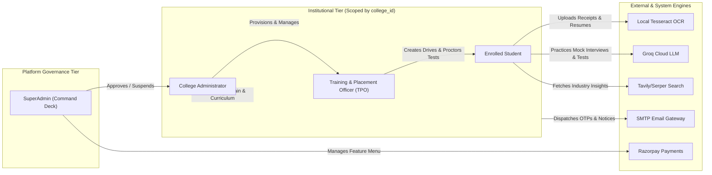

---

### 2.1 Actor Profile: Student

| Dimension | Detailed Specification |
|---|---|
| **Role Code** | `student` (`UserType.STUDENT`) |
| **Registration Pathway** | Self-service registration via dynamic email domain resolution (`/auth/signup/*`). The platform extracts the email domain after `@` and matches it against `colleges.email_domains`. Rejects unauthorized public domains (e.g. Gmail, Yahoo). |
| **Authentication Flow** | Cryptographic 3-step OTP flow: 6-digit random code hashed with bcrypt, dispatched via SMTP, verified within a 10-minute validity window to generate a 15-minute signup purpose token. |
| **Primary Responsibilities** | 1. Complete multi-field onboarding academic profile (CGPA, 10th/12th percentages, active backlogs, skills, competitive exam scores).<br>2. Upload and verify institutional placement fee receipts (JPG/PNG/PDF).<br>3. Upload and manage PDF resumes; initiate ATS score analysis and interactive Q&A enhancements.<br>4. Monitor eligible campus placement drives and submit formal drive applications.<br>5. Complete timed, proctored instant tests under strict browser integrity and webcam supervision.<br>6. Undertake adaptive, multi-stage AI mock interviews (Aptitude, Technical, Coding, HR).<br>7. Study curriculum-aligned books, articles, and video resources approved by departmental TPOs.<br>8. Track personal career readiness score progression and weak area timelines. |
| **System Permissions** | • Full CRUD on own profile and skills array.<br>• Upload resumes and toggle single active resume flag.<br>• Upload placement fee receipts.<br>• Submit drive applications (gated by fee verification and academic eligibility).<br>• Withdraw applications prior to shortlisting.<br>• Start and complete proctored test attempts.<br>• Access own test attempt violation logs and AI score feedback.<br>• Start mock interview sessions, submit answers, and receive real-time evaluations.<br>• Read approved departmental curriculum resources.<br>• Read own notifications and mark them as read. |
| **Enforced Restrictions** | • **Tenant Boundary**: Cannot view drives, companies, curriculum, or students belonging to other colleges.<br>• **Placement Lockout**: Auto-locked from applying to additional placement drives once marked `SELECTED` (`profile.is_placed = True`), unless a TPO or Admin grants an explicit `placement_lock_override`.<br>• **Fee Gate**: Completely blocked from applying to placement drives until fee receipt is validated (`users.fee_verified = True`).<br>• **Single Active Session**: Blocked from running simultaneous proctored test attempts or opening multiple interview windows.<br>• **Administrative Barrier**: Cannot create companies, create drives, alter application statuses, modify feature subscriptions, or access audit feeds. |

---

### 2.2 Actor Profile: Training & Placement Officer (TPO)

| Dimension | Detailed Specification |
|---|---|
| **Role Code** | `tpo` (`UserType.TPO`) |
| **Provisioning Pathway** | Provisioned exclusively by the College Administrator (`POST /admin/users`) or seeded initially via database seeders. No self-registration. |
| **Primary Responsibilities** | 1. Establish corporate partnerships by creating and updating corporate company directories.<br>2. Formulate and publish placement drives with granular eligibility rules (CGPA, max backlogs, 10th/12th cutoffs, allowed branches, bond duration, CTC package).<br>3. Review incoming drive applicants, track applicant stages, and update statuses (`shortlisted`, `selected`, `rejected`).<br>4. Generate AI-powered Instant Tests linked to drives using Groq prompt engineering.<br>5. Audit live and post-test proctoring logs, inspect candidate webcam violation snapshots, and evaluate integrity.<br>6. Conduct human-in-the-loop review of flagged fee receipts with side-by-side template comparisons.<br>7. Prioritize curriculum subjects based on hiring trends and approve/reject AI-curated study resources.<br>8. Generate official NBA/NAAC accreditation placement reports with CSV and printable HTML export. |
| **System Permissions** | • Full CRUD on corporate companies and placement drives within their college.<br>• View all student profiles, resumes, and academic records within their college.<br>• Update application pipeline statuses and assign offered CTC packages upon final selection.<br>• Create, preview, and close Instant Tests.<br>• Access full proctoring audit trails, violation timestamps, and captured violation snapshots (`/tpo/tests/attempts/{id}/violations`).<br>• Issue administrative warnings to students via automated system notifications.<br>• Deactivate non-compliant student accounts.<br>• Toggle student `placement_lock_override` for tier-1 dream company recruitment.<br>• Perform human verification on pending student fee receipts.<br>• Access and export branch CTC, selection ratios, and proctoring audit reports. |
| **Enforced Restrictions** | • **Tenant Boundary**: Strictly barred from viewing corporate drives, applicants, or test results from another college.<br>• **Platform Barrier**: Cannot alter college domain configurations, upload institutional fee templates, subscribe to platform features, or view global SuperAdmin analytics.<br>• **Administrative Boundary**: Cannot create or delete College Admin accounts or modify core college billing settings. |

---

### 2.3 Actor Profile: College Administrator

| Dimension | Detailed Specification |
|---|---|
| **Role Code** | `admin` (`UserType.ADMIN`) |
| **Provisioning Pathway** | Created automatically during the multi-step College SaaS Registration flow (`/register-college/*`) upon successful verification of an official institutional email address. |
| **Primary Responsibilities** | 1. Oversee institutional configuration, including allowed student email domains, college name, physical address, and contact information.<br>2. Upload and manage official department branches matching institutional nomenclature.<br>3. Upload official college fee receipt baseline templates for automated OCR similarity comparison.<br>4. Ingest institutional curriculum syllabus PDFs and execute human-reviewed AI extraction into structured subject trees.<br>5. Provision, manage, and deactivate departmental TPO officer accounts.<br>6. Browse platform Feature Catalog, submit feature requests, initiate Razorpay order checkouts, and manage monthly/annual subscriptions.<br>7. Track college setup completion via the non-intrusive Progressive Setup Checklist.<br>8. Inspect institutional activity audit streams and macro placement metrics. |
| **System Permissions** | • Moderate, edit, or delete any placement drive created by any TPO within their college.<br>• Full CRUD over institutional branches (`/branches/*`).<br>• Upload fee receipt templates (`/admin/fee-receipt-template`).<br>• Upload, review, and confirm curriculum syllabi (`/curriculum/*`).<br>• Full CRUD over institutional staff accounts (create TPOs, reset passwords, deactivate users).<br>• Request and purchase platform feature licenses via Razorpay gateway (`/payments/*`).<br>• View college billing history, active subscription expiry dates, and payment receipts.<br>• Send direct notifications to institutional TPOs and Students. |
| **Enforced Restrictions** | • **Cross-Tenant Barrier**: Cannot access data, drives, students, or settings of any other college on the platform.<br>• **SuperAdmin Barrier**: Cannot approve own college registration (must await SuperAdmin gate), cannot modify platform-wide feature pricing, and cannot view other colleges' subscription transactions. |

---

### 2.4 Actor Profile: Platform SuperAdministrator ("Command Deck")

| Dimension | Detailed Specification |
|---|---|
| **Role Code** | `superadmin` (`UserType.SUPERADMIN`) |
| **Provisioning Pathway** | Provisioned at platform deployment via root seeder script (`seed_superadmin.py`) or secure backend environment bootstrapping. Zero public registration. |
| **Primary Responsibilities** | 1. Govern global multi-tenant operations across all onboarded colleges and universities.<br>2. Review registered colleges transitioning from `pending_setup` to `ready_for_review`; approve live status or reject fraudulent registrations.<br>3. Maintain emergency administrative controls: suspend delinquent or violating colleges (immediate killswitch).<br>4. Define and manage master Feature Catalog menu: set feature codes, descriptions, billing types (Monthly, Annual, One-Time), and pricing.<br>5. Review and approve/reject custom feature requests submitted by College Admins.<br>6. Monitor SaaS subscription transactions, inspect Razorpay order IDs, and issue subscription renewal reminders.<br>7. Broadcast global system announcements to all College Administrators (e.g. scheduled maintenance, platform updates).<br>8. Audit global activity logs and analyze platform-wide macro analytics (college adoption, feature uptake, aggregate placement numbers). |
| **System Permissions** | • Unrestricted access to `/superadmin/*` routes.<br>• Transition college status (`pending_setup`, `ready_for_review`, `active`, `suspended`, `rejected`).<br>• Create, edit, and archive master features (`/superadmin/features/*`).<br>• Direct approval/rejection of college feature requests with 7-day payment window initialization.<br>• Trigger manual subscription expiry scans across all institutions (`check_all_expiries`).<br>• Issue global platform announcements.<br>• Read aggregate platform audit logs. |
| **Enforced Restrictions** | • **Data Privacy Blindness Rule**: SuperAdmin has **zero operational data access**. Cannot view individual student resumes, test answers, fee receipts, individual drive applicants, or student contact numbers. Protected by architectural database design. |

---

### 2.5 System Actors & External Service Integrations

| System Actor | Underlying Technology | Operational Purpose & Integration Details |
|---|---|---|
| **Groq Cloud LLM** | `llama-3.3-70b-versatile` via Groq SDK 1.5.0 | Sub-second generative inference. Operates in strict `json_object` mode across 7 core workflows: (1) ATS resume scoring and keyword extraction, (2) Interactive resume enhancement, (3) Adaptive mock interview question generation and answer scoring, (4) Weak area synthesis, (5) Instant test question creation and grading, (6) Fee receipt legitimacy verification, (7) Live career insights summarization. |
| **Razorpay Payment Engine** | Razorpay REST API + Webhooks | Full-stack payment automation for modular college features. Backend generates cryptographically signed order IDs; frontend opens Razorpay modal; backend validates client HMAC-SHA256 signatures and handles server-to-server webhook notifications. |
| **Local OCR Engine** | `pytesseract` 0.3.13 + `pdf2image` 1.17.0 | Server-side text extraction from uploaded student fee receipts (JPG/PNG/PDF) and baseline institutional fee templates. Enables high-accuracy text extraction without third-party cloud data transmission. |
| **SMTP Mail Relay** | `fastapi-mail` 1.4.2 (Gmail SMTP) | High-reliability transactional email engine delivering 6-digit OTP verification codes (signup, password recovery, college registration) and urgent administrative notices. |
| **Web Search Integrator** | Tavily / Serper API via `httpx` | Real-time internet search ingestion. Fetches live hiring trends, emerging skillsets, and educational resources (books, tutorials, video lectures) based on curriculum subject keywords. |
| **Browser Proctoring Sensors** | HTML5 APIs (Webcam, Web Audio, Page Visibility) | Client-side behavioral sensors running during proctored Instant Tests. Detects window blur, tab switching, devtools toggles, fullscreen exits, copy attempts, multiple faces, and ambient speech noise. |

---

### 2.6 Comprehensive RBAC Permissions & Execution Matrix

The following matrix documents the exact permissions enforced across all entities and routers:

| Entity / Resource Domain | Student | TPO | College Admin | SuperAdmin |
|---|:---:|:---:|:---:|:---:|
| **Platform Analytics (Macro SaaS)** | ❌ Denied | ❌ Denied | ❌ Denied | ✅ Full Access |
| **Colleges Master Directory** | ❌ Denied | ❌ Denied | Own College View | ✅ Full CRUD |
| **College Status (Approve / Suspend)** | ❌ Denied | ❌ Denied | ❌ Denied | ✅ Execute Only |
| **Feature Catalog Master Menu** | ❌ Denied | ❌ Denied | Read Only | ✅ Full CRUD |
| **Feature Subscription (Razorpay)** | ❌ Denied | ❌ Denied | Request & Buy | ✅ Manage / Review |
| **Custom Feature Requests** | ❌ Denied | ❌ Denied | Submit & View | ✅ Review / Decide |
| **Institutional Email Domains** | ❌ Denied | ❌ Denied | ✅ Manage Own | Read Only |
| **Institutional Branches** | Read Only | Read Only | ✅ Full CRUD | ❌ Denied |
| **Curriculum Syllabi (Upload / Confirm)** | ❌ Denied | ❌ Denied | ✅ Upload & Confirm | ❌ Denied |
| **Curriculum Subjects (Prioritize)** | ❌ Denied | ✅ Select / Curate | ✅ Select / Curate | ❌ Denied |
| **Curated Resources (Approve / Reject)** | Read Approved | ✅ Review / Decide | ✅ Review / Decide | ❌ Denied |
| **Fee Receipt Templates (Upload)** | ❌ Denied | ❌ Denied | ✅ Upload / Replace | ❌ Denied |
| **Student Fee Review Queue** | ❌ Denied | ✅ Approve / Reject | ✅ Approve / Reject | ❌ Denied |
| **Student Fee Receipt (Upload Own)** | ✅ Upload Own | ❌ Denied | ❌ Denied | ❌ Denied |
| **Placement Drives (Create / Edit)** | ❌ Denied | ✅ Full CRUD (Own) | ✅ Moderate All (Own College) | ❌ Denied |
| **Drive Applications (Submit / Withdraw)** | ✅ Own Applications | ❌ Denied | ❌ Denied | ❌ Denied |
| **Application Pipeline (Select / Reject)** | ❌ Denied | ✅ Update Status | ✅ Update Status | ❌ Denied |
| **Placement Lock Override** | ❌ Denied | ✅ Toggle Override | ✅ Toggle Override | ❌ Denied |
| **Instant Tests (Create / Close)** | ❌ Denied | ✅ Create & Close | ✅ Moderate | ❌ Denied |
| **Instant Tests (Attempt Exam)** | ✅ Attempt (Eligible) | ❌ Denied | ❌ Denied | ❌ Denied |
| **Proctoring Violations & Snapshots** | View Own Count | ✅ Full Audit View | ✅ Full Audit View | ❌ Denied |
| **AI Mock Interviews** | ✅ Full Execution | ❌ Denied | ❌ Denied | ❌ Denied |
| **Resume ATS & Enhancer** | ✅ Full Execution | Read Applicants | Read Applicants | ❌ Denied |
| **Accreditation Reports (CSV / HTML)** | ❌ Denied | ✅ Export Reports | ✅ Export Reports | ❌ Denied |
| **Global Announcements** | Read Received | Read Received | Read Received | ✅ Create Broadcast |
| **Activity Audit Stream** | ❌ Denied | ❌ Denied | Own College Feed | Global Platform Feed |

---

---

## 3. Database Schema & Entity-Relationship Model

The persistence layer of the platform is engineered using PostgreSQL 15+ and SQLAlchemy 2.0 declarative mapped-column syntax. It contains **33 relational tables** partitioned logically by `college_id` for multi-tenant isolation, proctoring telemetry, Razorpay billing, and AI preparation.

---

### 3.1 Table: `analytics` (analytics — Student Placement Readiness Aggregates)

**Architectural Role & Domain Context:**
The `analytics` table caches quantitative placement readiness metrics for students. Maintains total applications count, completed mock interview count, average mock interview score, and the composite Placement Readiness Score (0.00 to 100.00). Recalculated automatically whenever a student completes an interview, analyzes a resume, or submits a drive application.

**Key Table Invariants & Lifecycle Rules:**
- readiness_score is clamped between 0.00 and 100.00.
- Maintains a strict 1:1 relationship with the student's user account.

| Field Name | SQL Column Type | Nullability | Constraints & Defaults | Key Reference | Semantic Definition & Technical Invariant |
|---|---|---|---|---|---|
| `id` | `INTEGER` | **NOT NULL** | - | **PK** | Unique surrogate primary key identifier (auto-incrementing 32-bit integer). |
| `user_id` | `INTEGER` | NULL | - | **UK**<br>FK -> `users.id` | Foreign key linking record to the owning `users.id` identity record. |
| `total_applications` | `INTEGER` | **NOT NULL** | `0` | - | Stores `total_applications` attribute for `analytics`. |
| `interviews_taken` | `INTEGER` | **NOT NULL** | `0` | - | Stores `interviews_taken` attribute for `analytics`. |
| `avg_score` | `FLOAT` | NULL | - | - | Stores `avg_score` attribute for `analytics`. |
| `readiness_score` | `FLOAT` | NULL | - | - | Stores `readiness_score` attribute for `analytics`. |
| `updated_at` | `DATETIME` | **NOT NULL** | `now()` | - | UTC timestamp automatically updated on any row modification via server onupdate trigger. |

**Relational Mappings & Foreign Key Cardinality:**
- 1:1 with `users` via `analytics.user_id` (CASCADE delete, Unique constraint)

---

### 3.2 Table: `announcements` (announcements — Broadcast Communications Engine)

**Architectural Role & Domain Context:**
The `announcements` table stores platform-wide and institution-level broadcast messages. A SuperAdmin can broadcast messages to all College Administrators (e.g. system maintenance alerts, feature releases), while College Administrators can publish targeted notices to their institution's TPOs and enrolled Students. Stores title, rich text content, sender reference (`created_by`), and creation timestamp.

**Key Table Invariants & Lifecycle Rules:**
- If college_id is NULL, the announcement is global from SuperAdmin to all College Admins.
- If college_id is populated, the announcement is scoped strictly within that specific institutional tenant.

| Field Name | SQL Column Type | Nullability | Constraints & Defaults | Key Reference | Semantic Definition & Technical Invariant |
|---|---|---|---|---|---|
| `id` | `INTEGER` | **NOT NULL** | - | **PK** | Unique surrogate primary key identifier (auto-incrementing 32-bit integer). |
| `content` | `TEXT` | **NOT NULL** | - | - | Stores `content` attribute for `announcements`. |
| `created_by` | `INTEGER` | **NOT NULL** | - | FK -> `users.id` | Stores `created_by` attribute for `announcements`. |
| `created_at` | `DATETIME` | **NOT NULL** | `now()` | - | Immutable UTC timestamp set automatically at row creation time. |

**Relational Mappings & Foreign Key Cardinality:**
- N:1 with `colleges` via `announcements.college_id` (CASCADE delete)
- N:1 with `users` via `announcements.created_by` (RESTRICT delete)

---

### 3.3 Table: `answers` (answers — Candidate Interview Responses & AI Feedback)

**Architectural Role & Domain Context:**
The `answers` table stores student responses submitted during mock interviews. Stores candidate response transcript text, Groq AI evaluation feedback text, and quantitative score (0.0 to 100.0) evaluating accuracy, depth, clarity, and communication relevance.

**Key Table Invariants & Lifecycle Rules:**
- question_id is unique, enforcing a single submitted answer per question.
- Score must be between 0.0 and 100.0.

| Field Name | SQL Column Type | Nullability | Constraints & Defaults | Key Reference | Semantic Definition & Technical Invariant |
|---|---|---|---|---|---|
| `id` | `INTEGER` | **NOT NULL** | - | **PK** | Unique surrogate primary key identifier (auto-incrementing 32-bit integer). |
| `question_id` | `INTEGER` | **NOT NULL** | - | **UK**<br>FK -> `questions.id` | Stores `question_id` attribute for `answers`. |
| `answer_text` | `TEXT` | **NOT NULL** | - | - | Stores `answer_text` attribute for `answers`. |
| `ai_feedback` | `TEXT` | NULL | - | - | Stores `ai_feedback` attribute for `answers`. |
| `score` | `FLOAT` | NULL | - | - | Quantitative performance score (0.0 to 100.0) evaluated by automated engine or Groq AI. |

**Relational Mappings & Foreign Key Cardinality:**
- 1:1 with `questions` via `answers.question_id` (CASCADE delete, Unique constraint)

---

### 3.4 Table: `applications` (applications — Student Drive Application Funnel)

**Architectural Role & Domain Context:**
The `applications` table tracks student progression through recruitment drive funnels. Maps the student `user_id` to the recruitment `drive_id`. Stores application status (`ApplicationStatus`: applied, eligible, not_eligible, shortlisted, rejected, selected, withdrawn), current pipeline stage description (e.g. 'Online Assessment', 'Technical Interview 1', 'HR Round'), offered package CTC (populated upon final selection), and submission timestamp (`applied_on`).

**Key Table Invariants & Lifecycle Rules:**
- A student can have at most one active application per drive (enforced by application logic and unique constraints).
- Applications can only be withdrawn while in 'applied', 'eligible', or 'not_eligible' status.
- When status is changed to 'selected', package_offered must be provided and > 0, and the candidate's profile is_placed becomes True.

| Field Name | SQL Column Type | Nullability | Constraints & Defaults | Key Reference | Semantic Definition & Technical Invariant |
|---|---|---|---|---|---|
| `id` | `INTEGER` | **NOT NULL** | - | **PK** | Unique surrogate primary key identifier (auto-incrementing 32-bit integer). |
| `user_id` | `INTEGER` | **NOT NULL** | - | FK -> `users.id` | Foreign key linking record to the owning `users.id` identity record. |
| `drive_id` | `INTEGER` | **NOT NULL** | - | FK -> `drives.id` | Stores `drive_id` attribute for `applications`. |
| `status` | `VARCHAR(12)` | **NOT NULL** | `ApplicationStatus.APPLIED` | - | Finite state machine enumeration tracking operational lifecycle status. |
| `current_stage` | `VARCHAR(100)` | NULL | - | - | Stores `current_stage` attribute for `applications`. |
| `package_offered` | `FLOAT` | NULL | - | - | Stores `package_offered` attribute for `applications`. |
| `applied_on` | `DATETIME` | **NOT NULL** | `now()` | - | Stores `applied_on` attribute for `applications`. |

**Relational Mappings & Foreign Key Cardinality:**
- N:1 with `users` via `applications.user_id` (CASCADE delete)
- N:1 with `drives` via `applications.drive_id` (CASCADE delete)

---

### 3.5 Table: `audit_logs` (audit_logs — Immutable Security Audit Stream)

**Architectural Role & Domain Context:**
The `audit_logs` table provides an immutable historical audit record of sensitive administrative actions across the platform. Logs events including college approvals, college suspensions, feature license grants, manual fee receipt approvals, account deactivations, placement lock overrides, and proctored test disqualifications. Records the acting user ID, action verb, target entity type, entity ID, JSON structured details payload, client IP address, and UTC timestamp.

**Key Table Invariants & Lifecycle Rules:**
- Audit records are strictly append-only; updates and deletions are disabled in application code.
- SuperAdmin can query global audit logs; College Admin can query only logs belonging to users of their own college_id.

| Field Name | SQL Column Type | Nullability | Constraints & Defaults | Key Reference | Semantic Definition & Technical Invariant |
|---|---|---|---|---|---|
| `id` | `INTEGER` | **NOT NULL** | - | **PK** | Unique surrogate primary key identifier (auto-incrementing 32-bit integer). |
| `action` | `VARCHAR(255)` | **NOT NULL** | - | - | Stores `action` attribute for `audit_logs`. |
| `details` | `TEXT` | NULL | - | - | Stores `details` attribute for `audit_logs`. |
| `performed_by` | `INTEGER` | NULL | - | FK -> `users.id` | Stores `performed_by` attribute for `audit_logs`. |
| `timestamp` | `DATETIME` | **NOT NULL** | `now()` | - | Stores `timestamp` attribute for `audit_logs`. |

**Relational Mappings & Foreign Key Cardinality:**
- N:1 with `users` via `audit_logs.user_id` (CASCADE delete)

---

### 3.6 Table: `branches` (branches — Institutional Academic Departments)

**Architectural Role & Domain Context:**
The `branches` table defines the academic departments available at each college (e.g. 'Information Technology', 'Civil Engineering'). It replaces hardcoded department lists with dynamic, college-specific branch registries. Stores branch name, standardized branch code (e.g. 'IT', 'ME'), college reference, and creation timestamp. Used to populate profile dropdowns, drive eligibility branch checklists, and curriculum department hierarchies.

**Key Table Invariants & Lifecycle Rules:**
- Branch codes must be unique within a given college_id.
- Deleting a branch is restricted if active student profiles or drives reference it.

| Field Name | SQL Column Type | Nullability | Constraints & Defaults | Key Reference | Semantic Definition & Technical Invariant |
|---|---|---|---|---|---|
| `id` | `INTEGER` | **NOT NULL** | - | **PK** | Unique surrogate primary key identifier (auto-incrementing 32-bit integer). |
| `code` | `VARCHAR(50)` | **NOT NULL** | Indexed | **UK** | Stores `code` attribute for `branches`. |
| `name` | `VARCHAR(255)` | **NOT NULL** | - | - | Stores `name` attribute for `branches`. |
| `is_active` | `BOOLEAN` | **NOT NULL** | `True` | - | Stores `is_active` attribute for `branches`. |
| `created_at` | `DATETIME` | **NOT NULL** | `now()` | - | Immutable UTC timestamp set automatically at row creation time. |

**Relational Mappings & Foreign Key Cardinality:**
- N:1 with `colleges` via `branches.college_id` (CASCADE delete)

---

### 3.7 Table: `college_features` (college_features — Institutional Feature Licensing & Subscriptions)

**Architectural Role & Domain Context:**
The `college_features` connecting table records the licensing and subscription state of modular features for each college. It implements the multi-tenant feature gating lifecycle (`FeatureRequestStatus`: pending_review, approved_awaiting_payment, active, approval_expired, expired, rejected, revoked). When an Admin requests a feature, it enters `pending_review`. Upon SuperAdmin approval, `payment_due_at` is set to exactly 7 days in the future. Once paid via Razorpay, `activated_at` is set, and `expires_at` is calculated based on the feature's billing model (Monthly: +30d, Annual: +365d). Opportunistic checks (`_maybe_expire`) and global background scans (`check_all_expiries`) automatically transition past-due records to `approval_expired` or `expired`.

**Key Table Invariants & Lifecycle Rules:**
- Only features with status == 'active' and (expires_at is null or expires_at > now()) permit client access to gated endpoints.
- If payment_due_at lapses without payment, status auto-flips to 'approval_expired' and sends an email notification to the College Admin.
- Revocation by SuperAdmin immediately locks feature access across all institutional users.

| Field Name | SQL Column Type | Nullability | Constraints & Defaults | Key Reference | Semantic Definition & Technical Invariant |
|---|---|---|---|---|---|
| `id` | `INTEGER` | **NOT NULL** | - | **PK** | Unique surrogate primary key identifier (auto-incrementing 32-bit integer). |
| `college_id` | `INTEGER` | **NOT NULL** | Indexed | FK -> `colleges.id` | Multi-tenant institutional partition key referencing `colleges.id`. Required for logical data isolation. |
| `feature_id` | `INTEGER` | **NOT NULL** | Indexed | FK -> `features.id` | Stores `feature_id` attribute for `college_features`. |
| `status` | `VARCHAR(25)` | **NOT NULL** | `FeatureRequestStatus.PENDING_REVIEW` | - | Finite state machine enumeration tracking operational lifecycle status. |
| `amount_charged` | `NUMERIC(10, 2)` | NULL | - | - | Stores `amount_charged` attribute for `college_features`. |
| `requested_at` | `DATETIME` | **NOT NULL** | `now()` | - | Stores `requested_at` attribute for `college_features`. |
| `decided_at` | `DATETIME` | NULL | - | - | Stores `decided_at` attribute for `college_features`. |
| `approved_at` | `DATETIME` | NULL | - | - | Stores `approved_at` attribute for `college_features`. |
| `paid_at` | `DATETIME` | NULL | - | - | Stores `paid_at` attribute for `college_features`. |
| `expires_at` | `DATETIME` | NULL | - | - | Stores `expires_at` attribute for `college_features`. |
| `payment_due_at` | `DATETIME` | NULL | - | - | Stores `payment_due_at` attribute for `college_features`. |
| `reminder_count` | `INTEGER` | **NOT NULL** | `0` | - | Stores `reminder_count` attribute for `college_features`. |
| `last_reminder_sent_at` | `DATETIME` | NULL | - | - | Stores `last_reminder_sent_at` attribute for `college_features`. |
| `decided_by` | `INTEGER` | NULL | - | FK -> `users.id` | Stores `decided_by` attribute for `college_features`. |
| `is_auto_granted` | `BOOLEAN` | **NOT NULL** | `False` | - | Stores `is_auto_granted` attribute for `college_features`. |

**Relational Mappings & Foreign Key Cardinality:**
- N:1 with `colleges` via `college_features.college_id` (CASCADE delete)
- N:1 with `features` via `college_features.feature_id` (CASCADE delete)
- 1:1 with `transactions` via `college_features.transaction_id`

---

### 3.8 Table: `college_registrations` (college_registrations — Ephemeral Onboarding Lifecycle Tracking)

**Architectural Role & Domain Context:**
The `college_registrations` table tracks self-service institutional onboarding attempts prior to full tenant activation. When an institutional representative initiates registration at `/register-college`, this record captures the college name, administrator name, official institutional email, phone number, and targeted domain. It enforces a strict 48-hour expiration window (`expires_at`), after which unverified or abandoned registrations are purged by a scheduled background worker to release reserved email domains for legitimate attempts.

**Key Table Invariants & Lifecycle Rules:**
- Registrations using public email providers (Gmail, Yahoo, Outlook) are rejected at the router level.
- If OTP verification is completed within 48 hours, is_verified is set to True, and a permanent college and user record are spawned.
- Expired registrations (now() > expires_at with is_verified == False) are deleted automatically.

| Field Name | SQL Column Type | Nullability | Constraints & Defaults | Key Reference | Semantic Definition & Technical Invariant |
|---|---|---|---|---|---|
| `id` | `INTEGER` | **NOT NULL** | - | **PK** | Unique surrogate primary key identifier (auto-incrementing 32-bit integer). |
| `college_name` | `VARCHAR(255)` | **NOT NULL** | - | - | Stores `college_name` attribute for `college_registrations`. |
| `admin_name` | `VARCHAR(255)` | **NOT NULL** | - | - | Stores `admin_name` attribute for `college_registrations`. |
| `email` | `VARCHAR(255)` | **NOT NULL** | Indexed | - | User login identifier or contact email, validated against standard email syntax rules. |
| `domain` | `VARCHAR(255)` | **NOT NULL** | Indexed | - | Stores `domain` attribute for `college_registrations`. |
| `mobile_number` | `VARCHAR(50)` | NULL | - | - | Stores `mobile_number` attribute for `college_registrations`. |
| `status` | `VARCHAR(50)` | **NOT NULL** | `pending_otp` | - | Finite state machine enumeration tracking operational lifecycle status. |
| `created_at` | `DATETIME` | **NOT NULL** | `now()` | - | Immutable UTC timestamp set automatically at row creation time. |
| `expires_at` | `DATETIME` | **NOT NULL** | - | - | Stores `expires_at` attribute for `college_registrations`. |

**Relational Mappings & Foreign Key Cardinality:**
- Standalone ephemeral entity; transitions into `colleges` and `users` upon verification.

---

### 3.9 Table: `colleges` (colleges — Institutional SaaS Tenant Directory)

**Architectural Role & Domain Context:**
The `colleges` table is the central institutional partition entity for the multi-tenant SaaS architecture. Every university, engineering college, or technical institute is represented by a single row. It stores the institution's official legal name, URL slug, address, contact details, and brand logo URL. Crucially, it contains the `email_domains` JSON array, which whitelists the authorized email domain suffixes (e.g. `['bvmengineering.ac.in']`) used to automatically resolve incoming student signups to this college. The table governs the tenant lifecycle state machine (`CollegeStatus`: pending_setup, ready_for_review, active, suspended, rejected). It also maintains commercial SaaS subscription data, including subscription tier, Razorpay customer identifier, and trial expiry dates.

**Key Table Invariants & Lifecycle Rules:**
- No two colleges can share the same email domain; duplicate domains are strictly rejected during registration.
- A college cannot transition to 'ready_for_review' until all 5 blocking setup checklist items are completed.
- A college in 'suspended' status acts as an immediate global killswitch, blocking all API operations for its students and staff.
- Deleting a college cascades and removes all associated users, drives, applications, curriculum, and templates.

| Field Name | SQL Column Type | Nullability | Constraints & Defaults | Key Reference | Semantic Definition & Technical Invariant |
|---|---|---|---|---|---|
| `id` | `INTEGER` | **NOT NULL** | - | **PK** | Unique surrogate primary key identifier (auto-incrementing 32-bit integer). |
| `name` | `VARCHAR(255)` | **NOT NULL** | Indexed | **UK** | Stores `name` attribute for `colleges`. |
| `domain` | `VARCHAR(255)` | **NOT NULL** | Indexed | **UK** | Stores `domain` attribute for `colleges`. |
| `status` | `VARCHAR(16)` | **NOT NULL** | `CollegeStatus.ACTIVE` | - | Finite state machine enumeration tracking operational lifecycle status. |
| `registered_at` | `DATETIME` | **NOT NULL** | `now()` | - | Stores `registered_at` attribute for `colleges`. |
| `activated_at` | `DATETIME` | NULL | - | - | Stores `activated_at` attribute for `colleges`. |
| `rejection_reason` | `TEXT` | NULL | - | - | Stores `rejection_reason` attribute for `colleges`. |
| `contact_name` | `VARCHAR(255)` | NULL | - | - | Stores `contact_name` attribute for `colleges`. |
| `contact_mobile` | `VARCHAR(50)` | NULL | - | - | Stores `contact_mobile` attribute for `colleges`. |
| `contact_mobile_verified` | `BOOLEAN` | **NOT NULL** | `False` | - | Stores `contact_mobile_verified` attribute for `colleges`. |
| `subscription_status` | `VARCHAR(50)` | **NOT NULL** | `active` | - | Stores `subscription_status` attribute for `colleges`. |
| `subscription_plan` | `VARCHAR(50)` | **NOT NULL** | `campus_monthly` | - | Stores `subscription_plan` attribute for `colleges`. |
| `subscription_amount` | `NUMERIC(10, 2)` | **NOT NULL** | `10000.0` | - | Stores `subscription_amount` attribute for `colleges`. |
| `subscription_started_at` | `DATETIME` | NULL | - | - | Stores `subscription_started_at` attribute for `colleges`. |
| `subscription_expires_at` | `DATETIME` | NULL | - | - | Stores `subscription_expires_at` attribute for `colleges`. |
| `created_at` | `DATETIME` | **NOT NULL** | `now()` | - | Immutable UTC timestamp set automatically at row creation time. |
| `updated_at` | `DATETIME` | **NOT NULL** | `now()` | - | UTC timestamp automatically updated on any row modification via server onupdate trigger. |

**Relational Mappings & Foreign Key Cardinality:**
- 1:N with `users` via `users.college_id` (CASCADE delete)
- 1:N with `college_features` via `college_features.college_id` (CASCADE delete)
- 1:N with `transactions` via `transactions.college_id` (CASCADE delete)
- 1:N with `branches` via `branches.college_id` (CASCADE delete)
- 1:N with `fee_receipt_templates` via `fee_receipt_templates.college_id` (CASCADE delete)
- 1:N with `drives` via `drives.college_id` (CASCADE delete)
- 1:N with `curriculum_uploads` via `curriculum_uploads.college_id` (CASCADE delete)
- 1:N with `curriculum_subjects` via `curriculum_subjects.college_id` (CASCADE delete)
- 1:N with `custom_feature_requests` via `custom_feature_requests.college_id` (CASCADE delete)
- 1:N with `announcements` via `announcements.college_id` (CASCADE delete)

---

### 3.10 Table: `companies` (companies — Corporate Recruiting Employers Directory)

**Architectural Role & Domain Context:**
The `companies` table represents recruiting corporate organizations. Maintains corporate employer name, official website URL, headquarters location, detailed overview text, corporate logo URL, and industry sector classification (e.g. 'Software & IT', 'Core Engineering', 'FinTech'). Companies can recruit across multiple colleges or be registered on-the-fly by departmental TPOs.

**Key Table Invariants & Lifecycle Rules:**
- Company name is mandatory and indexed.
- Corporate logo URLs must be valid HTTP/HTTPS URLs or valid local static asset paths.

| Field Name | SQL Column Type | Nullability | Constraints & Defaults | Key Reference | Semantic Definition & Technical Invariant |
|---|---|---|---|---|---|
| `id` | `INTEGER` | **NOT NULL** | - | **PK** | Unique surrogate primary key identifier (auto-incrementing 32-bit integer). |
| `name` | `VARCHAR(255)` | **NOT NULL** | - | - | Stores `name` attribute for `companies`. |
| `website` | `VARCHAR(500)` | NULL | - | - | Stores `website` attribute for `companies`. |
| `location` | `VARCHAR(255)` | NULL | - | - | Stores `location` attribute for `companies`. |
| `about` | `TEXT` | NULL | - | - | Stores `about` attribute for `companies`. |
| `industry_type` | `VARCHAR(255)` | NULL | - | - | Stores `industry_type` attribute for `companies`. |
| `logo_url` | `VARCHAR(500)` | NULL | - | - | Stores `logo_url` attribute for `companies`. |

**Relational Mappings & Foreign Key Cardinality:**
- 1:N with `drives` via `drives.company_id` (CASCADE delete)

---

### 3.11 Table: `contact_messages` (contact_messages — Public & Institutional Inquiries)

**Architectural Role & Domain Context:**
The `contact_messages` table records incoming inquiry and support messages submitted through the platform. Categorized into `general` inquiries (reviewed by SuperAdmin and College Admins) and `placement` inquiries (reviewed by institutional TPOs). Stores sender name, sender email, message body, optional authenticated user reference, resolution status (`ContactStatus`: new, read, resolved), and submission timestamp.

**Key Table Invariants & Lifecycle Rules:**
- Public users can submit contact messages without prior authentication.
- TPOs can only query messages categorized as 'placement' for their college; Admins can query all institutional messages.

| Field Name | SQL Column Type | Nullability | Constraints & Defaults | Key Reference | Semantic Definition & Technical Invariant |
|---|---|---|---|---|---|
| `id` | `INTEGER` | **NOT NULL** | - | **PK** | Unique surrogate primary key identifier (auto-incrementing 32-bit integer). |
| `name` | `VARCHAR(255)` | **NOT NULL** | - | - | Stores `name` attribute for `contact_messages`. |
| `email` | `VARCHAR(255)` | **NOT NULL** | - | - | User login identifier or contact email, validated against standard email syntax rules. |
| `message` | `TEXT` | **NOT NULL** | - | - | Stores `message` attribute for `contact_messages`. |
| `category` | `VARCHAR(9)` | **NOT NULL** | - | - | Stores `category` attribute for `contact_messages`. |
| `submitted_by_user_id` | `INTEGER` | NULL | - | FK -> `users.id` | Stores `submitted_by_user_id` attribute for `contact_messages`. |
| `status` | `VARCHAR(8)` | **NOT NULL** | `ContactStatus.NEW` | - | Finite state machine enumeration tracking operational lifecycle status. |
| `created_at` | `DATETIME` | **NOT NULL** | `now()` | - | Immutable UTC timestamp set automatically at row creation time. |

**Relational Mappings & Foreign Key Cardinality:**
- N:1 with `users` (as submitter) via `contact_messages.submitted_by_user_id` (SET NULL)

---

### 3.12 Table: `curated_subject_resources` (curated_subject_resources — AI-Curated Educational Learning Materials)

**Architectural Role & Domain Context:**
The `curated_subject_resources` table stores web-indexed learning resources curated for prioritized curriculum subjects. Populated via a dual pipeline: Tavily/Serper web search indexing followed by Groq AI relevance filtering and original summary generation. Stores resource title, direct URL link, resource type (`SubjectResourceType`: book, article, video), original AI-generated summary, curation timestamp, TPO review status (`CurationApprovalStatus`: pending_review, approved, rejected), and reviewing TPO user reference. Only approved resources are rendered in student portals.

**Key Table Invariants & Lifecycle Rules:**
- AI must produce an original summary; reproducing copyrighted text from source material is strictly forbidden.
- Only resources with approval_status == 'approved' are visible to students.
- Rejected resources are retained in database to prevent re-recommending identical rejected URLs upon refresh.

| Field Name | SQL Column Type | Nullability | Constraints & Defaults | Key Reference | Semantic Definition & Technical Invariant |
|---|---|---|---|---|---|
| `id` | `INTEGER` | **NOT NULL** | - | **PK** | Unique surrogate primary key identifier (auto-incrementing 32-bit integer). |
| `subject_id` | `INTEGER` | **NOT NULL** | Indexed | FK -> `curriculum_subjects.id` | Stores `subject_id` attribute for `curated_subject_resources`. |
| `college_id` | `INTEGER` | **NOT NULL** | Indexed | FK -> `colleges.id` | Multi-tenant institutional partition key referencing `colleges.id`. Required for logical data isolation. |
| `resource_type` | `VARCHAR(7)` | **NOT NULL** | - | - | Stores `resource_type` attribute for `curated_subject_resources`. |
| `title` | `VARCHAR(255)` | **NOT NULL** | - | - | Stores `title` attribute for `curated_subject_resources`. |
| `link` | `VARCHAR(1000)` | **NOT NULL** | - | - | Stores `link` attribute for `curated_subject_resources`. |
| `ai_summary` | `TEXT` | **NOT NULL** | - | - | Stores `ai_summary` attribute for `curated_subject_resources`. |
| `approval_status` | `VARCHAR(14)` | **NOT NULL** | `CurationApprovalStatus.PENDING_REVIEW` | - | Stores `approval_status` attribute for `curated_subject_resources`. |
| `reviewed_by` | `INTEGER` | NULL | - | FK -> `users.id` | Stores `reviewed_by` attribute for `curated_subject_resources`. |
| `reviewed_at` | `DATETIME` | NULL | - | - | Stores `reviewed_at` attribute for `curated_subject_resources`. |
| `generated_at` | `DATETIME` | **NOT NULL** | `now()` | - | Stores `generated_at` attribute for `curated_subject_resources`. |

**Relational Mappings & Foreign Key Cardinality:**
- N:1 with `curriculum_subjects` via `curated_subject_resources.subject_id` (CASCADE delete)
- N:1 with `users` (as reviewer) via `curated_subject_resources.reviewed_by_user_id` (SET NULL)

---

### 3.13 Table: `curriculum_subjects` (curriculum_subjects — Structured Academic Subject Hierarchy)

**Architectural Role & Domain Context:**
The `curriculum_subjects` table stores confirmed academic subjects extracted from official college curricula. Organized by institutional college, department branch name, semester number (1 to 8), and subject title. Includes the `is_market_trend_focus` boolean toggle, allowing departmental TPOs to select specific high-demand subjects (e.g. Cloud Computing, DBMS, Operating Systems) for automated AI web search curation.

**Key Table Invariants & Lifecycle Rules:**
- Branch names are plain text, dynamically matching the college's official nomenclature.
- Semester number must be a positive integer (typically 1 to 8).
- Toggling is_market_trend_focus enables the 'Curate Resources' action in the TPO console.

| Field Name | SQL Column Type | Nullability | Constraints & Defaults | Key Reference | Semantic Definition & Technical Invariant |
|---|---|---|---|---|---|
| `id` | `INTEGER` | **NOT NULL** | - | **PK** | Unique surrogate primary key identifier (auto-incrementing 32-bit integer). |
| `college_id` | `INTEGER` | **NOT NULL** | Indexed | FK -> `colleges.id` | Multi-tenant institutional partition key referencing `colleges.id`. Required for logical data isolation. |
| `source_upload_id` | `INTEGER` | NULL | Indexed | FK -> `curriculum_uploads.id` | Stores `source_upload_id` attribute for `curriculum_subjects`. |
| `branch_name` | `VARCHAR(255)` | **NOT NULL** | Indexed | - | Stores `branch_name` attribute for `curriculum_subjects`. |
| `semester_number` | `INTEGER` | **NOT NULL** | Indexed | - | Stores `semester_number` attribute for `curriculum_subjects`. |
| `subject_name` | `VARCHAR(255)` | **NOT NULL** | Indexed | - | Stores `subject_name` attribute for `curriculum_subjects`. |
| `is_prioritized` | `BOOLEAN` | **NOT NULL** | `False` | - | Stores `is_prioritized` attribute for `curriculum_subjects`. |
| `created_at` | `DATETIME` | **NOT NULL** | `now()` | - | Immutable UTC timestamp set automatically at row creation time. |

**Relational Mappings & Foreign Key Cardinality:**
- N:1 with `colleges` via `curriculum_subjects.college_id` (CASCADE delete)
- N:1 with `curriculum_uploads` via `curriculum_subjects.upload_id` (SET NULL)
- 1:N with `curated_subject_resources` via `curated_subject_resources.subject_id` (CASCADE delete)

---

### 3.14 Table: `curriculum_uploads` (curriculum_uploads — College Syllabus PDF Ingestion Ledger)

**Architectural Role & Domain Context:**
The `curriculum_uploads` table records syllabus document uploads and AI extraction processing. Stores the uploaded syllabus PDF file path, original filename, upload timestamp, administrator reference, extraction status (`CurriculumExtractionStatus`: processing, ready_for_review, confirmed, failed), and raw extracted JSON tree (branches, semesters, subjects). Allows the College Admin to review and edit extracted subjects before committing them to the permanent curriculum.

**Key Table Invariants & Lifecycle Rules:**
- File upload is constrained to PDF documents <= 15MB.
- When confirmed, extraction_status becomes 'confirmed' and final records are inserted into curriculum_subjects.

| Field Name | SQL Column Type | Nullability | Constraints & Defaults | Key Reference | Semantic Definition & Technical Invariant |
|---|---|---|---|---|---|
| `id` | `INTEGER` | **NOT NULL** | - | **PK** | Unique surrogate primary key identifier (auto-incrementing 32-bit integer). |
| `college_id` | `INTEGER` | **NOT NULL** | Indexed | FK -> `colleges.id` | Multi-tenant institutional partition key referencing `colleges.id`. Required for logical data isolation. |
| `uploaded_by` | `INTEGER` | **NOT NULL** | - | FK -> `users.id` | Stores `uploaded_by` attribute for `curriculum_uploads`. |
| `original_filename` | `VARCHAR(255)` | **NOT NULL** | - | - | Stores `original_filename` attribute for `curriculum_uploads`. |
| `file_path` | `VARCHAR(500)` | **NOT NULL** | - | - | Stores `file_path` attribute for `curriculum_uploads`. |
| `extraction_status` | `VARCHAR(16)` | **NOT NULL** | `CurriculumExtractionStatus.PROCESSING` | - | Stores `extraction_status` attribute for `curriculum_uploads`. |
| `raw_extracted_data` | `JSON` | NULL | - | - | Stores `raw_extracted_data` attribute for `curriculum_uploads`. |
| `uploaded_at` | `DATETIME` | **NOT NULL** | `now()` | - | Stores `uploaded_at` attribute for `curriculum_uploads`. |
| `confirmed_at` | `DATETIME` | NULL | - | - | Stores `confirmed_at` attribute for `curriculum_uploads`. |

**Relational Mappings & Foreign Key Cardinality:**
- N:1 with `colleges` via `curriculum_uploads.college_id` (CASCADE delete)
- N:1 with `users` via `curriculum_uploads.uploaded_by` (RESTRICT delete)
- 1:N with `curriculum_subjects` via `curriculum_subjects.upload_id`

---

### 3.15 Table: `custom_feature_requests` (custom_feature_requests — Bespoke Institutional Development Requests)

**Architectural Role & Domain Context:**
The `custom_feature_requests` table allows College Administrators to propose custom software features or tailored integrations directly to the Platform SuperAdmin. Captures feature title, detailed functional description, institutional business justification, urgency priority level (low, medium, high, critical), SuperAdmin decision status (`CustomFeatureStatus`: pending, approved, rejected, in_development, completed), estimated price in INR, and update timestamps.

**Key Table Invariants & Lifecycle Rules:**
- College Admins can only view custom requests submitted by their own college.
- SuperAdmin can update status, assign estimated pricing, and link completed custom requests into the master Feature Catalog.

| Field Name | SQL Column Type | Nullability | Constraints & Defaults | Key Reference | Semantic Definition & Technical Invariant |
|---|---|---|---|---|---|
| `id` | `INTEGER` | **NOT NULL** | - | **PK** | Unique surrogate primary key identifier (auto-incrementing 32-bit integer). |
| `college_id` | `INTEGER` | **NOT NULL** | Indexed | FK -> `colleges.id` | Multi-tenant institutional partition key referencing `colleges.id`. Required for logical data isolation. |
| `admin_id` | `INTEGER` | **NOT NULL** | Indexed | FK -> `users.id` | Stores `admin_id` attribute for `custom_feature_requests`. |
| `title` | `VARCHAR(255)` | **NOT NULL** | - | - | Stores `title` attribute for `custom_feature_requests`. |
| `description` | `TEXT` | **NOT NULL** | - | - | Stores `description` attribute for `custom_feature_requests`. |
| `target_user` | `VARCHAR(50)` | **NOT NULL** | `all` | - | Stores `target_user` attribute for `custom_feature_requests`. |
| `category` | `VARCHAR(100)` | **NOT NULL** | `General` | - | Stores `category` attribute for `custom_feature_requests`. |
| `priority` | `VARCHAR(50)` | **NOT NULL** | `medium` | - | Stores `priority` attribute for `custom_feature_requests`. |
| `status` | `VARCHAR(50)` | **NOT NULL** | `pending` | - | Finite state machine enumeration tracking operational lifecycle status. |
| `superadmin_feedback` | `TEXT` | NULL | - | - | Stores `superadmin_feedback` attribute for `custom_feature_requests`. |
| `created_at` | `DATETIME` | **NOT NULL** | `now()` | - | Immutable UTC timestamp set automatically at row creation time. |
| `updated_at` | `DATETIME` | **NOT NULL** | `now()` | - | UTC timestamp automatically updated on any row modification via server onupdate trigger. |

**Relational Mappings & Foreign Key Cardinality:**
- N:1 with `colleges` via `custom_feature_requests.college_id` (CASCADE delete)
- N:1 with `features` via `custom_feature_requests.feature_id` (SET NULL)

---

### 3.16 Table: `dashboard_insights` (dashboard_insights — Personalized Career Market Insights)

**Architectural Role & Domain Context:**
The `dashboard_insights` table stores personalized industry career insights for students. Synthesized using Tavily live web search combined with Groq LLM summarization based on student branch and skills. Stores external job opportunities JSON, trending technical skills JSON, resume enhancement suggestions JSON, generation timestamp, and last manual refresh timestamp. Enforces a strict 12-hour cooldown on manual student refresh actions.

**Key Table Invariants & Lifecycle Rules:**
- Automated refresh occurs at most once per calendar day (checked against generated_at.date()).
- Manual refresh requests within 12 hours of last_manual_refresh_at are rejected with cooldown alert.

| Field Name | SQL Column Type | Nullability | Constraints & Defaults | Key Reference | Semantic Definition & Technical Invariant |
|---|---|---|---|---|---|
| `id` | `INTEGER` | **NOT NULL** | - | **PK** | Unique surrogate primary key identifier (auto-incrementing 32-bit integer). |
| `user_id` | `INTEGER` | **NOT NULL** | - | **UK**<br>FK -> `users.id` | Foreign key linking record to the owning `users.id` identity record. |
| `external_opportunities` | `JSON` | NULL | - | - | Stores `external_opportunities` attribute for `dashboard_insights`. |
| `resume_suggestions` | `JSON` | NULL | - | - | Stores `resume_suggestions` attribute for `dashboard_insights`. |
| `trending_skills` | `JSON` | NULL | - | - | Stores `trending_skills` attribute for `dashboard_insights`. |
| `generated_at` | `DATETIME` | **NOT NULL** | `now()` | - | Stores `generated_at` attribute for `dashboard_insights`. |
| `last_manual_refresh_at` | `DATETIME` | NULL | - | - | Stores `last_manual_refresh_at` attribute for `dashboard_insights`. |

**Relational Mappings & Foreign Key Cardinality:**
- 1:1 with `users` via `dashboard_insights.user_id` (CASCADE delete, Unique constraint)

---

### 3.17 Table: `drives` (drives — Campus Placement Recruitment Drives)

**Architectural Role & Domain Context:**
The `drives` table represents specific campus placement drives hosted by an employer for an institutional college. Stores job title role, detailed job description (JD), bond duration and terms, offered annual package CTC (in LPA), application deadline datetime, drive status (`DriveStatus`: draft, open, closed), test status (`DriveTestStatus`: not_created, open, closed), and structured eligibility criteria JSON (min_cgpa, max_backlogs, department_list, min_tenth, min_twelfth, min_percentile). Links the recruiting company, the sponsoring college, and the TPO creator.

**Key Table Invariants & Lifecycle Rules:**
- Deadline must be a future datetime at creation time.
- Students cannot apply to a drive if status != 'open' or now() > deadline.
- Only TPOs of the owning college_id or College Admins can edit or close a drive.

| Field Name | SQL Column Type | Nullability | Constraints & Defaults | Key Reference | Semantic Definition & Technical Invariant |
|---|---|---|---|---|---|
| `id` | `INTEGER` | **NOT NULL** | - | **PK** | Unique surrogate primary key identifier (auto-incrementing 32-bit integer). |
| `college_id` | `INTEGER` | **NOT NULL** | Indexed | FK -> `colleges.id` | Multi-tenant institutional partition key referencing `colleges.id`. Required for logical data isolation. |
| `company_id` | `INTEGER` | **NOT NULL** | - | FK -> `companies.id` | Stores `company_id` attribute for `drives`. |
| `role` | `VARCHAR(255)` | **NOT NULL** | - | - | Stores `role` attribute for `drives`. |
| `jd_text` | `TEXT` | **NOT NULL** | - | - | Stores `jd_text` attribute for `drives`. |
| `placement_type` | `VARCHAR(100)` | NULL | `Internship + Placement` | - | Stores `placement_type` attribute for `drives`. |
| `student_instructions` | `TEXT` | NULL | - | - | Stores `student_instructions` attribute for `drives`. |
| `min_ctc` | `FLOAT` | NULL | - | - | Stores `min_ctc` attribute for `drives`. |
| `max_ctc` | `FLOAT` | NULL | - | - | Stores `max_ctc` attribute for `drives`. |
| `eligibility_criteria` | `JSON` | **NOT NULL** | - | - | Stores `eligibility_criteria` attribute for `drives`. |
| `bond_details` | `TEXT` | NULL | - | - | Stores `bond_details` attribute for `drives`. |
| `deadline` | `DATETIME` | **NOT NULL** | - | - | Stores `deadline` attribute for `drives`. |
| `status` | `VARCHAR(6)` | **NOT NULL** | `DriveStatus.OPEN` | - | Finite state machine enumeration tracking operational lifecycle status. |
| `test_status` | `VARCHAR(11)` | **NOT NULL** | `DriveTestStatus.NOT_CREATED` | - | Stores `test_status` attribute for `drives`. |
| `created_by` | `INTEGER` | **NOT NULL** | - | FK -> `users.id` | Stores `created_by` attribute for `drives`. |
| `created_at` | `DATETIME` | **NOT NULL** | `now()` | - | Immutable UTC timestamp set automatically at row creation time. |

**Relational Mappings & Foreign Key Cardinality:**
- N:1 with `colleges` via `drives.college_id` (CASCADE delete)
- N:1 with `companies` via `drives.company_id` (CASCADE delete)
- N:1 with `users` (as creator) via `drives.created_by` (RESTRICT delete)
- 1:N with `applications` via `applications.drive_id` (CASCADE delete)
- 1:N with `instant_tests` via `instant_tests.drive_id` (CASCADE delete)
- 1:N with `interview_sessions` via `interview_sessions.drive_id` (SET NULL)

---

### 3.18 Table: `features` (features — Master Modular Feature Catalog)

**Architectural Role & Domain Context:**
The `features` table represents the platform's commercial modular product catalog, managed exclusively by the Platform SuperAdmin. It defines the add-on capabilities that colleges can license, such as AI Mock Interviews, AI Resume Enhancer, Proctored Tests, Curriculum Study Resources, and GATE/CAT Prep Modules. Each feature has a unique code, human-readable name, detailed marketing description, category tag, billing type (`BillingType`: MONTHLY, ANNUAL, ONE_TIME), base price in INR (e.g. ₹5,000 / month), and active availability status.

**Key Table Invariants & Lifecycle Rules:**
- Feature code must be unique across the platform (e.g. 'ai_mock_interview', 'proctored_tests').
- Price must be non-negative integer representing Indian Rupees (INR).
- Archiving a feature (status = INACTIVE) prevents new college subscription requests but does not disrupt existing active subscriptions.

| Field Name | SQL Column Type | Nullability | Constraints & Defaults | Key Reference | Semantic Definition & Technical Invariant |
|---|---|---|---|---|---|
| `id` | `INTEGER` | **NOT NULL** | - | **PK** | Unique surrogate primary key identifier (auto-incrementing 32-bit integer). |
| `code` | `VARCHAR(100)` | **NOT NULL** | Indexed | **UK** | Stores `code` attribute for `features`. |
| `name` | `VARCHAR(255)` | **NOT NULL** | - | - | Stores `name` attribute for `features`. |
| `description` | `TEXT` | **NOT NULL** | - | - | Stores `description` attribute for `features`. |
| `category` | `VARCHAR(100)` | **NOT NULL** | `General` | - | Stores `category` attribute for `features`. |
| `target_role` | `VARCHAR(100)` | **NOT NULL** | `Student` | - | Stores `target_role` attribute for `features`. |
| `price` | `NUMERIC(10, 2)` | NULL | - | - | Stores `price` attribute for `features`. |
| `billing_type` | `VARCHAR(8)` | **NOT NULL** | `BillingType.ONE_TIME` | - | Stores `billing_type` attribute for `features`. |
| `status` | `VARCHAR(10)` | **NOT NULL** | `FeatureStatus.DRAFT` | - | Finite state machine enumeration tracking operational lifecycle status. |
| `created_at` | `DATETIME` | **NOT NULL** | `now()` | - | Immutable UTC timestamp set automatically at row creation time. |

**Relational Mappings & Foreign Key Cardinality:**
- 1:N with `college_features` via `college_features.feature_id` (CASCADE delete)
- 1:N with `transactions` via `transactions.feature_id` (SET NULL on delete)
- 1:N with `custom_feature_requests` via `custom_feature_requests.feature_id`

---

### 3.19 Table: `fee_receipt_templates` (fee_receipt_templates — Institutional Reference Fee Templates)

**Architectural Role & Domain Context:**
The `fee_receipt_templates` table stores baseline fee receipt reference samples uploaded by College Administrators. It captures the college's standard receipt layout, institution letterhead, seal/stamp locations, and standard fee wording. Stores the uploaded sample document path, pre-extracted OCR text layer, active status flag (`is_active`), and admin uploader reference. When active, student fee receipt uploads execute Path B verification (structural comparative matching against this template text).

**Key Table Invariants & Lifecycle Rules:**
- Only one template can be marked is_active = True per college at any given time.
- Uploading a new template deactivates previous templates, retaining them as historical audit records.
- Template extracted text is cached permanently so OCR does not need to re-run on every student upload.

| Field Name | SQL Column Type | Nullability | Constraints & Defaults | Key Reference | Semantic Definition & Technical Invariant |
|---|---|---|---|---|---|
| `id` | `INTEGER` | **NOT NULL** | - | **PK** | Unique surrogate primary key identifier (auto-incrementing 32-bit integer). |
| `college_id` | `INTEGER` | **NOT NULL** | Indexed | FK -> `colleges.id` | Multi-tenant institutional partition key referencing `colleges.id`. Required for logical data isolation. |
| `template_name` | `VARCHAR(100)` | NULL | - | - | Stores `template_name` attribute for `fee_receipt_templates`. |
| `file_path` | `VARCHAR(500)` | **NOT NULL** | - | - | Stores `file_path` attribute for `fee_receipt_templates`. |
| `original_filename` | `VARCHAR(255)` | NULL | - | - | Stores `original_filename` attribute for `fee_receipt_templates`. |
| `extracted_text` | `TEXT` | NULL | - | - | Stores `extracted_text` attribute for `fee_receipt_templates`. |
| `uploaded_by` | `INTEGER` | **NOT NULL** | - | FK -> `users.id` | Stores `uploaded_by` attribute for `fee_receipt_templates`. |
| `is_active` | `BOOLEAN` | **NOT NULL** | `True` | - | Stores `is_active` attribute for `fee_receipt_templates`. |
| `created_at` | `DATETIME` | **NOT NULL** | `now()` | - | Immutable UTC timestamp set automatically at row creation time. |

**Relational Mappings & Foreign Key Cardinality:**
- N:1 with `colleges` via `fee_receipt_templates.college_id` (CASCADE delete)
- N:1 with `users` via `fee_receipt_templates.uploaded_by` (RESTRICT delete)
- 1:N with `fee_receipts` via `fee_receipts.matched_template_id`

---

### 3.20 Table: `fee_receipts` (fee_receipts — Student Fee Verification & OCR Auditing)

**Architectural Role & Domain Context:**
The `fee_receipts` table stores student placement registration fee receipt submissions. It persists the relative local file path, extracted OCR text from pytesseract, Groq AI verification verdict (`FeeVerdict`: valid, invalid), AI confidence score (0.00 to 1.00), AI explanatory reasoning, matched template reference (`matched_template_id`), sub-assessments JSON (structural letterhead match, content plausibility), and human verifier reference (`verified_by_user_id`). If AI confidence >= 0.85, the owning user's `fee_verified` flag is automatically updated to True. If confidence < 0.85, the record enters the TPO manual review queue.

**Key Table Invariants & Lifecycle Rules:**
- File upload is constrained to <= 5MB PDF, JPG, JPEG, or PNG.
- verified_at is set either automatically on confidence >= 0.85 or upon manual TPO override.
- When fee_receipts is marked valid, users.fee_verified for that user is atomically set to True.

| Field Name | SQL Column Type | Nullability | Constraints & Defaults | Key Reference | Semantic Definition & Technical Invariant |
|---|---|---|---|---|---|
| `id` | `INTEGER` | **NOT NULL** | - | **PK** | Unique surrogate primary key identifier (auto-incrementing 32-bit integer). |
| `user_id` | `INTEGER` | **NOT NULL** | - | FK -> `users.id` | Foreign key linking record to the owning `users.id` identity record. |
| `file_path` | `VARCHAR(500)` | **NOT NULL** | - | - | Stores `file_path` attribute for `fee_receipts`. |
| `extracted_text` | `TEXT` | NULL | - | - | Stores `extracted_text` attribute for `fee_receipts`. |
| `ai_verdict` | `VARCHAR(7)` | NULL | - | - | Stores `ai_verdict` attribute for `fee_receipts`. |
| `ai_confidence` | `FLOAT` | NULL | - | - | Stores `ai_confidence` attribute for `fee_receipts`. |
| `ai_reason` | `TEXT` | NULL | - | - | Stores `ai_reason` attribute for `fee_receipts`. |
| `verified_at` | `DATETIME` | NULL | - | - | Stores `verified_at` attribute for `fee_receipts`. |
| `created_at` | `DATETIME` | **NOT NULL** | `now()` | - | Immutable UTC timestamp set automatically at row creation time. |
| `matched_against_template_id` | `INTEGER` | NULL | - | FK -> `fee_receipt_templates.id` | Stores `matched_against_template_id` attribute for `fee_receipts`. |
| `structural_match_result` | `JSON` | NULL | - | - | Stores `structural_match_result` attribute for `fee_receipts`. |
| `content_valid_result` | `JSON` | NULL | - | - | Stores `content_valid_result` attribute for `fee_receipts`. |
| `verified_by` | `INTEGER` | NULL | - | FK -> `users.id` | Stores `verified_by` attribute for `fee_receipts`. |

**Relational Mappings & Foreign Key Cardinality:**
- N:1 with `users` via `fee_receipts.user_id` (CASCADE delete)
- N:1 with `fee_receipt_templates` via `fee_receipts.matched_template_id` (SET NULL)
- N:1 with `users` (as verifier) via `fee_receipts.verified_by_user_id` (SET NULL)

---

### 3.21 Table: `instant_tests` (instant_tests — Proctored Recruitment & Practice Tests)

**Architectural Role & Domain Context:**
The `instant_tests` table represents timed, online assessments created by TPOs for placement drives or practice. Stores test title, duration in minutes, practice vs official drive assessment flag (`is_practice`), TPO prompt configuration JSON, AI-generated questions JSON array (question text, options array, correct option index, difficulty, marks), minimum passing score, top-N shortlisting rule flag (`use_top_n`), top-N count cutoff, test status (`InstantTestStatus`: open, closed), and creator reference.

**Key Table Invariants & Lifecycle Rules:**
- min_passing_marks cannot exceed the sum of all question marks.
- If use_top_n is True, top_n_count must be an integer > 0.
- Sanitized test endpoint strips correct_option_index before delivering questions to students.

| Field Name | SQL Column Type | Nullability | Constraints & Defaults | Key Reference | Semantic Definition & Technical Invariant |
|---|---|---|---|---|---|
| `id` | `INTEGER` | **NOT NULL** | - | **PK** | Unique surrogate primary key identifier (auto-incrementing 32-bit integer). |
| `college_id` | `INTEGER` | NULL | Indexed | FK -> `colleges.id` | Multi-tenant institutional partition key referencing `colleges.id`. Required for logical data isolation. |
| `drive_id` | `INTEGER` | NULL | - | FK -> `drives.id` | Stores `drive_id` attribute for `instant_tests`. |
| `created_by` | `INTEGER` | **NOT NULL** | - | FK -> `users.id` | Stores `created_by` attribute for `instant_tests`. |
| `title` | `VARCHAR(255)` | **NOT NULL** | `Placement Qualifying Test` | - | Stores `title` attribute for `instant_tests`. |
| `duration_minutes` | `INTEGER` | **NOT NULL** | `30` | - | Stores `duration_minutes` attribute for `instant_tests`. |
| `is_practice` | `BOOLEAN` | **NOT NULL** | `False` | - | Stores `is_practice` attribute for `instant_tests`. |
| `prompt_config` | `JSON` | **NOT NULL** | - | - | Stores `prompt_config` attribute for `instant_tests`. |
| `questions` | `JSON` | **NOT NULL** | - | - | Stores `questions` attribute for `instant_tests`. |
| `min_passing_marks` | `INTEGER` | **NOT NULL** | - | - | Stores `min_passing_marks` attribute for `instant_tests`. |
| `use_top_n` | `BOOLEAN` | **NOT NULL** | `False` | - | Stores `use_top_n` attribute for `instant_tests`. |
| `top_n_count` | `INTEGER` | NULL | - | - | Stores `top_n_count` attribute for `instant_tests`. |
| `status` | `VARCHAR(6)` | **NOT NULL** | `InstantTestStatus.OPEN` | - | Finite state machine enumeration tracking operational lifecycle status. |

**Relational Mappings & Foreign Key Cardinality:**
- N:1 with `drives` via `instant_tests.drive_id` (CASCADE delete)
- N:1 with `users` (as creator) via `instant_tests.created_by` (RESTRICT delete)
- 1:N with `test_attempts` via `test_attempts.test_id` (CASCADE delete)

---

### 3.22 Table: `interview_sessions` (interview_sessions — Adaptive AI Mock Interview Sessions)

**Architectural Role & Domain Context:**
The `interview_sessions` table records interactive AI-powered mock interview practice sessions. Tracks target company name, candidate skills list, interview mode (`InterviewMode`: aptitude, technical, coding, hr, full), overall cumulative score (0.0 to 100.0), synthesized weak areas JSON array, session status (`InterviewSessionStatus`: in_progress, completed, abandoned), optional linked drive reference, and creation timestamp. Anchors the sequential Q&A questions asked during the session.

**Key Table Invariants & Lifecycle Rules:**
- Mock interviews are strictly capped at 10 questions (Full mode: 2 Aptitude, 3 Technical, 3 Coding, 2 HR; Single-stage modes: 10 domain-specific questions).
- overall_score is calculated upon session completion as the arithmetic mean of all question answer scores.
- Completed sessions trigger synthesis of weak areas and update the user's readiness score.

| Field Name | SQL Column Type | Nullability | Constraints & Defaults | Key Reference | Semantic Definition & Technical Invariant |
|---|---|---|---|---|---|
| `id` | `INTEGER` | **NOT NULL** | - | **PK** | Unique surrogate primary key identifier (auto-incrementing 32-bit integer). |
| `user_id` | `INTEGER` | **NOT NULL** | - | FK -> `users.id` | Foreign key linking record to the owning `users.id` identity record. |
| `drive_id` | `INTEGER` | NULL | - | FK -> `drives.id` | Stores `drive_id` attribute for `interview_sessions`. |
| `company_name` | `VARCHAR(255)` | **NOT NULL** | - | - | Stores `company_name` attribute for `interview_sessions`. |
| `skills` | `JSON` | NULL | - | - | Stores `skills` attribute for `interview_sessions`. |
| `mode` | `VARCHAR(9)` | **NOT NULL** | - | - | Stores `mode` attribute for `interview_sessions`. |
| `overall_score` | `FLOAT` | NULL | - | - | Stores `overall_score` attribute for `interview_sessions`. |
| `weak_areas` | `JSON` | NULL | - | - | Stores `weak_areas` attribute for `interview_sessions`. |
| `status` | `VARCHAR(11)` | **NOT NULL** | `InterviewSessionStatus.IN_PROGRESS` | - | Finite state machine enumeration tracking operational lifecycle status. |
| `created_at` | `DATETIME` | **NOT NULL** | `now()` | - | Immutable UTC timestamp set automatically at row creation time. |

**Relational Mappings & Foreign Key Cardinality:**
- N:1 with `users` via `interview_sessions.user_id` (CASCADE delete)
- N:1 with `drives` via `interview_sessions.drive_id` (SET NULL)
- 1:N with `questions` via `questions.session_id` (CASCADE delete)

---

### 3.23 Table: `notifications` (notifications — Transactional & Administrative Notification Center)

**Architectural Role & Domain Context:**
The `notifications` table manages user communications and system alert dispatches. Delivers notifications for drive publications, application status updates, interview feedback, warnings, proctored test disqualifications, feature subscription payment dues, and approval expirations. Stores recipient reference, optional sender reference (NULL for automated system notices), notification type (`NotificationType`: info, warning, notice, system, approval_expired), message text, read flag, and timestamp.

**Key Table Invariants & Lifecycle Rules:**
- is_read defaults to False and is toggled to True via PATCH /notifications/:id/read.
- Notifications are scoped strictly to the recipient user.

| Field Name | SQL Column Type | Nullability | Constraints & Defaults | Key Reference | Semantic Definition & Technical Invariant |
|---|---|---|---|---|---|
| `id` | `INTEGER` | **NOT NULL** | - | **PK** | Unique surrogate primary key identifier (auto-incrementing 32-bit integer). |
| `recipient_id` | `INTEGER` | **NOT NULL** | - | FK -> `users.id` | Stores `recipient_id` attribute for `notifications`. |
| `sender_id` | `INTEGER` | NULL | - | FK -> `users.id` | Stores `sender_id` attribute for `notifications`. |
| `type` | `VARCHAR(27)` | **NOT NULL** | - | - | Stores `type` attribute for `notifications`. |
| `message` | `TEXT` | **NOT NULL** | - | - | Stores `message` attribute for `notifications`. |
| `is_read` | `BOOLEAN` | **NOT NULL** | `False` | - | Stores `is_read` attribute for `notifications`. |
| `created_at` | `DATETIME` | **NOT NULL** | `now()` | - | Immutable UTC timestamp set automatically at row creation time. |

**Relational Mappings & Foreign Key Cardinality:**
- N:1 with `users` (recipient) via `notifications.recipient_id` (CASCADE delete)
- N:1 with `users` (sender) via `notifications.sender_id` (SET NULL)

---

### 3.24 Table: `otp_verifications` (otp_verifications — Cryptographic OTP Verification Store)

**Architectural Role & Domain Context:**
The `otp_verifications` table manages secure one-time password verifications across all system flows: Student signup, College registration, Forgot password, and Change password. Stores the target email address, bcrypt-hashed 6-digit OTP code (`otp_hash`), purpose enum (`OtpPurpose`), exact expiry timestamp (10 minutes), consumed status flag (`is_used`), failed attempt counter, and creation timestamp.

**Key Table Invariants & Lifecycle Rules:**
- Raw OTP codes are never written to disk or database; only salted bcrypt hashes are persisted.
- An OTP can only be validated while is_used == False and now() < expires_at.
- Maximum of 3 OTP requests allowed per email per purpose in any 15-minute sliding window.

| Field Name | SQL Column Type | Nullability | Constraints & Defaults | Key Reference | Semantic Definition & Technical Invariant |
|---|---|---|---|---|---|
| `id` | `INTEGER` | **NOT NULL** | - | **PK** | Unique surrogate primary key identifier (auto-incrementing 32-bit integer). |
| `email` | `VARCHAR(255)` | **NOT NULL** | Indexed | - | User login identifier or contact email, validated against standard email syntax rules. |
| `otp_hash` | `VARCHAR(255)` | **NOT NULL** | - | - | Stores `otp_hash` attribute for `otp_verifications`. |
| `purpose` | `VARCHAR(20)` | **NOT NULL** | - | - | Stores `purpose` attribute for `otp_verifications`. |
| `expires_at` | `DATETIME` | **NOT NULL** | - | - | Stores `expires_at` attribute for `otp_verifications`. |
| `is_used` | `BOOLEAN` | **NOT NULL** | `False` | - | Stores `is_used` attribute for `otp_verifications`. |
| `failed_attempts` | `INTEGER` | **NOT NULL** | `0` | - | Stores `failed_attempts` attribute for `otp_verifications`. |
| `created_at` | `DATETIME` | **NOT NULL** | `now()` | - | Immutable UTC timestamp set automatically at row creation time. |

**Relational Mappings & Foreign Key Cardinality:**
- Standalone security entity queried directly by email and purpose index.

---

### 3.25 Table: `profiles` (profiles — Student Academic & Placement Profile)

**Architectural Role & Domain Context:**
The `profiles` table maintains comprehensive academic records and placement candidate profiles for students. Contains institutional roll number (`student_id`), full legal name, department branch, cumulative CGPA (0.00 to 10.00), active backlog count, 10th and 12th standard percentages, competitive exam scores (GATE/CAT percentile), technical skills JSON array, first-job placement status (`is_placed`), and TPO placement lock override (`placement_lock_override`). Crucial for automated drive eligibility checking and placement readiness calculation.

**Key Table Invariants & Lifecycle Rules:**
- CGPA must be between 0.0 and 10.0 inclusive.
- 10th and 12th percentages must be between 0.0 and 100.0 inclusive.
- When an application reaches status 'selected', profile.is_placed is automatically set to True.
- If is_placed == True and placement_lock_override == False, student is strictly blocked from applying to further drives.

| Field Name | SQL Column Type | Nullability | Constraints & Defaults | Key Reference | Semantic Definition & Technical Invariant |
|---|---|---|---|---|---|
| `id` | `INTEGER` | **NOT NULL** | - | **PK** | Unique surrogate primary key identifier (auto-incrementing 32-bit integer). |
| `user_id` | `INTEGER` | **NOT NULL** | - | **UK**<br>FK -> `users.id` | Foreign key linking record to the owning `users.id` identity record. |
| `student_id` | `VARCHAR(50)` | **NOT NULL** | - | - | Stores `student_id` attribute for `profiles`. |
| `full_name` | `VARCHAR(255)` | **NOT NULL** | - | - | Stores `full_name` attribute for `profiles`. |
| `branch` | `VARCHAR(100)` | **NOT NULL** | - | - | Stores `branch` attribute for `profiles`. |
| `cgpa` | `FLOAT` | **NOT NULL** | - | - | Stores `cgpa` attribute for `profiles`. |
| `active_backlogs` | `INTEGER` | **NOT NULL** | `0` | - | Stores `active_backlogs` attribute for `profiles`. |
| `tenth_percentage` | `FLOAT` | **NOT NULL** | - | - | Stores `tenth_percentage` attribute for `profiles`. |
| `twelfth_percentage` | `FLOAT` | **NOT NULL** | - | - | Stores `twelfth_percentage` attribute for `profiles`. |
| `competitive_exam_name` | `VARCHAR(100)` | NULL | - | - | Stores `competitive_exam_name` attribute for `profiles`. |
| `competitive_exam_percentile` | `FLOAT` | NULL | - | - | Stores `competitive_exam_percentile` attribute for `profiles`. |
| `skills` | `JSON` | NULL | - | - | Stores `skills` attribute for `profiles`. |
| `is_placed` | `BOOLEAN` | **NOT NULL** | `False` | - | Stores `is_placed` attribute for `profiles`. |
| `placement_lock_override` | `BOOLEAN` | **NOT NULL** | `False` | - | Stores `placement_lock_override` attribute for `profiles`. |
| `created_at` | `DATETIME` | **NOT NULL** | `now()` | - | Immutable UTC timestamp set automatically at row creation time. |
| `updated_at` | `DATETIME` | **NOT NULL** | `now()` | - | UTC timestamp automatically updated on any row modification via server onupdate trigger. |

**Relational Mappings & Foreign Key Cardinality:**
- 1:1 with `users` via `profiles.user_id` (CASCADE delete, Unique constraint)

---

### 3.26 Table: `questions` (questions — Sequential Mock Interview Questions)

**Architectural Role & Domain Context:**
The `questions` table stores sequential questions generated dynamically by Groq LLM during mock interview sessions. Stores parent session reference, question text, domain question type (`QuestionType`: aptitude, technical, coding, hr), difficulty level (`DifficultyLevel`: easy, medium, hard), and sequential order index (0 to 7).

**Key Table Invariants & Lifecycle Rules:**
- order_index is strictly sequential within a session.
- A question can have at most one associated answer record.

| Field Name | SQL Column Type | Nullability | Constraints & Defaults | Key Reference | Semantic Definition & Technical Invariant |
|---|---|---|---|---|---|
| `id` | `INTEGER` | **NOT NULL** | - | **PK** | Unique surrogate primary key identifier (auto-incrementing 32-bit integer). |
| `session_id` | `INTEGER` | **NOT NULL** | - | FK -> `interview_sessions.id` | Stores `session_id` attribute for `questions`. |
| `question_text` | `TEXT` | **NOT NULL** | - | - | Stores `question_text` attribute for `questions`. |
| `q_type` | `VARCHAR(9)` | **NOT NULL** | - | - | Stores `q_type` attribute for `questions`. |
| `difficulty` | `VARCHAR(6)` | **NOT NULL** | - | - | Stores `difficulty` attribute for `questions`. |
| `order_index` | `INTEGER` | **NOT NULL** | - | - | Stores `order_index` attribute for `questions`. |

**Relational Mappings & Foreign Key Cardinality:**
- N:1 with `interview_sessions` via `questions.session_id` (CASCADE delete)
- 1:1 with `answers` via `answers.question_id` (CASCADE delete)

---

### 3.27 Table: `refresh_tokens` (refresh_tokens — Cryptographic Refresh Token Rotation Store)

**Architectural Role & Domain Context:**
The `refresh_tokens` table stores cryptographic hashes of issued JWT refresh tokens. Enforces secure single-use token rotation: when a refresh token is presented at `/auth/refresh`, it is verified, immediately marked `is_revoked = True`, and a new access/refresh token pair is issued. Stores the SHA-256 token hash (never the raw token), user association, 7-day expiration timestamp, revocation flag, and creation timestamp.

**Key Table Invariants & Lifecycle Rules:**
- token_hash is unique and indexed.
- Calling /auth/logout immediately sets is_revoked = True.
- Presenting an expired or revoked token raises HTTP 401 Unauthorized.

| Field Name | SQL Column Type | Nullability | Constraints & Defaults | Key Reference | Semantic Definition & Technical Invariant |
|---|---|---|---|---|---|
| `id` | `INTEGER` | **NOT NULL** | - | **PK** | Unique surrogate primary key identifier (auto-incrementing 32-bit integer). |
| `user_id` | `INTEGER` | **NOT NULL** | - | FK -> `users.id` | Foreign key linking record to the owning `users.id` identity record. |
| `token_hash` | `VARCHAR(255)` | **NOT NULL** | - | **UK** | Cryptographic SHA-256 hash of issued refresh token (raw token is never persisted). |
| `is_revoked` | `BOOLEAN` | **NOT NULL** | `False` | - | Stores `is_revoked` attribute for `refresh_tokens`. |
| `expires_at` | `DATETIME` | **NOT NULL** | - | - | Stores `expires_at` attribute for `refresh_tokens`. |
| `created_at` | `DATETIME` | **NOT NULL** | `now()` | - | Immutable UTC timestamp set automatically at row creation time. |

**Relational Mappings & Foreign Key Cardinality:**
- N:1 with `users` via `refresh_tokens.user_id` (CASCADE delete)

---

### 3.28 Table: `resources` (resources — General Academic & Interview Preparation Library)

**Architectural Role & Domain Context:**
The `resources` table stores general study materials, video tutorials, and technical interview guides. Categorized by topic (`ResourceCategory`: aptitude, communication, os, dbms, cn, interview_qna, java, python, gate_cat_prep) and content format (`ResourceContentType`: video, blog, document). Stores title, video URL, rich markdown content, creator reference, and creation timestamp.

**Key Table Invariants & Lifecycle Rules:**
- If content_type == 'video', video_url is required.
- If content_type in ('blog', 'document'), content text is required.
- Resources can be accessed by all authenticated institutional students.

| Field Name | SQL Column Type | Nullability | Constraints & Defaults | Key Reference | Semantic Definition & Technical Invariant |
|---|---|---|---|---|---|
| `id` | `INTEGER` | **NOT NULL** | - | **PK** | Unique surrogate primary key identifier (auto-incrementing 32-bit integer). |
| `college_id` | `INTEGER` | **NOT NULL** | Indexed | FK -> `colleges.id` | Multi-tenant institutional partition key referencing `colleges.id`. Required for logical data isolation. |
| `title` | `VARCHAR(255)` | **NOT NULL** | - | - | Stores `title` attribute for `resources`. |
| `category` | `VARCHAR(13)` | **NOT NULL** | - | - | Stores `category` attribute for `resources`. |
| `content_type` | `VARCHAR(8)` | **NOT NULL** | - | - | Stores `content_type` attribute for `resources`. |
| `video_url` | `VARCHAR(500)` | NULL | - | - | Stores `video_url` attribute for `resources`. |
| `content` | `TEXT` | NULL | - | - | Stores `content` attribute for `resources`. |
| `created_by` | `INTEGER` | **NOT NULL** | - | FK -> `users.id` | Stores `created_by` attribute for `resources`. |

**Relational Mappings & Foreign Key Cardinality:**
- N:1 with `users` via `resources.created_by` (RESTRICT delete)

---

### 3.29 Table: `resumes` (resumes — Student Resumes & AI ATS Evaluations)

**Architectural Role & Domain Context:**
The `resumes` table stores student PDF resumes and their AI-powered evaluations. Persists local disk file paths, extracted raw text layer from pypdf/pytesseract, Groq AI ATS score (0.0 to 100.0), AI feedback text, resume source classification (`ResumeSource`: uploaded vs. enhanced), active resume flag (`is_active`), and upload timestamp. Exactly one resume can be active per student at a time.

**Key Table Invariants & Lifecycle Rules:**
- File extension must be .pdf and file size <= 5MB.
- Setting is_active = True on a resume atomically deactivates all other resumes for that user.
- The active resume's ai_score feeds directly into the student's composite Placement Readiness Score (weight: 30%).

| Field Name | SQL Column Type | Nullability | Constraints & Defaults | Key Reference | Semantic Definition & Technical Invariant |
|---|---|---|---|---|---|
| `id` | `INTEGER` | **NOT NULL** | - | **PK** | Unique surrogate primary key identifier (auto-incrementing 32-bit integer). |
| `user_id` | `INTEGER` | **NOT NULL** | - | FK -> `users.id` | Foreign key linking record to the owning `users.id` identity record. |
| `file_path` | `VARCHAR(500)` | **NOT NULL** | - | - | Stores `file_path` attribute for `resumes`. |
| `parsed_text` | `TEXT` | NULL | - | - | Stores `parsed_text` attribute for `resumes`. |
| `ai_score` | `FLOAT` | NULL | - | - | Stores `ai_score` attribute for `resumes`. |
| `ai_feedback` | `TEXT` | NULL | - | - | Stores `ai_feedback` attribute for `resumes`. |
| `source` | `VARCHAR(8)` | **NOT NULL** | - | - | Stores `source` attribute for `resumes`. |
| `is_active` | `BOOLEAN` | **NOT NULL** | `False` | - | Stores `is_active` attribute for `resumes`. |
| `created_at` | `DATETIME` | **NOT NULL** | `now()` | - | Immutable UTC timestamp set automatically at row creation time. |

**Relational Mappings & Foreign Key Cardinality:**
- N:1 with `users` via `resumes.user_id` (CASCADE delete)

---

### 3.30 Table: `test_attempts` (test_attempts — Student Proctored Test Attempt Sessions)

**Architectural Role & Domain Context:**
The `test_attempts` table tracks student test taking under active proctoring supervision. Stores candidate submitted answers JSON, server-evaluated score, AI weak area synthesis, attempt start timestamp (`started_at`), authoritative server end timestamp (`authoritative_ends_at`), submission timestamp (`submitted_at`), attempt status (`AttemptStatus`: in_progress, completed, auto_ended_timeout, auto_ended_violations, abandoned), termination reason (`AttemptEndedReason`), total violation count, and strike counters.

**Key Table Invariants & Lifecycle Rules:**
- A student can have at most one in_progress test attempt at any given time.
- authoritative_ends_at is set server-side at start time (started_at + duration); client timer is purely visual.
- If total_violations reaches 5, the status is automatically transitioned to 'auto_ended_violations'.

| Field Name | SQL Column Type | Nullability | Constraints & Defaults | Key Reference | Semantic Definition & Technical Invariant |
|---|---|---|---|---|---|
| `id` | `INTEGER` | **NOT NULL** | - | **PK** | Unique surrogate primary key identifier (auto-incrementing 32-bit integer). |
| `test_id` | `INTEGER` | **NOT NULL** | - | FK -> `instant_tests.id` | Stores `test_id` attribute for `test_attempts`. |
| `user_id` | `INTEGER` | **NOT NULL** | - | FK -> `users.id` | Foreign key linking record to the owning `users.id` identity record. |
| `status` | `VARCHAR(11)` | **NOT NULL** | `AttemptStatus.IN_PROGRESS` | - | Finite state machine enumeration tracking operational lifecycle status. |
| `started_at` | `DATETIME` | **NOT NULL** | `now()` | - | Stores `started_at` attribute for `test_attempts`. |
| `ends_at` | `DATETIME` | NULL | - | - | Stores `ends_at` attribute for `test_attempts`. |
| `last_heartbeat_at` | `DATETIME` | NULL | - | - | Stores `last_heartbeat_at` attribute for `test_attempts`. |
| `question_order` | `JSON` | NULL | - | - | Stores `question_order` attribute for `test_attempts`. |
| `option_order_map` | `JSON` | NULL | - | - | Stores `option_order_map` attribute for `test_attempts`. |
| `answers` | `JSON` | **NOT NULL** | `<function dict at 0x000001433B80E980>` | - | Stores `answers` attribute for `test_attempts`. |
| `score` | `FLOAT` | **NOT NULL** | `0.0` | - | Quantitative performance score (0.0 to 100.0) evaluated by automated engine or Groq AI. |
| `weak_areas` | `JSON` | NULL | - | - | Stores `weak_areas` attribute for `test_attempts`. |
| `total_violation_count` | `INTEGER` | **NOT NULL** | `0` | - | Stores `total_violation_count` attribute for `test_attempts`. |
| `ended_reason` | `VARCHAR(16)` | NULL | - | - | Stores `ended_reason` attribute for `test_attempts`. |
| `submitted_at` | `DATETIME` | NULL | - | - | Stores `submitted_at` attribute for `test_attempts`. |

**Relational Mappings & Foreign Key Cardinality:**
- N:1 with `instant_tests` via `test_attempts.test_id` (CASCADE delete)
- N:1 with `users` via `test_attempts.user_id` (CASCADE delete)
- 1:N with `test_violations` via `test_violations.attempt_id` (CASCADE delete)

---

### 3.31 Table: `test_violations` (test_violations — Granular Proctoring Violation Telemetry)

**Architectural Role & Domain Context:**
The `test_violations` table logs granular anti-cheating events detected by browser sensors during proctored tests. Stores attempt reference, violation type (`ViolationType`: tab_switch, fullscreen_exit, copy_attempt, devtools, face_missing, multiple_faces, noise_detected), exact UTC timestamp, metadata payload JSON (e.g. blur duration, window delta, RMS noise level), and base64-encoded webcam snapshot image captured at the moment of violation for visual TPO audit.

**Key Table Invariants & Lifecycle Rules:**
- Every violation increments test_attempts.total_violations.
- Webcam snapshots are stored as compressed JPEG base64 strings.
- Violation events are reviewed chronologically on the TPO Proctoring Audit screen.

| Field Name | SQL Column Type | Nullability | Constraints & Defaults | Key Reference | Semantic Definition & Technical Invariant |
|---|---|---|---|---|---|
| `id` | `INTEGER` | **NOT NULL** | - | **PK** | Unique surrogate primary key identifier (auto-incrementing 32-bit integer). |
| `attempt_id` | `INTEGER` | **NOT NULL** | - | FK -> `test_attempts.id` | Stores `attempt_id` attribute for `test_violations`. |
| `violation_type` | `VARCHAR(12)` | **NOT NULL** | - | - | Stores `violation_type` attribute for `test_violations`. |
| `strike_number` | `INTEGER` | **NOT NULL** | - | - | Stores `strike_number` attribute for `test_violations`. |
| `detected_at` | `DATETIME` | **NOT NULL** | `now()` | - | Stores `detected_at` attribute for `test_violations`. |
| `meta` | `JSON` | NULL | - | - | Stores `meta` attribute for `test_violations`. |

**Relational Mappings & Foreign Key Cardinality:**
- N:1 with `test_attempts` via `test_violations.attempt_id` (CASCADE delete)

---

### 3.32 Table: `transactions` (transactions — Razorpay SaaS Financial Ledger)

**Architectural Role & Domain Context:**
The `transactions` table is the immutable audit ledger of all monetary payments executed via the Razorpay payment gateway. It records institutional feature license purchases, subscription renewals, and custom feature funding. It persists the Razorpay Order ID (`order_xyz...`), Razorpay Payment ID (`pay_abc...`), HMAC-SHA256 signature verification status, transaction amount in paise (1 INR = 100 paise), currency code (INR), payment method (UPI, Card, NetBanking), and payment timestamp.

**Key Table Invariants & Lifecycle Rules:**
- razorpay_order_id is unique and indexed for sub-millisecond webhook lookups.
- Amount is always stored in paise to prevent floating-point rounding errors.
- Transactions can only transition from 'created' to 'paid' upon cryptographic HMAC-SHA256 signature verification.
- Duplicate webhook deliveries are handled idempotently without re-triggering activation.

| Field Name | SQL Column Type | Nullability | Constraints & Defaults | Key Reference | Semantic Definition & Technical Invariant |
|---|---|---|---|---|---|
| `id` | `INTEGER` | **NOT NULL** | - | **PK** | Unique surrogate primary key identifier (auto-incrementing 32-bit integer). |
| `college_id` | `INTEGER` | NULL | Indexed | FK -> `colleges.id` | Multi-tenant institutional partition key referencing `colleges.id`. Required for logical data isolation. |
| `feature_id` | `INTEGER` | NULL | Indexed | FK -> `features.id` | Stores `feature_id` attribute for `transactions`. |
| `amount` | `NUMERIC(10, 2)` | **NOT NULL** | - | - | Stores `amount` attribute for `transactions`. |
| `currency` | `VARCHAR(10)` | **NOT NULL** | `INR` | - | Stores `currency` attribute for `transactions`. |
| `status` | `VARCHAR(8)` | **NOT NULL** | `TransactionStatus.CREATED` | - | Finite state machine enumeration tracking operational lifecycle status. |
| `razorpay_order_id` | `VARCHAR(255)` | **NOT NULL** | Indexed | **UK** | Stores `razorpay_order_id` attribute for `transactions`. |
| `razorpay_payment_id` | `VARCHAR(255)` | NULL | - | - | Stores `razorpay_payment_id` attribute for `transactions`. |
| `razorpay_signature` | `VARCHAR(512)` | NULL | - | - | Stores `razorpay_signature` attribute for `transactions`. |
| `created_at` | `DATETIME` | **NOT NULL** | `now()` | - | Immutable UTC timestamp set automatically at row creation time. |
| `paid_at` | `DATETIME` | NULL | - | - | Stores `paid_at` attribute for `transactions`. |
| `is_test_data` | `BOOLEAN` | **NOT NULL** | `False` | - | Stores `is_test_data` attribute for `transactions`. |

**Relational Mappings & Foreign Key Cardinality:**
- N:1 with `colleges` via `transactions.college_id` (CASCADE delete)
- N:1 with `features` via `transactions.feature_id` (SET NULL)
- 1:1 with `college_features` as target payment reference

---

### 3.33 Table: `users` (users — Multi-Tenant Identity & Authentication Store)

**Architectural Role & Domain Context:**
The `users` table is the root authentication entity for all four user tiers (Student, TPO, College Admin, SuperAdmin). It enforces login identifier uniqueness on `email`, stores salted bcrypt password hashes, and anchors the institutional tenant key `college_id`. For SuperAdmin users, `college_id` is explicitly NULL, denoting platform-wide authority. For Students, TPOs, and College Admins, `college_id` is a strictly enforced foreign key referencing `colleges.id` with ON DELETE CASCADE. The table also maintains critical security telemetry, including email verification state, institutional placement fee verification status, and consecutive failed login counters for brute-force account lockout protection.

**Key Table Invariants & Lifecycle Rules:**
- Every email address must be globally unique across all colleges.
- Passwords must be hashed using salted bcrypt via passlib (never stored in plaintext).
- When failed_login_attempts reaches 5, locked_until is set to exactly now() + 15 minutes.
- fee_verified is exclusively meaningful for students; it defaults to False and blocks drive applications until verified.
- If the parent college status is 'suspended', the authentication dependency rejects requests even if is_active is True.

| Field Name | SQL Column Type | Nullability | Constraints & Defaults | Key Reference | Semantic Definition & Technical Invariant |
|---|---|---|---|---|---|
| `id` | `INTEGER` | **NOT NULL** | - | **PK** | Unique surrogate primary key identifier (auto-incrementing 32-bit integer). |
| `college_id` | `INTEGER` | NULL | Indexed | FK -> `colleges.id` | Multi-tenant institutional partition key referencing `colleges.id`. Required for logical data isolation. |
| `email` | `VARCHAR(255)` | **NOT NULL** | Indexed | **UK** | User login identifier or contact email, validated against standard email syntax rules. |
| `hashed_password` | `VARCHAR(255)` | **NOT NULL** | - | - | One-way cryptographic password hash generated via salted bcrypt key derivation. |
| `user_type` | `VARCHAR(10)` | **NOT NULL** | - | - | Stores `user_type` attribute for `users`. |
| `is_active` | `BOOLEAN` | **NOT NULL** | `True` | - | Stores `is_active` attribute for `users`. |
| `is_email_verified` | `BOOLEAN` | **NOT NULL** | `False` | - | Stores `is_email_verified` attribute for `users`. |
| `fee_verified` | `BOOLEAN` | **NOT NULL** | `False` | - | Stores `fee_verified` attribute for `users`. |
| `failed_login_attempts` | `INTEGER` | **NOT NULL** | `0` | - | Stores `failed_login_attempts` attribute for `users`. |
| `locked_until` | `DATETIME` | NULL | - | - | Stores `locked_until` attribute for `users`. |
| `created_at` | `DATETIME` | **NOT NULL** | `now()` | - | Immutable UTC timestamp set automatically at row creation time. |

**Relational Mappings & Foreign Key Cardinality:**
- 1:1 with `profiles` via `profiles.user_id` (CASCADE delete)
- 1:1 with `analytics` via `analytics.user_id` (CASCADE delete)
- 1:1 with `dashboard_insights` via `dashboard_insights.user_id` (CASCADE delete)
- 1:N with `fee_receipts` via `fee_receipts.user_id` (CASCADE delete)
- 1:N with `resumes` via `resumes.user_id` (CASCADE delete)
- 1:N with `applications` via `applications.user_id` (CASCADE delete)
- 1:N with `interview_sessions` via `interview_sessions.user_id` (CASCADE delete)
- 1:N with `test_attempts` via `test_attempts.user_id` (CASCADE delete)
- 1:N with `refresh_tokens` via `refresh_tokens.user_id` (CASCADE delete)
- 1:N with `notifications` via `notifications.recipient_id` (CASCADE delete)
- 1:N with `audit_logs` via `audit_logs.user_id` (CASCADE delete)
- N:1 with `colleges` via `users.college_id` (CASCADE delete)

---

### 3.34 Master Entity-Relationship Diagram (Mermaid Topology)

The complete relational topology connecting all 33 tables is visualized below:

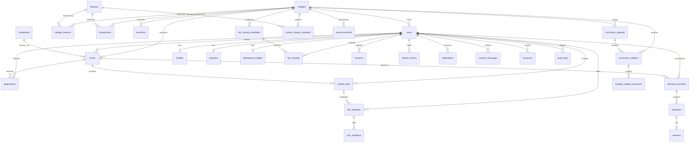

---

---

## 4. Class Diagram & Domain Model

The application domain layer maps relational database models to high-cohesion domain classes. Each class encapsulates state attributes, database mapping annotations, and business behavior methods executed across service layers.

```mermaid
classDiagram
    class User {
        +int id
        +int college_id
        +str email
        +str hashed_password
        +UserType user_type
        +bool is_active
        +bool is_email_verified
        +bool fee_verified
        +int failed_login_attempts
        +datetime locked_until
        +datetime created_at
        +check_lockout() bool
        +increment_failed_attempts() int
        +reset_failed_attempts() void
        +is_tenant_active() bool
    }

    class College {
        +int id
        +str name
        +str slug
        +list email_domains
        +CollegeStatus status
        +str address
        +str contact_email
        +str contact_phone
        +str logo_url
        +str subscription_tier
        +str razorpay_customer_id
        +datetime trial_ends_at
        +datetime created_at
        +datetime updated_at
        +is_domain_authorized(domain: str) bool
        +transition_status(new_status: CollegeStatus) void
        +is_active() bool
    }

    class CollegeRegistration {
        +int id
        +str college_name
        +str admin_name
        +str admin_email
        +str mobile_number
        +str domain
        +bool is_verified
        +datetime expires_at
        +datetime created_at
        +is_expired() bool
        +verify_registration() void
    }

    class Feature {
        +int id
        +str code
        +str name
        +str description
        +str category
        +BillingType billing_type
        +int price_inr
        +FeatureStatus status
        +datetime created_at
        +datetime updated_at
        +is_available() bool
    }

    class CollegeFeature {
        +int id
        +int college_id
        +int feature_id
        +FeatureRequestStatus status
        +datetime requested_at
        +datetime approved_at
        +datetime payment_due_at
        +datetime activated_at
        +datetime expires_at
        +int transaction_id
        +check_payment_window() bool
        +is_currently_active() bool
        +expire_subscription() void
    }

    class Transaction {
        +int id
        +int college_id
        +int feature_id
        +str razorpay_order_id
        +str razorpay_payment_id
        +str razorpay_signature
        +int amount_paise
        +str currency
        +TransactionStatus status
        +str payment_method
        +datetime created_at
        +datetime paid_at
        +verify_hmac_signature(secret: str) bool
        +mark_paid(payment_id: str) void
    }

    class Announcement {
        +int id
        +int college_id
        +str title
        +str message
        +int created_by
        +datetime created_at
        +broadcast_to_recipients() void
    }

    class AuditLog {
        +int id
        +int user_id
        +str action
        +str entity_type
        +int entity_id
        +dict details
        +str ip_address
        +datetime timestamp
        +record_event() void
    }

    class OtpVerification {
        +int id
        +str email
        +str otp_hash
        +OtpPurpose purpose
        +datetime expires_at
        +bool is_used
        +int attempt_count
        +datetime created_at
        +verify_code(candidate_otp: str) bool
        +is_valid() bool
    }

    class FeeReceipt {
        +int id
        +int user_id
        +int matched_template_id
        +str file_path
        +str extracted_text
        +FeeVerdict ai_verdict
        +float ai_confidence
        +str ai_reason
        +dict structural_comparison
        +int verified_by_user_id
        +datetime verified_at
        +datetime created_at
        +extract_text_ocr() str
        +run_ai_verification(template: FeeReceiptTemplate) dict
        +manual_override(tpo_id: int, approved: bool) void
    }

    class FeeReceiptTemplate {
        +int id
        +int college_id
        +str template_name
        +str file_path
        +str extracted_text
        +bool is_active
        +int uploaded_by
        +datetime uploaded_at
        +activate_template() void
    }

    class Profile {
        +int id
        +int user_id
        +str student_id
        +str full_name
        +str branch
        +float cgpa
        +int active_backlogs
        +float tenth_percentage
        +float twelfth_percentage
        +str competitive_exam_name
        +float competitive_exam_percentile
        +list skills
        +bool is_placed
        +bool placement_lock_override
        +datetime created_at
        +datetime updated_at
        +calculate_completeness() float
        +is_eligible_for_drive(criteria: dict) tuple
    }

    class Branch {
        +int id
        +int college_id
        +str name
        +str code
        +datetime created_at
    }

    class Resume {
        +int id
        +int user_id
        +str file_path
        +str parsed_text
        +float ai_score
        +str ai_feedback
        +ResumeSource source
        +bool is_active
        +datetime created_at
        +extract_text() str
        +evaluate_ats(groq_client) dict
        +enhance_content(qa_payload: dict) str
    }

    class Company {
        +int id
        +str name
        +str website
        +str location
        +str about
        +str logo_url
        +str industry_type
    }

    class Drive {
        +int id
        +int college_id
        +int company_id
        +str role
        +str jd_text
        +dict eligibility_criteria
        +str bond_details
        +float package_ctc
        +datetime deadline
        +DriveStatus status
        +DriveTestStatus test_status
        +int created_by
        +datetime created_at
        +is_open() bool
        +close_drive() void
    }

    class Application {
        +int id
        +int user_id
        +int drive_id
        +ApplicationStatus status
        +str current_stage
        +float package_offered
        +datetime applied_on
        +evaluate_gate_eligibility() bool
        +advance_stage(stage: str) void
        +mark_selected(ctc: float) void
        +withdraw() void
    }

    class InterviewSession {
        +int id
        +int user_id
        +int drive_id
        +str company_name
        +list skills
        +InterviewMode mode
        +float overall_score
        +list weak_areas
        +InterviewSessionStatus status
        +datetime created_at
        +start_interview() Question
        +submit_response(answer: str) dict
        +synthesize_weak_areas() list
    }

    class Question {
        +int id
        +int session_id
        +str question_text
        +QuestionType q_type
        +DifficultyLevel difficulty
        +int order_index
    }

    class Answer {
        +int id
        +int question_id
        +str answer_text
        +str ai_feedback
        +float score
    }

    class InstantTest {
        +int id
        +int drive_id
        +int created_by
        +str title
        +int duration_minutes
        +bool is_practice
        +dict prompt_config
        +list questions
        +int min_passing_marks
        +bool use_top_n
        +int top_n_count
        +InstantTestStatus status
        +datetime created_at
        +generate_questions_groq() list
        +close_test() void
    }

    class TestAttempt {
        +int id
        +int test_id
        +int user_id
        +dict submitted_answers
        +float score
        +list weak_areas
        +datetime started_at
        +datetime authoritative_ends_at
        +datetime submitted_at
        +AttemptStatus status
        +AttemptEndedReason ended_reason
        +int total_violations
        +int strike_count
        +grade_attempt() float
        +log_violation(v_type: ViolationType, snapshot: str) bool
        +auto_terminate(reason: AttemptEndedReason) void
    }

    class TestViolation {
        +int id
        +int attempt_id
        +ViolationType violation_type
        +datetime timestamp
        +dict metadata_payload
        +str snapshot_image_b64
    }

    class Resource {
        +int id
        +int created_by
        +str title
        +ResourceCategory category
        +ResourceContentType content_type
        +str video_url
        +str content
        +datetime created_at
    }

    class CurriculumUpload {
        +int id
        +int college_id
        +int uploaded_by
        +str original_filename
        +str file_path
        +CurriculumExtractionStatus extraction_status
        +dict raw_extracted_tree
        +datetime uploaded_at
        +datetime confirmed_at
        +parse_pdf_to_tree() dict
        +confirm_tree(reviewed_tree: dict) void
    }

    class CurriculumSubject {
        +int id
        +int college_id
        +int upload_id
        +str branch_name
        +int semester_number
        +str subject_name
        +bool is_market_trend_focus
        +datetime created_at
        +toggle_market_trend() void
    }

    class CuratedSubjectResource {
        +int id
        +int subject_id
        +SubjectResourceType resource_type
        +str title
        +str resource_url
        +str ai_summary
        +CurationApprovalStatus approval_status
        +int reviewed_by_user_id
        +datetime generated_at
        +datetime reviewed_at
        +approve_curation() void
        +reject_curation() void
    }

    class RefreshToken {
        +int id
        +int user_id
        +str token_hash
        +bool is_revoked
        +datetime expires_at
        +datetime created_at
        +revoke() void
        +is_active() bool
    }

    class Notification {
        +int id
        +int recipient_id
        +int sender_id
        +NotificationType type
        +str message
        +bool is_read
        +datetime created_at
        +mark_as_read() void
    }

    class Analytics {
        +int id
        +int user_id
        +int total_applications
        +int interviews_taken
        +float avg_score
        +float readiness_score
        +datetime updated_at
        +compute_readiness_score() float
    }

    class DashboardInsight {
        +int id
        +int user_id
        +list external_opportunities
        +list resume_suggestions
        +list trending_skills
        +datetime generated_at
        +datetime last_manual_refresh_at
        +refresh_insights(search_api, groq_api) void
        +is_cooldown_active() bool
    }

    class ContactMessage {
        +int id
        +str name
        +str email
        +str message
        +ContactCategory category
        +int submitted_by_user_id
        +ContactStatus status
        +datetime created_at
        +resolve_message() void
    }

    class CustomFeatureRequest {
        +int id
        +int college_id
        +str title
        +str description
        +str business_justification
        +str urgency_level
        +CustomFeatureStatus status
        +int estimated_price_inr
        +datetime created_at
        +datetime updated_at
        +decide_request(status: CustomFeatureStatus, price: int) void
    }

    College "1" -- "*" User : hosts
    College "1" -- "*" CollegeFeature : subscribes
    College "1" -- "*" Transaction : bills
    College "1" -- "*" Branch : teaches
    College "1" -- "*" Drive : hosts
    College "1" -- "*" FeeReceiptTemplate : configures
    College "1" -- "*" CurriculumUpload : processes
    College "1" -- "*" CurriculumSubject : maintains
    College "1" -- "*" CustomFeatureRequest : submits

    Feature "1" -- "*" CollegeFeature : activates
    Feature "1" -- "*" Transaction : prices

    User "1" -- "0..1" Profile : describes
    User "1" -- "0..1" Analytics : tracks
    User "1" -- "0..1" DashboardInsight : advises
    User "1" -- "*" FeeReceipt : uploads
    User "1" -- "*" Resume : uploads
    User "1" -- "*" Application : submits
    User "1" -- "*" InterviewSession : practices
    User "1" -- "*" TestAttempt : takes
    User "1" -- "*" RefreshToken : authenticates
    User "1" -- "*" Notification : receives
    User "1" -- "*" AuditLog : records

    Company "1" -- "*" Drive : posts
    Drive "1" -- "*" Application : receives
    Drive "1" -- "*" InstantTest : associates
    Drive "1" -- "*" InterviewSession : targets

    InstantTest "1" -- "*" TestAttempt : tests
    TestAttempt "1" -- "*" TestViolation : captures

    InterviewSession "1" -- "*" Question : presents
    Question "1" -- "0..1" Answer : evaluates

    CurriculumUpload "1" -- "*" CurriculumSubject : extracts
    CurriculumSubject "1" -- "*" CuratedSubjectResource : aggregates
    FeeReceiptTemplate "1" -- "*" FeeReceipt : baseline_for
```

---

---

## 5. Use Case Diagrams & Behavioral Models

The system architecture organizes functionality around four primary operational actors. Behavioral use cases are detailed with explicit `<<includes>>` (mandatory sub-flows) and `<<extends>>` (conditional branches), complete with precondition and postcondition specifications.

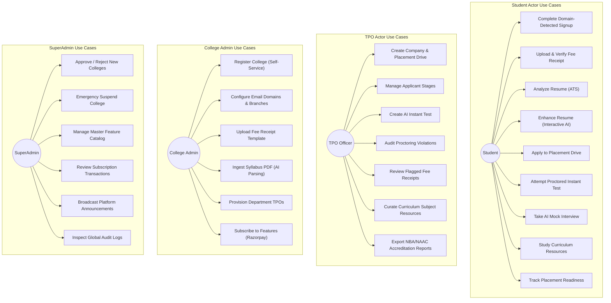

---

### 5.1 Student Functional Use Cases

#### 5.1.1 Authentication & Onboarding
* **UC-STU-01: Request Signup OTP**  
  *Precondition*: Student provides an email address matching an active college's whitelisted domain (`colleges.email_domains`).  
  *Description*: Backend checks domain validity, ensures no duplicate user exists, generates a 6-digit cryptographically random OTP, stores bcrypt hash in `otp_verifications`, and sends email via SMTP. Rejects public email providers.  
  *Postcondition*: Record created in `otp_verifications` with 10-minute expiry; rate limit counter incremented.
* **UC-STU-02: Verify Signup OTP**  
  *Description*: Submits email and 6-digit code. Validates hash and expiry, marks OTP as used, and issues a 15-minute signup purpose token.  
  *Includes*: Cryptographic bcrypt verification and rate-limiting enforcement.
* **UC-STU-03: Complete Registration**  
  *Description*: Submits password alongside the valid signup purpose token. Backend hashes password via bcrypt, creates active `User` record tagged with the detected `college_id`, and issues initial JWT access/refresh token pair.  
  *Postcondition*: User record initialized with `is_email_verified = True`, `fee_verified = False`.
* **UC-STU-04: Complete Profile Onboarding**  
  *Description*: Populates academic profile: full name, student roll ID, department branch, CGPA (0.0-10.0), active backlogs, 10th and 12th percentages, competitive exam percentiles, and technical skills list.  
  *Includes*: Profile completeness re-calculation and baseline readiness score update.
* **UC-STU-05: Upload Placement Fee Receipt**  
  *Description*: Uploads institutional fee receipt (PDF/JPG/PNG <= 5MB). Backend executes OCR text extraction and dispatches prompt to Groq. If college has an active template, executes structural comparison (Path B); otherwise executes content-plausibility verification (Path A).  
  *Includes*: OCR processing and Groq LLM verification.  
  *Extends*: If AI confidence >= 0.85, auto-sets `fee_verified = True`. If < 0.85, routes to TPO manual review queue.

#### 5.1.2 Resume Engineering & Career Preparation
* **UC-STU-06: Upload Resume PDF**  
  *Description*: Uploads resume PDF (<= 5MB). Direct text layer extracted via `pypdf`, falling back to `pytesseract` OCR if scanned. Stored in `resumes` table.
* **UC-STU-07: Analyze Resume with AI (ATS Scoring)**  
  *Description*: Requests Groq ATS analysis. Evaluates against standard industry criteria, generating quantitative score (0-100), identified missing core skills, formatting suggestions, and structural improvements.  
  *Includes*: Groq AI JSON prompt execution; updates `analytics.readiness_score`.
* **UC-STU-08: Enhance Resume via Interactive AI**  
  *Description*: AI generates custom interview-style questions regarding project accomplishments, quantifiable impact, and target roles. Upon receiving student answers, Groq generates a fully enhanced, formatted resume text draft. Student can mark the enhanced version as the active resume.

#### 5.1.3 Placement Drives & Applications
* **UC-STU-09: Browse Matched Placement Drives**  
  *Description*: Fetches active placement drives for the student's college. Drives are color-coded with live eligibility badges (Eligible vs. Ineligible) with specific failure explanations (e.g. CGPA cutoff, backlog limit, branch mismatch).
* **UC-STU-10: Apply to Placement Drive**  
  *Precondition*: Student must have `fee_verified = True` and must meet all academic criteria. Student must not be locked by previous selection unless granted `placement_lock_override`.  
  *Description*: Submits formal drive application. Creates `Application` row with status `applied` or `eligible`. Dispatches confirmation notification.  
  *Includes*: Automated eligibility check and placement lock enforcement.
* **UC-STU-11: Withdraw Application**  
  *Description*: Student withdraws application prior to shortlisting. Permitted only from states `applied`, `eligible`, or `not_eligible`. Blocked once candidate is shortlisted or selected.

#### 5.1.4 Proctored Instant Test Attempt
* **UC-STU-12: Complete Test Precheck**  
  *Description*: Mandatory pre-test screen (`/student/tests/:id/precheck`). Validates camera access via `getUserMedia`, microphone access, and fullscreen capability. Passes persistent `MediaStream` refs into test session.
* **UC-STU-13: Start Proctored Test Session**  
  *Description*: Calls backend to create `test_attempts` record. Backend validates eligibility, ensures no active concurrent attempt exists, randomizes question and option orders server-side, and returns server-authoritative `ends_at` timestamp.
* **UC-STU-14: Attempt Proctored Test**  
  *Description*: Fullscreen, single-question or multi-question assessment view. Browser detectors monitor tab switching, fullscreen exit, clipboard copy, devtools keys, face absence, multiple faces, and ambient speech noise.  
  *Includes*: Periodic answer auto-saving and real-time violation event reporting with snapshot capture.
* **UC-STU-15: Submit Test Attempt**  
  *Description*: Explicit student submission or automatic server-side termination (timer expiry or 5-strike violation limit). Backend grades objective answers, triggers Groq for subjective answers, synthesizes weak areas, and updates readiness score.

#### 5.1.5 AI Mock Interviews & Study Resources
* **UC-STU-16: Start Adaptive Mock Interview**  
  *Description*: Configures interview target company, target domain, and mode (Aptitude, Technical, Coding, HR, Full). Groq generates dynamic question sequence. Evaluates submitted answers with instant scores (0-100) and actionable feedback.
* **UC-STU-17: Access Curriculum-Driven Study Resources**  
  *Description*: Navigates approved educational resources organized hierarchically by department branch, academic semester, and subject name. Views book recommendations, articles, and video lectures.
* **UC-STU-18: Track Career Readiness Score**  
  *Description*: Views breakdown of composite 0-100 Readiness Score based on Resume AI, Mock Interviews, Profile Completeness, and Application Activity. Views timeline of identified academic and technical weak areas.

---

### 5.2 Training & Placement Officer (TPO) Functional Use Cases

#### 5.2.1 Corporate Relations & Drive Execution
* **UC-TPO-01: Create & Manage Companies**  
  *Description*: Registers recruiting companies with corporate logo URL, website, location, industry classification, and corporate overview.
* **UC-TPO-02: Formulate Placement Drive**  
  *Description*: Creates a placement drive linked to a company. Sets job role, detailed JD, bond requirements, offered CTC, deadline, and structured eligibility parameters (min CGPA, max backlogs, eligible branches, 10th/12th cutoffs).
* **UC-TPO-03: Manage Applicant Pipeline**  
  *Description*: Views applicant roster for a drive. Filters by eligibility. Transitions candidate stages (`shortlisted`, `rejected`, `selected`).  
  *Includes*: Assigning offered package CTC upon final selection and automatically marking student `profile.is_placed = True`.
* **UC-TPO-04: Toggle Placement Lock Override**  
  *Description*: Grants or revokes placement lock override for placed students to allow participation in tier-1 dream company recruitment drives.
* **UC-TPO-05: Close Placement Drive**  
  *Description*: Transitions drive status from `open` to `closed`, terminating incoming applications and locking test creation.

#### 5.2.2 Proctored Instant Test Administration
* **UC-TPO-06: Create AI-Powered Instant Test**  
  *Description*: Configures test duration, minimum passing score, top-N shortlisting rule, and Groq generation prompt. Groq generates standardized question set with randomized distractor options.
* **UC-TPO-07: Audit Proctoring Violations & Evidence**  
  *Description*: Accesses real-time or post-test audit screen (`/tpo/tests/attempts/:id/violations`). Inspects chronological violation telemetry, tab-switch durations, noise levels, and base64 webcam snapshot captures.
* **UC-TPO-08: Review Candidate Test Scores & Rankings**  
  *Description*: Inspects scored candidate attempts. Sorts by marks obtained, filters by top-N threshold, and bulk-shortlists qualifying candidates directly into the drive pipeline.

#### 5.2.3 Verification, Curation & Reporting
* **UC-TPO-09: Human-in-the-Loop Fee Receipt Review**  
  *Description*: Inspects student fee receipts routed to manual review queue (`ai_confidence < 0.85`). Displays student receipt alongside college reference template with OCR side-by-side comparison and stated AI reasoning. Approves (sets `fee_verified = True`) or rejects.
* **UC-TPO-10: Prioritize Curriculum Subjects & Curate Resources**  
  *Description*: Browses confirmed departmental curriculum subjects. Toggles "Market Trend Focus" on high-priority subjects. Triggers automated Groq + Tavily web search curation for books, articles, and videos. Reviews and approves/rejects each recommended resource.
* **UC-TPO-11: Generate NBA/NAAC Accreditation Reports**  
  *Description*: Exports standardized institutional placement metrics: Company Selections Roster, Department CTC Distributions, Unplaced Student Lists, and Proctoring Integrity Audits in CSV and printable HTML formats.

---

### 5.3 College Administrator Functional Use Cases

#### 5.3.1 Institutional Governance & Settings
* **UC-ADM-01: Self-Service College SaaS Registration**  
  *Description*: Submits college name, administrator name, official institutional email, and mobile number. Enforces institutional domain validation (rejecting free providers) and domain collision checks. Completes OTP verification and password setup.
* **UC-ADM-02: Manage Institutional Email Whitelist**  
  *Description*: Configures authorized email domain suffixes (`colleges.email_domains`) to automate student tenant routing during registration. Prevents cross-college domain collisions.
* **UC-ADM-03: Manage Departmental Branches**  
  *Description*: Adds, renames, and manages institutional department branches (e.g. Computer Science, Civil, Electrical), providing dynamic branch pills throughout the college portal.
* **UC-ADM-04: Upload Fee Receipt Baseline Template**  
  *Description*: Uploads sample institutional fee receipt (PDF/image). Backend extracts baseline OCR text and letterhead markers, storing them in `fee_receipt_templates` for automated structural comparison.

#### 5.3.2 Academic Curriculum Ingestion & Staffing
* **UC-ADM-05: Ingest Syllabus Document (PDF)**  
  *Description*: Uploads official institutional syllabus PDF. System executes text layer parsing and Groq extraction into a structured tree (branches -> semesters -> subjects).  
  *Postcondition*: Upload record created in `curriculum_uploads` with status `ready_for_review`.
* **UC-ADM-06: Review & Confirm Extracted Curriculum**  
  *Description*: Admin reviews extracted draft in an interactive table editor: corrects misread subject titles, adds missed electives, edits semester assignments, and confirms. Writes final records into `curriculum_subjects`.
* **UC-ADM-07: Provision Departmental TPO Accounts**  
  *Description*: Creates staff accounts for Training & Placement Officers, assigns departmental scopes, and resets credentials.

#### 5.3.3 Modular Feature Licensing & Billing
* **UC-ADM-08: Browse Feature Catalog & Request Features**  
  *Description*: Browses available modular features (Mock Interviews, Proctored Tests, Curriculum Study Resources, Career Insights, GATE/CAT Prep). Submits activation request to SuperAdmin.
* **UC-ADM-09: Complete Razorpay Checkout**  
  *Description*: Upon SuperAdmin approval, opens Razorpay payment modal, executes transaction, and submits cryptographic signature for verification. Auto-activates feature upon verification.
* **UC-ADM-10: Track Progressive Setup Checklist**  
  *Description*: Monitors unobtrusive dashboard indicator showing completion percentage across essential onboarding milestones (domain config, branches, fee template, curriculum, TPO provisioning).

---

### 5.4 Platform SuperAdministrator Functional Use Cases

#### 5.4.1 Tenant Governance & Approvals
* **UC-SADM-01: Review & Approve Registered Colleges**  
  *Description*: Reviews onboarded colleges in `ready_for_review` state. Inspects administrator identity, institutional domain, and setup completeness. Approves college to `active` status, enabling live student registrations.
* **UC-SADM-02: Emergency College Suspension (Killswitch)**  
  *Description*: Immediately transitions delinquent or non-compliant college to `suspended`. Instantly revokes session validity for all institutional users via the tenant suspension guard.

#### 5.4.2 Master Catalog & Financial Oversight
* **UC-SADM-03: Manage Master Feature Catalog**  
  *Description*: Full CRUD on platform modular features. Sets feature identifiers, display titles, pricing in INR, and billing models (Monthly, Annual, One-Time).
* **UC-SADM-04: Review College Feature Requests**  
  *Description*: Evaluates incoming feature requests from College Admins. Approves with 7-day payment window initialization or rejects with feedback.
* **UC-SADM-05: Monitor SaaS Transactions & Run Expiry Scans**  
  *Description*: Inspects Razorpay transaction logs, verifies webhook receipts, and executes system-wide subscription expiry sweeps (`check_all_expiries`). Dispatches payment renewal reminders.

#### 5.4.3 Communications & Platform Telemetry
* **UC-SADM-06: Broadcast Global Announcements**  
  *Description*: Composes and publishes platform-wide notices delivered to all College Administrators (maintenance downtime, new feature releases).
* **UC-SADM-07: Inspect Platform Macro Analytics & Audit Logs**  
  *Description*: Analyzes aggregate platform metrics (total colleges, total active students, global drive counts, feature adoption rates). Inspects chronological security audit trail.

---

---

## 6. Sequence Diagrams

The following 18 sequence diagrams represent every mission-critical system workflow. Each diagram documents the precise interaction between Actor, Frontend Client, API Router, Service Layer, External Service Providers, and PostgreSQL Database.

---

### 6.1 Student Signup with Dynamic Domain Detection (3-Step OTP Flow)

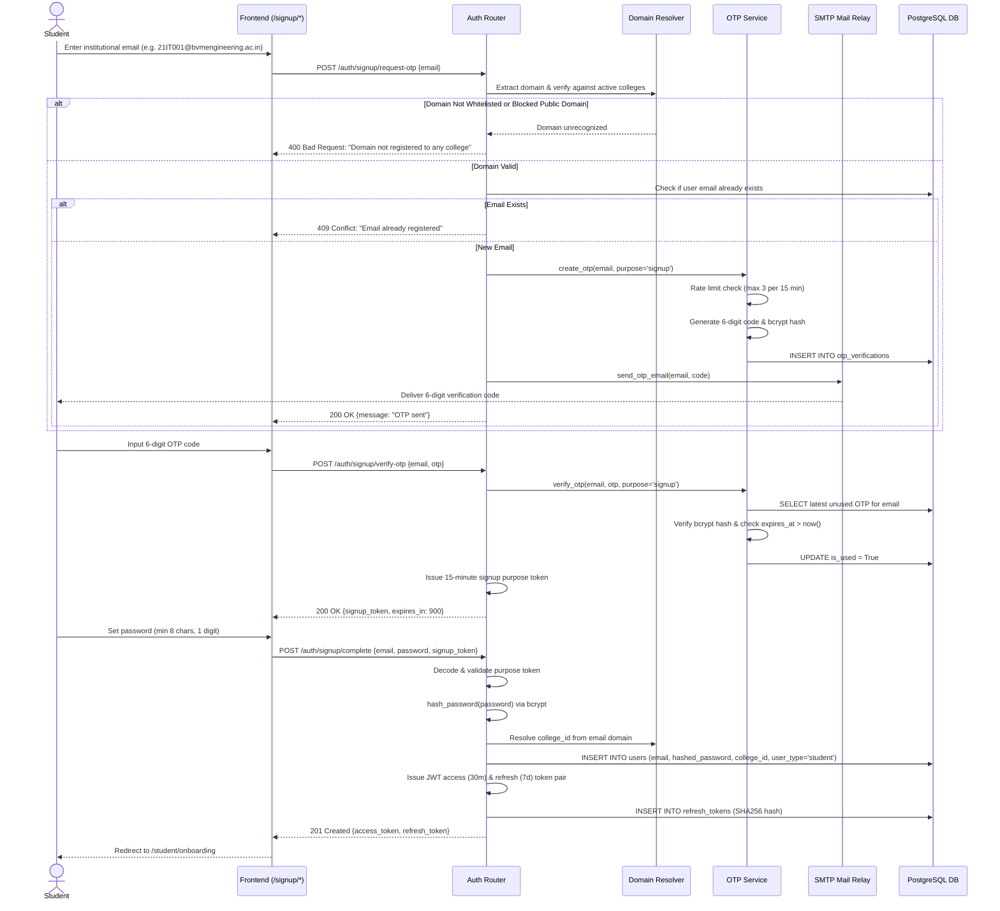

---

### 6.2 Self-Service College SaaS Registration Flow

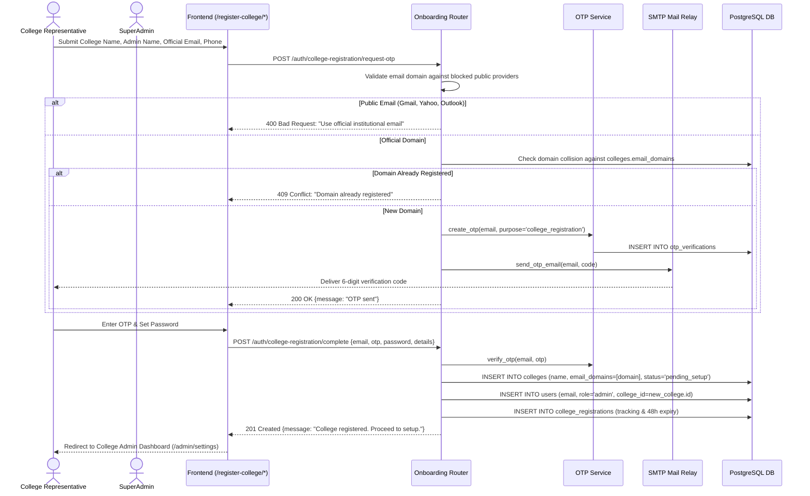

---

### 6.3 College Onboarding Progressive Checklist & SuperAdmin Approval Gate

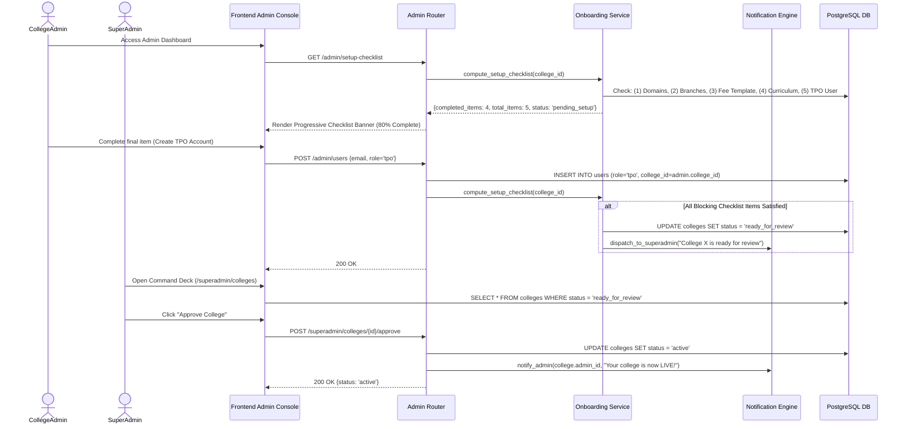

---

### 6.4 Feature Catalog Browsing, Request, and Razorpay Checkout

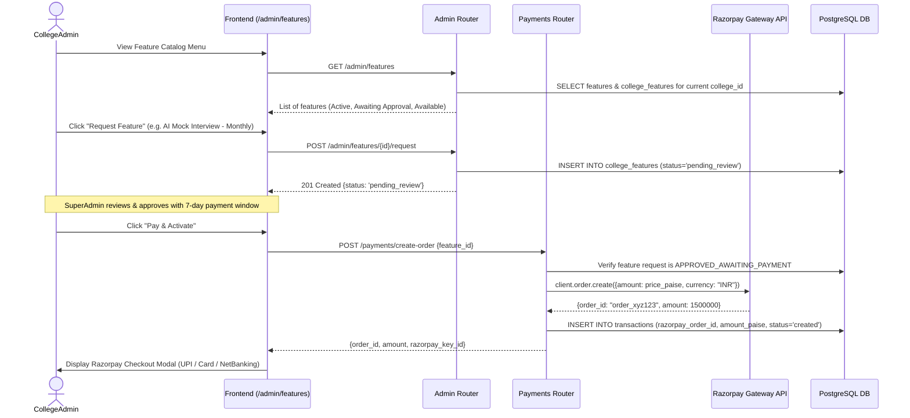

---

### 6.5 Razorpay Webhook Processing & Auto-Activation

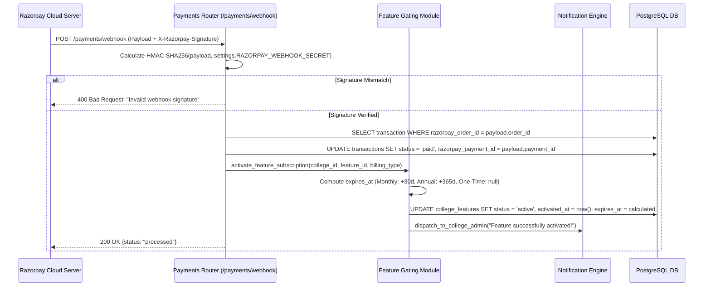

---

### 6.6 Login with Brute-Force Lockout & Tenant Suspension Guard

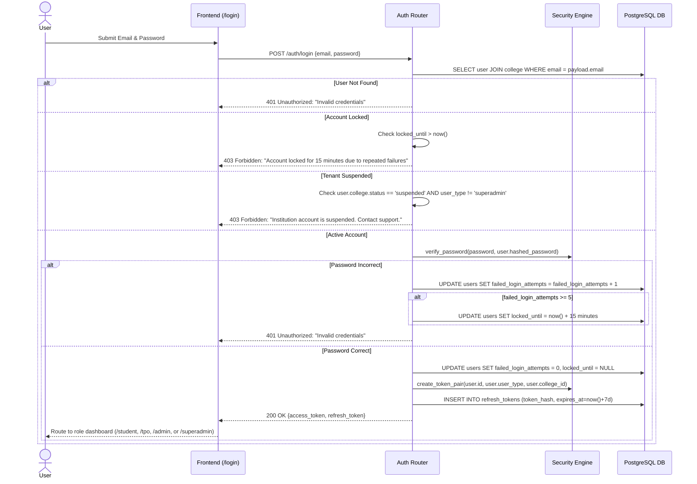

---

### 6.7 Template-Matched Fee Receipt Verification Flow (Path A vs Path B)

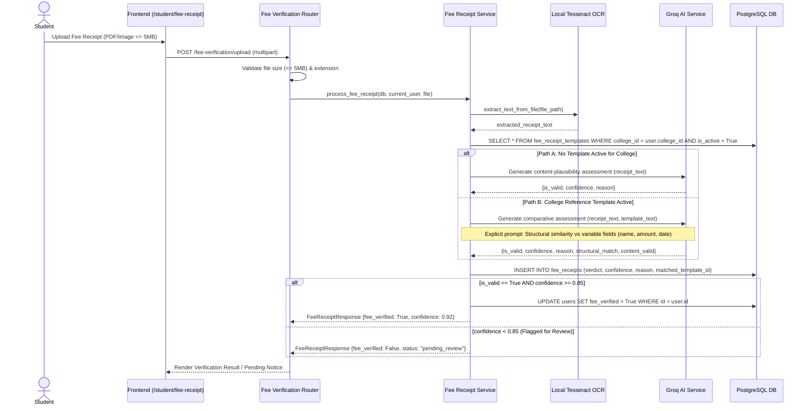

---

### 6.8 TPO Human-in-the-Loop Fee Review Queue Flow

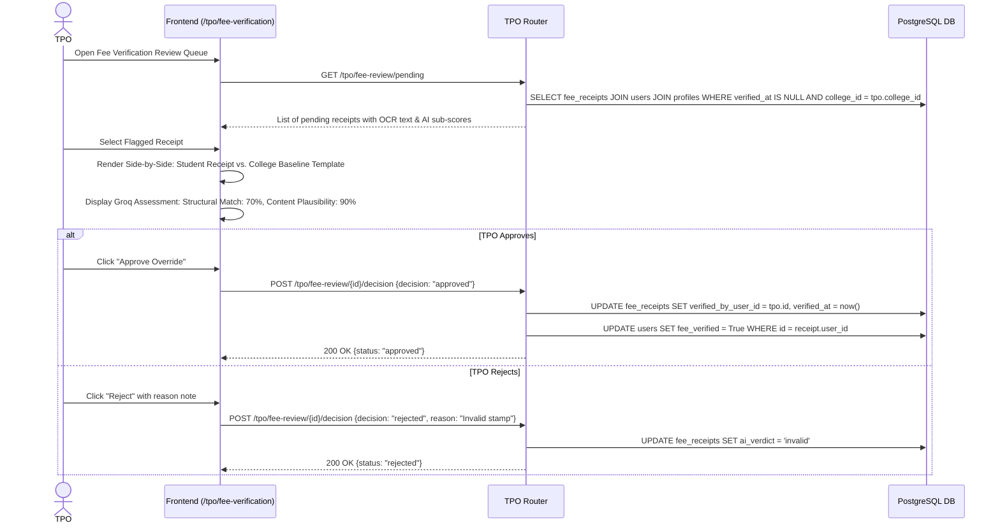

---

### 6.9 Drive Creation & Application Pipeline

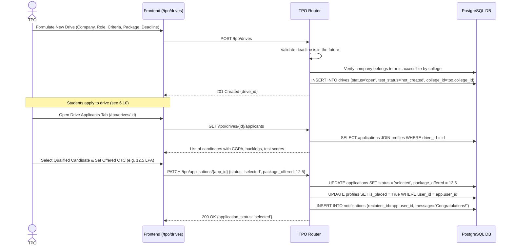

---

### 6.10 Student Drive Application & Eligibility Gate Check Flow

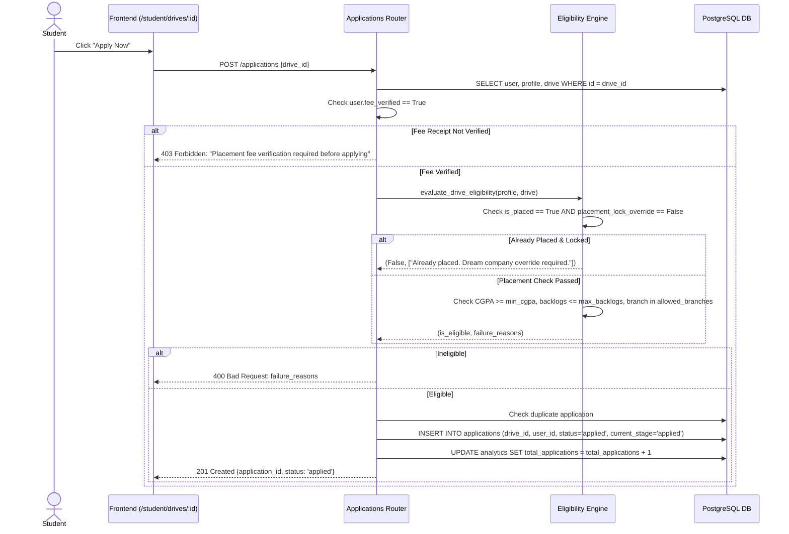

---

### 6.11 Proctored Instant Test Precheck & Initiation

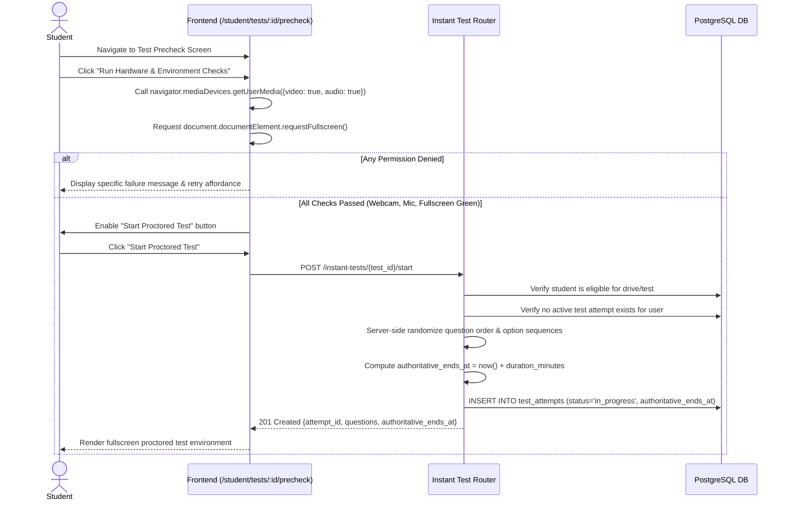

---

### 6.12 Proctored Exam Anti-Cheating Violations & Auto-Termination

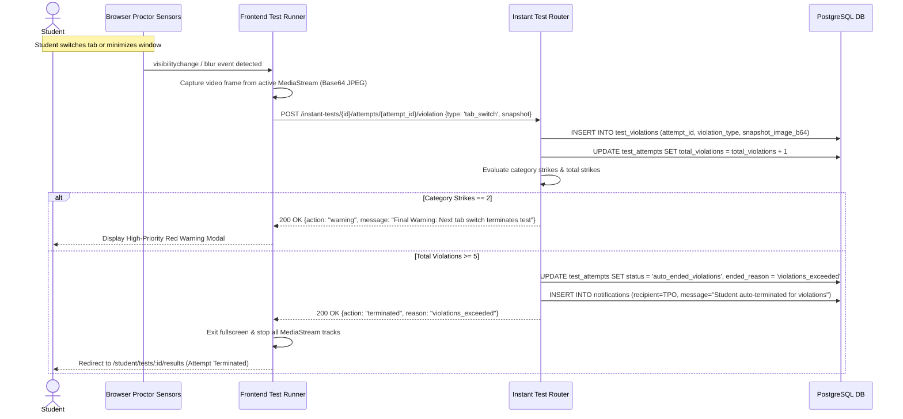

---

### 6.13 TPO Live / Post-Test Anti-Cheating Audit

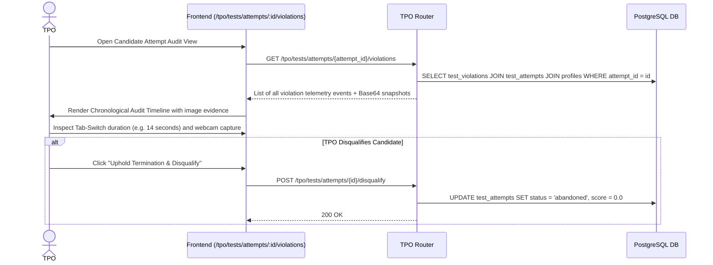

---

### 6.14 Full AI Mock Interview Simulation

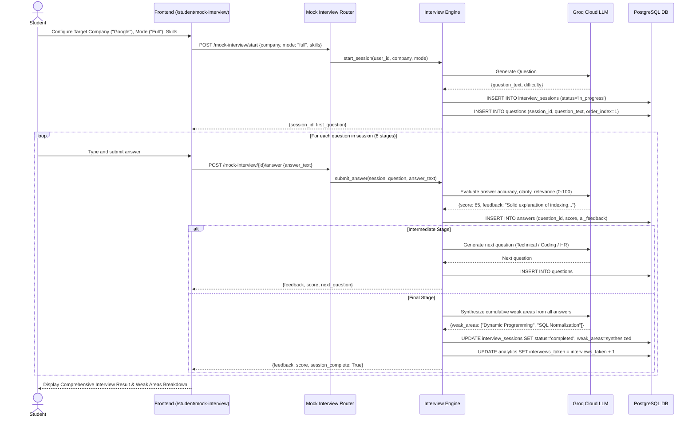

---

### 6.15 Interactive AI Resume Enhancer Q&A

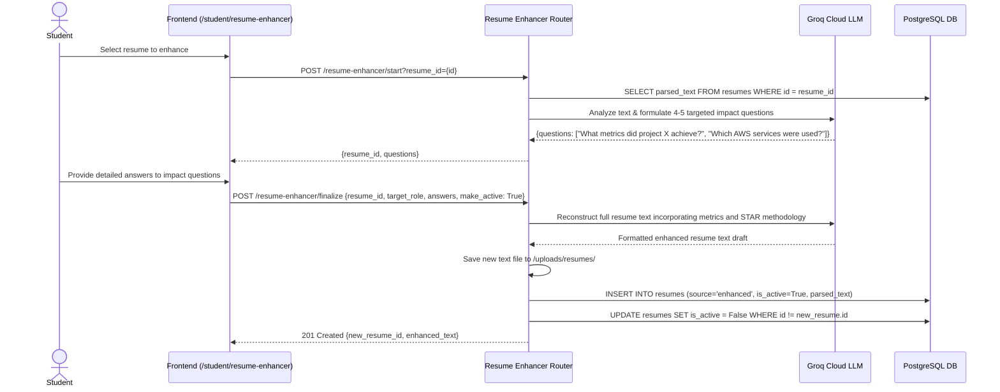

---

### 6.16 Curriculum Syllabus Ingestion, OCR & Confirmation

```mermaid
sequenceDiagram
    actor CollegeAdmin
    participant FE as Frontend (/admin/settings?tab=curriculum)
    participant CurricRouter as Curriculum Router
    participant Parser as Curriculum Service
    participant Groq as Groq Cloud LLM
    participant DB as PostgreSQL DB

    CollegeAdmin->>FE: Upload Syllabus PDF (e.g. BVM_Curriculum_2026.pdf)
    FE->>CurricRouter: POST /curriculum/upload (multipart)
    CurricRouter->>Parser: extract_text_from_pdf(file_path)
    Parser-->>CurricRouter: raw_syllabus_text
    CurricRouter->>Groq: Parse text into structured tree (Branches -> Semesters -> Subjects)
    Groq-->>CurricRouter: {branches: [{name: "IT", semesters: [{sem: 5, subjects: ["DBMS", "OS"]}]}]}
    CurricRouter->>DB: INSERT INTO curriculum_uploads (status='ready_for_review', raw_extracted_tree)
    CurricRouter-->>FE: 201 Created {upload_id, draft_tree}

    CollegeAdmin->>FE: Review extracted subjects in table editor, fix typos & add missing electives
    CollegeAdmin->>FE: Click "Confirm & Save Curriculum"
    FE->>CurricRouter: POST /curriculum/confirm {upload_id, reviewed_tree}
    CurricRouter->>DB: INSERT INTO curriculum_subjects (branch_name, semester_number, subject_name, college_id)
    CurricRouter->>DB: UPDATE curriculum_uploads SET extraction_status = 'confirmed'
    CurricRouter-->>FE: 200 OK {message: "Curriculum confirmed"}
```

---

### 6.17 TPO Subject Prioritization & AI Resource Curation

```mermaid
sequenceDiagram
    actor TPO
    actor Student
    participant FE_TPO as TPO Console (/tpo/curriculum)
    participant FE_STU as Student Portal (/student/resources)
    participant CurricRouter as Curriculum Router
    participant Search as Tavily / Serper Search API
    participant Groq as Groq Cloud LLM
    participant DB as PostgreSQL DB

    TPO->>FE_TPO: Browse Confirmed Subjects for Department
    TPO->>FE_TPO: Toggle "Market Trend Focus" on "Cloud Computing"
    FE_TPO->>CurricRouter: POST /curriculum/subjects/{id}/prioritize
    CurricRouter->>DB: UPDATE curriculum_subjects SET is_market_trend_focus = True

    TPO->>FE_TPO: Click "Curate Resources with AI"
    FE_TPO->>CurricRouter: POST /curriculum/subjects/{id}/curate
    CurricRouter->>Search: Query books, documentation, and tutorials for "Cloud Computing"
    Search-->>CurricRouter: Web search snippets & URLs
    CurricRouter->>Groq: Select top educational resources & generate original summaries
    Groq-->>CurricRouter: List of {title, url, type, ai_summary}
    CurricRouter->>DB: INSERT INTO curated_subject_resources (approval_status='pending_review')
    CurricRouter-->>FE_TPO: List of candidate resources

    TPO->>FE_TPO: Approve valid resources & reject low-quality links
    FE_TPO->>CurricRouter: POST /curriculum/resources/{res_id}/review {decision: 'approved'}
    CurricRouter->>DB: UPDATE curated_subject_resources SET approval_status = 'approved'
    CurricRouter-->>FE_TPO: 200 OK

    Student->>FE_STU: Open Resources Library -> "By Subject" -> "Cloud Computing"
    FE_STU->>CurricRouter: GET /curriculum/subjects/{id}/resources
    CurricRouter->>DB: SELECT * FROM curated_subject_resources WHERE approval_status = 'approved'
    CurricRouter-->>FE_STU: Curated Books, Articles, and Video Lectures
```

---

### 6.18 Live Career Insights Dashboard Generation

```mermaid
sequenceDiagram
    actor Student
    participant FE as Frontend (/student/dashboard)
    participant InsightsRouter as Insights Router
    participant InsightsSvc as Web Insights Service
    participant Search as Tavily / Serper API
    participant Groq as Groq Cloud LLM
    participant DB as PostgreSQL DB

    Student->>FE: Access Student Dashboard
    FE->>InsightsRouter: GET /insights/dashboard
    InsightsRouter->>InsightsSvc: get_dashboard_insights(user, profile)
    InsightsSvc->>DB: SELECT * FROM dashboard_insights WHERE user_id = user.id
    alt Cache Stale (generated_at.date != today)
        InsightsSvc->>Search: Search industry trends for student branch & skills
        Search-->>InsightsSvc: Search results & news
        InsightsSvc->>Groq: Synthesize external opportunities & trending skills
        Groq-->>InsightsSvc: {external_opportunities, trending_skills, resume_suggestions}
        InsightsSvc->>DB: UPSERT INTO dashboard_insights
    end
    InsightsSvc-->>InsightsRouter: Insights payload
    InsightsRouter-->>FE: Render Career Trends, External Jobs, and Skill Alerts
```

---

---

## 7. State Diagrams & Lifecycle State Machines

The platform governs institutional workflows, recruitment funnels, and examination proctoring via 9 formal finite state machines. Each state machine details entry conditions, exit transitions, terminal states, and database side effects.

---

### 7.1 College Status Lifecycle (`CollegeStatus`)

Manages the institutional multi-tenant operational status from registration to SaaS decommissioning.

| State | Description | Entry Condition | Next Allowed States | Terminal? |
|---|---|---|---|---|
| `pending_setup` | College registered; Administrator configuring essential setup items (domains, branches, templates). | Successful completion of College SaaS registration OTP. | `ready_for_review`, `rejected` | No |
| `ready_for_review` | All blocking setup items completed; queued in SuperAdmin Command Deck for review. | Completion of the 5th blocking item in the setup checklist. | `active`, `rejected` | No |
| `active` | Live institutional tenant. Student registrations enabled; drives, tests, and mock interviews active. | SuperAdmin explicit approval (`POST /superadmin/colleges/:id/approve`). | `suspended` | No |
| `suspended` | Emergency administrative freeze. All logins and API access for this college immediately blocked. | SuperAdmin emergency action or payment delinquency. | `active` (Reactivated) | No |
| `rejected` | Registration denied due to fraudulent domain, unverified institution, or policy violation. | SuperAdmin rejection decision. | `[*]` | Yes |

```mermaid
stateDiagram-v2
    [*] --> pending_setup : Self-Service Registration OTP Verified
    pending_setup --> ready_for_review : All 5 Blocking Checklist Items Satisfied
    pending_setup --> rejected : SuperAdmin Rejection
    
    ready_for_review --> active : SuperAdmin Approves Institution
    ready_for_review --> rejected : SuperAdmin Rejects Institution
    
    active --> suspended : SuperAdmin Suspends (Killswitch Active)
    suspended --> active : SuperAdmin Reactivates Institution
    
    rejected --> [*]
```

---

### 7.2 College Feature & Subscription Status (`FeatureRequestStatus`)

Tracks modular feature licensing and the 7-day Razorpay payment due window.

| State | Description | Entry Condition | Next Allowed States | Terminal? |
|---|---|---|---|---|
| `pending_review` | Feature requested by College Admin; awaiting SuperAdmin approval. | `POST /admin/features/:id/request` | `approved_awaiting_payment`, `rejected` | No |
| `approved_awaiting_payment` | SuperAdmin approved; 7-day payment window initiated (`payment_due_at = now() + 7d`). | SuperAdmin approval action. | `active`, `approval_expired` | No |
| `active` | Feature license active. Endpoints unlocked and UI navigation tabs rendered. | Verified Razorpay payment transaction. | `expired`, `revoked` | No |
| `approval_expired` | 7-day payment window lapsed without payment. Auto-expired by background scanner. | `now() > payment_due_at` | `pending_review` (Re-requested) | No |
| `expired` | Subscription period ended (Monthly +30d or Annual +365d). Feature locked. | `now() > expires_at` | `approved_awaiting_payment` (Renewed) | No |
| `rejected` | Feature request denied by SuperAdmin. | SuperAdmin rejection. | `pending_review` | Yes |
| `revoked` | SuperAdmin revoked active feature license due to abuse or refund. | SuperAdmin revocation. | `[*]` | Yes |

```mermaid
stateDiagram-v2
    [*] --> pending_review : College Admin Requests Feature
    pending_review --> approved_awaiting_payment : SuperAdmin Approves (Sets 7-Day Due Date)
    pending_review --> rejected : SuperAdmin Rejects
    
    approved_awaiting_payment --> active : Razorpay Payment Verified
    approved_awaiting_payment --> approval_expired : 7 Days Elapse Without Payment
    
    active --> expired : Subscription Period Ends (expires_at Reached)
    active --> revoked : SuperAdmin Revokes Access
    
    approval_expired --> pending_review : College Admin Re-submits Request
    expired --> approved_awaiting_payment : College Admin Renews Subscription
    
    rejected --> [*]
    revoked --> [*]
```

---

### 7.3 Financial Transaction Status (`TransactionStatus`)

Tracks payment processing and cryptographic verification via Razorpay.

| State | Description | Next Allowed States | Terminal? |
|---|---|---|---|
| `created` | Razorpay order generated via API (`client.order.create`). | `paid`, `failed` | No |
| `paid` | Client HMAC-SHA256 signature verified or server webhook processed. | `refunded` | Yes (Standard) |
| `failed` | Payment rejected at gateway or signature mismatch. | `[*]` | Yes |
| `refunded` | Transaction amount refunded to institution. Feature license revoked. | `[*]` | Yes |

```mermaid
stateDiagram-v2
    [*] --> created : Order Created (/payments/create-order)
    created --> paid : HMAC Signature or Webhook Verified
    created --> failed : Payment Cancelled / Failed
    paid --> refunded : SuperAdmin Issues Refund
    failed --> [*]
    refunded --> [*]
```

---

### 7.4 Student Drive Application Pipeline (`ApplicationStatus`)

Manages candidate progression through the campus recruitment funnel.

| State | Description | Permitted Next States | Terminal? |
|---|---|---|---|
| `applied` | Student submitted application; pending automated or manual eligibility verification. | `eligible`, `not_eligible`, `withdrawn` | No |
| `eligible` | Academic criteria (CGPA, backlogs, branch) confirmed by system. | `shortlisted`, `rejected`, `selected`, `withdrawn` | No |
| `not_eligible` | Failed academic cutoffs or backlog thresholds. | `withdrawn` | Yes |
| `shortlisted` | Candidate cleared initial screening or passed Instant Test cutoff. | `selected`, `rejected` | No |
| `selected` | Final job offer issued. Triggers `profile.is_placed = True`. | `[*]` | Yes |
| `rejected` | Candidate eliminated during resume screening or interviews. | `[*]` | Yes |
| `withdrawn` | Candidate retracted application. Allowed only prior to shortlisting. | `[*]` | Yes |

```mermaid
stateDiagram-v2
    [*] --> applied : Student Applies to Drive
    applied --> eligible : Eligibility Check Passes
    applied --> not_eligible : Eligibility Cutoff Fails
    applied --> withdrawn : Student Retracts Application
    
    eligible --> shortlisted : TPO Reviews / Test Passed
    eligible --> selected : Direct Selection (Package Assigned)
    eligible --> rejected : TPO Eliminates
    eligible --> withdrawn : Student Retracts
    
    not_eligible --> withdrawn : Student Acknowledges
    
    shortlisted --> selected : Final Interview Cleared (is_placed=True)
    shortlisted --> rejected : Final Interview Failed
    
    selected --> [*]
    rejected --> [*]
    withdrawn --> [*]
```

---

### 7.5 Placement Drive & Test Lifecycle (`DriveStatus` & `DriveTestStatus`)

Governs corporate recruitment drive availability and associated testing stages.

```mermaid
stateDiagram-v2
    state DriveLifecycle {
        [*] --> draft : TPO Prepares Drive
        draft --> open : TPO Publishes (deadline in future)
        open --> closed : TPO Closes Drive or Deadline Lapsed
        closed --> [*]
    }

    state DriveTestLifecycle {
        [*] --> not_created : Drive Initialized
        not_created --> test_open : TPO Generates Instant Test
        test_open --> test_closed : TPO Closes Assessment Window
        test_closed --> [*]
    }
```

---

### 7.6 Proctored Test Attempt Lifecycle (`AttemptStatus` & `AttemptEndedReason`)

Governs student examination execution, timer synchronization, and anti-cheating termination.

| State | Description | Terminal? |
|---|---|---|
| `in_progress` | Candidate currently answering questions under active camera/audio proctoring. | No |
| `completed` | Candidate submitted answers cleanly within time limit. | Yes |
| `auto_ended_timeout` | Server-authoritative timer expired (`now() > authoritative_ends_at`). Auto-submitted. | Yes |
| `auto_ended_violations` | Proctored sensors logged 5 cumulative anti-cheating violations. Immediate termination. | Yes |
| `abandoned` | Browser tab closed or disconnected without submitting. | Yes |

```mermaid
stateDiagram-v2
    [*] --> in_progress : Student Passes Precheck & Starts
    
    in_progress --> in_progress : Answer Auto-Save / Warning Issued
    in_progress --> completed : Candidate Explicitly Submits
    in_progress --> auto_ended_timeout : Timer Expires (ends_at Reached)
    in_progress --> auto_ended_violations : 5 Cumulative Violations Logged
    in_progress --> abandoned : Session Disconnected / Inactive
    
    completed --> [*]
    auto_ended_timeout --> [*]
    auto_ended_violations --> [*]
    abandoned --> [*]
```

---

### 7.7 Fee Receipt Verification Lifecycle (`FeeVerdict`)

Tracks student placement fee verification against institutional templates.

```mermaid
stateDiagram-v2
    [*] --> uploaded : Student Uploads Receipt File
    uploaded --> analyzing : Local OCR Extracted Text Layer
    
    analyzing --> valid : Groq Confidence >= 85% (Auto-Verified)
    analyzing --> pending_review : Groq Confidence < 85% (Flagged for Review)
    
    pending_review --> valid : TPO Overrides & Approves
    pending_review --> invalid : TPO Rejects Fake / Mismatched Receipt
    
    valid --> [*] : fee_verified = True (Student Can Apply)
    invalid --> uploaded : Student Uploads Corrected Receipt
```

---

### 7.8 Academic Curriculum & Resource Curation Lifecycle

Tracks syllabus PDF ingestion and departmental resource curation.

```mermaid
stateDiagram-v2
    state CurriculumExtraction {
        [*] --> processing : Admin Uploads Syllabus PDF
        processing --> ready_for_review : AI Extracted Draft Subject Tree
        processing --> failed : OCR or Text Extraction Error
        ready_for_review --> confirmed : Admin Corrects & Confirms Tree
        confirmed --> [*]
    }

    state ResourceApproval {
        [*] --> pending_review : AI Curates Links from Web Search
        pending_review --> approved : TPO Approves (Visible to Students)
        pending_review --> rejected : TPO Rejects (Hidden from Students)
        approved --> [*]
        rejected --> [*]
    }
```

---

### 7.9 User Account Security Status

Tracks authentication lockouts and administrative account deactivation.

```mermaid
stateDiagram-v2
    [*] --> active : Account Created & Email Verified
    active --> locked : 5 Consecutive Failed Password Attempts
    locked --> active : 15 Minutes Elapse (locked_until Expired)
    locked --> active : Successful Password Reset via OTP
    active --> deactivated : TPO or Admin Deactivates Account
    deactivated --> active : Administrative Reactivation
    deactivated --> [*]
```

---

---

## 8. Activity & Business Process Workflows

The following 5 process flow diagrams represent the end-to-end operational lifecycles across each stakeholder tier.

---

### 8.1 Complete Student Placement & Career Readiness Journey

```mermaid
flowchart TD
    Start([Student Enters Portal]) --> HasAccount{Existing Account?}
    
    HasAccount -- No --> EnterEmail[Enter Institutional Email]
    EnterEmail --> CheckDomain{Domain Matches Active College?}
    CheckDomain -- No --> RejectDomain[Display Error: Invalid Domain]
    RejectDomain --> EnterEmail
    CheckDomain -- Yes --> SendOTP[Dispatch 6-Digit OTP via SMTP]
    SendOTP --> VerifyOTP{Enter Valid OTP?}
    VerifyOTP -- No / Expired --> SendOTP
    VerifyOTP -- Yes --> SetPass[Set Secure Password]
    SetPass --> CreateAccount[Account Created: Student Role]
    
    HasAccount -- Yes --> Login[Submit Email & Password]
    CreateAccount --> Login
    
    Login --> BruteForceCheck{Failed Attempts >= 5?}
    BruteForceCheck -- Yes --> Lockout[Account Locked for 15 Minutes]
    BruteForceCheck -- No --> CredCheck{Credentials Valid?}
    CredCheck -- No --> IncFail[Increment Failed Counter] --> Login
    CredCheck -- Yes --> TenantCheck{College Status == Suspended?}
    TenantCheck -- Yes --> SuspendBlock[Display 403: Institution Suspended]
    TenantCheck -- No --> CheckProfile{Onboarding Profile Complete?}
    
    CheckProfile -- No --> FillProfile[Complete CGPA, Backlogs, Percentages, Skills]
    FillProfile --> SaveProfile[Profile Saved]
    CheckProfile -- Yes --> SaveProfile
    
    SaveProfile --> FeeGateCheck{Fee Receipt Verified?}
    FeeGateCheck -- No --> UploadFee[Upload Fee Receipt PDF/Image]
    UploadFee --> RunOCR[Local Tesseract OCR Extraction]
    RunOCR --> HasTemplate{College Template Active?}
    HasTemplate -- Yes --> CompareTemplate[Groq Path B: Structural Comparison]
    HasTemplate -- No --> PlausibilityCheck[Groq Path A: Content Plausibility]
    CompareTemplate --> EvalConfidence{Confidence >= 85%?}
    PlausibilityCheck --> EvalConfidence
    EvalConfidence -- Yes --> SetFeeVerified[fee_verified = True]
    EvalConfidence -- No --> RouteReview[Flagged for TPO Manual Review]
    RouteReview --> TpoDecision{TPO Decision?}
    TpoDecision -- Approved --> SetFeeVerified
    TpoDecision -- Rejected --> UploadFee
    
    FeeGateCheck -- Yes --> StudentDashboard[Access Student Dashboard]
    SetFeeVerified --> StudentDashboard
    
    StudentDashboard --> PrepActions{Choose Action}
    
    PrepActions --> ResumePrep[Upload Resume PDF]
    ResumePrep --> RunATS[Groq AI ATS Scoring]
    RunATS --> EnhanceQ[Interactive AI Enhancement Q&A]
    EnhanceQ --> UpdateResume[Update Active Resume]
    
    PrepActions --> MockInterview[Start AI Mock Interview]
    MockInterview --> MultiStage[Aptitude -> Technical -> Coding -> HR]
    MultiStage --> SynthesizeWeak[AI Weak Area Synthesis]
    
    PrepActions --> StudyCurriculum[Browse Department Study Resources]
    StudyCurriculum --> AccessBooks[Read Approved Books, Articles, Videos]
    
    PrepActions --> BrowseDrives[Browse Matched Placement Drives]
    BrowseDrives --> EligibilityCheck{Meets Drive Cutoffs?}
    EligibilityCheck -- No --> ShowReasons[Display Failure Reasons]
    EligibilityCheck -- Yes --> CheckPlaced{Already Placed?}
    CheckPlaced -- Yes & No Override --> BlockApp[Application Blocked: Already Placed]
    CheckPlaced -- No / Override Active --> ApplyDrive[Submit Drive Application]
    
    ApplyDrive --> DrivePipeline{Drive Assessment Type}
    DrivePipeline --> ProctoredExam[Take Proctored Instant Test]
    ProctoredExam --> RunPrecheck[Webcam, Mic, Fullscreen Precheck]
    RunPrecheck --> TestRunner[Answer Questions under Proctoring]
    TestRunner --> ViolationsCheck{Violations >= 5?}
    ViolationsCheck -- Yes --> TerminateTest[Test Terminated: Violations Exceeded]
    ViolationsCheck -- No --> SubmitTest[Test Scored & Ranked]
    
    DrivePipeline --> DirectInterview[TPO Review & Interview Rounds]
    SubmitTest --> DirectInterview
    DirectInterview --> FinalOutcome{Selection Decision?}
    FinalOutcome -- Rejected --> StudentDashboard
    FinalOutcome -- Selected --> MarkPlaced[is_placed = True, Package Recorded]
    MarkPlaced --> Finish([Student Successfully Placed!])
```

---

### 8.2 TPO Drive, Proctored Examination & Accreditation Lifecycle

```mermaid
flowchart TD
    TpoLogin([TPO Logs In]) --> TpoDash[TPO Command Suite]
    
    TpoDash --> DriveAction{Operational Task}
    
    DriveAction --> CreateCompany[Register Employer Company]
    CreateCompany --> FormulateDrive[Formulate Placement Drive]
    FormulateDrive --> SetRules[Set CGPA, Max Backlogs, Branches, CTC, Deadline]
    SetRules --> PublishDrive[Publish Drive: status = open]
    
    PublishDrive --> InstantTestOpt{Include AI Instant Test?}
    InstantTestOpt -- Yes --> ConfigTest[Configure Topic Prompt, Passing Marks, Top-N]
    ConfigTest --> GroqGen[Groq Generates Question Set & Options]
    GroqGen --> PublishTest[Publish Test: test_status = open]
    
    PublishTest --> StudentsTest[Students Attempt Test under Proctoring]
    StudentsTest --> AuditViolations[Open Proctoring Audit Dashboard]
    AuditViolations --> InspectSnapshots[Inspect Captured Webcam Frames & Tab Switches]
    InspectSnapshots --> FinalizeScores[Rank Candidates by Marks & Top-N Filter]
    FinalizeScores --> ShortlistCandidates[Bulk Shortlist Qualifying Students]
    
    InstantTestOpt -- No --> ReviewApplicants[Review Direct Applicants]
    ShortlistCandidates --> InterviewRounds[Conduct Technical & HR Interviews]
    ReviewApplicants --> InterviewRounds
    
    InterviewRounds --> SelectionDecision{Candidate Selected?}
    SelectionDecision -- No --> RejectCandidate[Mark Status = rejected]
    SelectionDecision -- Yes --> RecordOffer[Assign Package CTC & Mark Status = selected]
    RecordOffer --> LockStudent[Student Marked is_placed = True]
    LockStudent --> NotifyStudent[Send Congratulations Notification]
    
    DriveAction --> FeeReviewQueue[Open Pending Fee Review Queue]
    FeeReviewQueue --> SideBySide[Render Student Receipt vs. College Baseline Template]
    SideBySide --> ManualDecision{Approve Receipt?}
    ManualDecision -- Yes --> SetVerified[Set fee_verified = True]
    ManualDecision -- No --> RejectFee[Mark Receipt Invalid & Request Re-upload]
    
    DriveAction --> CurriculumCuration[Open Curriculum Focus Manager]
    CurriculumCuration --> SelectTrend[Toggle Market Trend Focus on Subjects]
    SelectTrend --> TriggerAI[Trigger Tavily Search + Groq Curation]
    TriggerAI --> ReviewResources[Approve / Reject Recommended Books & Videos]
    ReviewResources --> PublishToStudents[Resources Published to Students]
    
    DriveAction --> ExportReports[Generate NBA/NAAC Accreditation Reports]
    ExportReports --> SelectReportType{Choose Report}
    SelectReportType --> Rpt1[Company Selections Roster]
    SelectReportType --> Rpt2[Department CTC Distribution]
    SelectReportType --> Rpt3[Unplaced Students Audit]
    SelectReportType --> Rpt4[Proctoring Integrity Audit]
    Rpt1 --> DownloadExport[Export as Clean CSV or Printable HTML Document]
    Rpt2 --> DownloadExport
    Rpt3 --> DownloadExport
    Rpt4 --> DownloadExport
```

---

### 8.3 College Admin Progressive Onboarding & SaaS Subscription Workflow

```mermaid
flowchart TD
    AdminRegister([Representative Registers College]) --> VerifyEmail[Verify Institutional Email via OTP]
    VerifyEmail --> CreateTenant[College Created: status = pending_setup]
    CreateTenant --> LoginAdmin[Admin Logs In to Dashboard]
    
    LoginAdmin --> ProgressiveChecklist[Progressive Setup Checklist Visible]
    ProgressiveChecklist --> Step1[Step 1: Configure Email Domains]
    Step1 --> Step2[Step 2: Add Departmental Branches]
    Step2 --> Step3[Step 3: Upload Fee Receipt Baseline Template]
    Step3 --> Step4[Step 4: Ingest Curriculum Syllabus PDF]
    Step4 --> ParsePDF[AI Extracts Draft Subject Hierarchy]
    ParsePDF --> ConfirmTree[Admin Reviews & Confirms Curriculum]
    ConfirmTree --> Step5[Step 5: Provision First Departmental TPO Account]
    
    Step5 --> AllComplete{All 5 Steps Satisfied?}
    AllComplete -- Yes --> AutoQueue[Auto-Transition: status = ready_for_review]
    AutoQueue --> NotifySuper[Notify SuperAdmin for Review]
    
    NotifySuper --> SuperDecision{SuperAdmin Decision}
    SuperDecision -- Rejected --> DisplayRejection[Display Rejection Reason]
    SuperDecision -- Approved --> ActivateCollege[College Status = active]
    
    ActivateCollege --> FeatureCatalog[Browse Platform Feature Catalog]
    FeatureCatalog --> SelectFeature[Request Modular Feature e.g. Proctored Tests]
    SelectFeature --> SuperReviewFeat{SuperAdmin Approves Feature?}
    SuperReviewFeat -- Approved --> 7DayWindow[7-Day Payment Due Window Initiated]
    7DayWindow --> RazorpayCheckout[Admin Opens Razorpay Modal]
    RazorpayCheckout --> PaySuccess{Payment Verified?}
    PaySuccess -- No / Expired --> FeatExpired[Status = approval_expired]
    PaySuccess -- Yes --> FeatActive[Feature Activated: status = active]
    FeatActive --> StudentsAccess[Students & TPOs Can Now Use Feature]
```

---

### 8.4 SuperAdmin Platform Oversight & Multi-Tenant Governance

```mermaid
flowchart TD
    SuperLogin([SuperAdmin Logs In]) --> CommandDeck[SuperAdmin Command Deck]
    
    CommandDeck --> GovAction{Governance Action}
    
    GovAction --> ReviewColleges[Review Pending Institutions Queue]
    ReviewColleges --> InspectDetails[Inspect Domain, Admin Identity, Setup Score]
    InspectDetails --> ApproveCollege[Approve College -> status = active]
    InspectDetails --> RejectCollege[Reject College -> status = rejected]
    
    GovAction --> MonitorActive[Inspect Active Institutions Directory]
    MonitorActive --> DelinquencyCheck{Delinquency or Rule Violation?}
    DelinquencyCheck -- Yes --> SuspendCollege[Emergency Action: status = suspended]
    SuspendCollege --> KillswitchActive[All Institutional Logins Blocked]
    
    GovAction --> ManageCatalog[Manage Master Feature Catalog]
    ManageCatalog --> AddFeature[Create New Feature: Code, Name, Pricing, Billing Model]
    ManageCatalog --> EditFeature[Update Feature Pricing or Monthly/Annual Terms]
    
    GovAction --> FeatureRequestsQueue[Review Feature Request Queue]
    FeatureRequestsQueue --> ApproveRequest[Approve Request -> 7-Day Window Set]
    FeatureRequestsQueue --> RejectRequest[Reject Request with Feedback Note]
    
    GovAction --> BillingOversight[Inspect SaaS Billing & Subscriptions]
    BillingOversight --> RunSweep[Trigger check_all_expiries Sweep]
    RunSweep --> SendReminders[Dispatch Automated Renewal Reminders]
    
    GovAction --> PlatformAnnouncements[Broadcast Platform Announcements]
    PlatformAnnouncements --> SendBroadcast[Publish Notice to All College Admins]
    
    GovAction --> AuditFeed[Inspect Global Security Audit Logs]
```

---

### 8.5 Curriculum Ingestion, Curation & Educational Delivery Pipeline

```mermaid
flowchart TD
    StartCurric([College Admin Ingests Syllabus]) --> UploadPDF[Upload Syllabus PDF File]
    UploadPDF --> ValidatePDF[Validate File Size <= 15MB and MIME Type]
    ValidatePDF --> ExtractText[pypdf / OCR Text Extraction]
    ExtractText --> GroqParse[Groq LLM Extracts Branches -> Semesters -> Subjects]
    GroqParse --> CreateUploadRec[Record in curriculum_uploads: ready_for_review]
    
    CreateUploadRec --> TableEditor[Admin Opens Interactive Table Editor]
    TableEditor --> EditActions[Correct Misread Titles, Add Electives, Fix Semesters]
    EditActions --> ConfirmButton[Admin Clicks 'Confirm Curriculum']
    ConfirmButton --> CommitDB[Insert Rows into curriculum_subjects]
    
    CommitDB --> TpoNotified[TPO Accesses Departmental Curriculum]
    TpoNotified --> PrioritizeSubjects[TPO Toggles 'Market Trend Focus' on Subjects]
    PrioritizeSubjects --> CurateButton[TPO Clicks 'Curate Resources with AI']
    
    CurateButton --> TavilySearch[Tavily API Executes Web Search for Books, Articles, Videos]
    TavilySearch --> GroqSummarize[Groq Filters Reputable Sources & Generates Original Summaries]
    GroqSummarize --> InsertResources[Insert into curated_subject_resources: pending_review]
    
    InsertResources --> TpoReviewScreen[TPO Opens Resource Review Screen]
    TpoReviewScreen --> ReviewDecision{TPO Decision per Link}
    ReviewDecision -- Reject --> MarkRejected[Mark approval_status = rejected]
    ReviewDecision -- Approve --> MarkApproved[Mark approval_status = approved]
    
    MarkApproved --> StudentPortal[Render in Student Resources Library]
    StudentPortal --> StudentLearns([Student Studies Verified Curriculum Resources])
```

---

---

## 9. Exhaustive API Endpoint Inventory

The platform backend exposes **180+ REST API endpoints** distributed across 25 specialized router namespaces. Every endpoint is documented below with its HTTP method, URL path, RBAC security dependencies, input parameters, request/response models, and business logic side effects.

---

### 9.1 Router Namespace: `admin` (35 Endpoints)

**Architectural Overview & Security Scope:**
The `admin` router provides institutional governance for College Administrators. Covers department branch management, fee receipt template uploads, staff TPO provisioning, modular feature requests, Razorpay subscription checkout, institutional activity audit logs, and student oversight.

#### 9.1.1 `[GET]` `/admin/activity`

- **Summary**: Executes `get_activity_feed` business logic.
- **Access Control**: Public Endpoint / Purpose Token
- **Response Model**: `list`
- **Functional Details & Side Effects**: Processes incoming request parameters and updates database state within an isolated transaction.
- **Expected HTTP Status Codes**:
  - `200 OK` / `201 Created` / `204 No Content`: Successful execution.
  - `400 Bad Request`: Payload validation failure or business rule violation.
  - `401 Unauthorized`: Missing, expired, or invalid JWT bearer token.
  - `403 Forbidden`: Insufficient role permissions or suspended tenant institution.
  - `404 Not Found`: Target entity identifier does not exist or belongs to another tenant.
  - `409 Conflict`: Unique constraint violation or duplicate active record.

#### 9.1.2 `[GET]` `/admin/analytics`

- **Summary**: Executes `get_admin_analytics` business logic.
- **Access Control**: Public Endpoint / Purpose Token
- **Response Model**: `AdminAnalyticsResponse`
- **Functional Details & Side Effects**: Processes incoming request parameters and updates database state within an isolated transaction.
- **Expected HTTP Status Codes**:
  - `200 OK` / `201 Created` / `204 No Content`: Successful execution.
  - `400 Bad Request`: Payload validation failure or business rule violation.
  - `401 Unauthorized`: Missing, expired, or invalid JWT bearer token.
  - `403 Forbidden`: Insufficient role permissions or suspended tenant institution.
  - `404 Not Found`: Target entity identifier does not exist or belongs to another tenant.
  - `409 Conflict`: Unique constraint violation or duplicate active record.

#### 9.1.3 `[GET]` `/admin/billing/transactions`

- **Summary**: List all payment transactions and invoices for this college (subscription + modules).
- **Access Control**: Public Endpoint / Purpose Token
- **Response Model**: `list`
- **Functional Details & Side Effects**: Processes incoming request parameters and updates database state within an isolated transaction.
- **Expected HTTP Status Codes**:
  - `200 OK` / `201 Created` / `204 No Content`: Successful execution.
  - `400 Bad Request`: Payload validation failure or business rule violation.
  - `401 Unauthorized`: Missing, expired, or invalid JWT bearer token.
  - `403 Forbidden`: Insufficient role permissions or suspended tenant institution.
  - `404 Not Found`: Target entity identifier does not exist or belongs to another tenant.
  - `409 Conflict`: Unique constraint violation or duplicate active record.

#### 9.1.4 `[GET]` `/admin/college`

- **Summary**: Fetch current college details and platform stats for this College Admin.
- **Access Control**: Public Endpoint / Purpose Token
- **Response Model**: `CollegeInfoResponse`
- **Functional Details & Side Effects**: Processes incoming request parameters and updates database state within an isolated transaction.
- **Expected HTTP Status Codes**:
  - `200 OK` / `201 Created` / `204 No Content`: Successful execution.
  - `400 Bad Request`: Payload validation failure or business rule violation.
  - `401 Unauthorized`: Missing, expired, or invalid JWT bearer token.
  - `403 Forbidden`: Insufficient role permissions or suspended tenant institution.
  - `404 Not Found`: Target entity identifier does not exist or belongs to another tenant.
  - `409 Conflict`: Unique constraint violation or duplicate active record.

#### 9.1.5 `[PATCH]` `/admin/college/domain`

- **Summary**: Update the institution's allowed email domain for student signups.
- **Access Control**: Public Endpoint / Purpose Token
- **Response Model**: `CollegeInfoResponse`
- **Functional Details & Side Effects**: Processes incoming request parameters and updates database state within an isolated transaction.
- **Expected HTTP Status Codes**:
  - `200 OK` / `201 Created` / `204 No Content`: Successful execution.
  - `400 Bad Request`: Payload validation failure or business rule violation.
  - `401 Unauthorized`: Missing, expired, or invalid JWT bearer token.
  - `403 Forbidden`: Insufficient role permissions or suspended tenant institution.
  - `404 Not Found`: Target entity identifier does not exist or belongs to another tenant.
  - `409 Conflict`: Unique constraint violation or duplicate active record.

#### 9.1.6 `[DELETE]` `/admin/college/fee-template`

- **Summary**: Deactivates all active reference sample templates for this college.
- **Access Control**: Public Endpoint / Purpose Token
- **Response Model**: `dict`
- **Functional Details & Side Effects**: Processes incoming request parameters and updates database state within an isolated transaction.
- **Expected HTTP Status Codes**:
  - `200 OK` / `201 Created` / `204 No Content`: Successful execution.
  - `400 Bad Request`: Payload validation failure or business rule violation.
  - `401 Unauthorized`: Missing, expired, or invalid JWT bearer token.
  - `403 Forbidden`: Insufficient role permissions or suspended tenant institution.
  - `404 Not Found`: Target entity identifier does not exist or belongs to another tenant.
  - `409 Conflict`: Unique constraint violation or duplicate active record.

#### 9.1.7 `[GET]` `/admin/college/fee-template`

- **Summary**: Retrieve the primary/latest active reference sample template for the admin's college.
- **Access Control**: Public Endpoint / Purpose Token
- **Response Model**: `Optional`
- **Functional Details & Side Effects**: Processes incoming request parameters and updates database state within an isolated transaction.
- **Expected HTTP Status Codes**:
  - `200 OK` / `201 Created` / `204 No Content`: Successful execution.
  - `400 Bad Request`: Payload validation failure or business rule violation.
  - `401 Unauthorized`: Missing, expired, or invalid JWT bearer token.
  - `403 Forbidden`: Insufficient role permissions or suspended tenant institution.
  - `404 Not Found`: Target entity identifier does not exist or belongs to another tenant.
  - `409 Conflict`: Unique constraint violation or duplicate active record.

#### 9.1.8 `[POST]` `/admin/college/fee-template`

- **Summary**: Upload an official reference fee receipt sample for the admin's college.
- **Access Control**: Public Endpoint / Purpose Token
- **Response Model**: `FeeReceiptTemplateResponse`
- **Functional Details & Side Effects**: Runs OCR and stores extracted text for student template-matching. Supports multiple active templates per institution.
- **Expected HTTP Status Codes**:
  - `200 OK` / `201 Created` / `204 No Content`: Successful execution.
  - `400 Bad Request`: Payload validation failure or business rule violation.
  - `401 Unauthorized`: Missing, expired, or invalid JWT bearer token.
  - `403 Forbidden`: Insufficient role permissions or suspended tenant institution.
  - `404 Not Found`: Target entity identifier does not exist or belongs to another tenant.
  - `409 Conflict`: Unique constraint violation or duplicate active record.

#### 9.1.9 `[GET]` `/admin/college/fee-templates`

- **Summary**: Retrieve all reference sample templates for the admin's college, newest first.
- **Access Control**: Public Endpoint / Purpose Token
- **Response Model**: `list`
- **Functional Details & Side Effects**: Processes incoming request parameters and updates database state within an isolated transaction.
- **Expected HTTP Status Codes**:
  - `200 OK` / `201 Created` / `204 No Content`: Successful execution.
  - `400 Bad Request`: Payload validation failure or business rule violation.
  - `401 Unauthorized`: Missing, expired, or invalid JWT bearer token.
  - `403 Forbidden`: Insufficient role permissions or suspended tenant institution.
  - `404 Not Found`: Target entity identifier does not exist or belongs to another tenant.
  - `409 Conflict`: Unique constraint violation or duplicate active record.

#### 9.1.10 `[POST]` `/admin/college/fee-templates`

- **Summary**: Upload an official reference fee receipt sample for the admin's college.
- **Access Control**: Public Endpoint / Purpose Token
- **Response Model**: `FeeReceiptTemplateResponse`
- **Functional Details & Side Effects**: Runs OCR and stores extracted text for student template-matching. Supports multiple active templates per institution.
- **Expected HTTP Status Codes**:
  - `200 OK` / `201 Created` / `204 No Content`: Successful execution.
  - `400 Bad Request`: Payload validation failure or business rule violation.
  - `401 Unauthorized`: Missing, expired, or invalid JWT bearer token.
  - `403 Forbidden`: Insufficient role permissions or suspended tenant institution.
  - `404 Not Found`: Target entity identifier does not exist or belongs to another tenant.
  - `409 Conflict`: Unique constraint violation or duplicate active record.

#### 9.1.11 `[DELETE]` `/admin/college/fee-templates/{template_id}`

- **Summary**: Deletes a specific reference template for this college.
- **Access Control**: Public Endpoint / Purpose Token
- **Response Model**: `dict`
- **Path Parameters**: `template_id` (Path parameter, Integer/String identifier)
- **Functional Details & Side Effects**: Processes incoming request parameters and updates database state within an isolated transaction.
- **Expected HTTP Status Codes**:
  - `200 OK` / `201 Created` / `204 No Content`: Successful execution.
  - `400 Bad Request`: Payload validation failure or business rule violation.
  - `401 Unauthorized`: Missing, expired, or invalid JWT bearer token.
  - `403 Forbidden`: Insufficient role permissions or suspended tenant institution.
  - `404 Not Found`: Target entity identifier does not exist or belongs to another tenant.
  - `409 Conflict`: Unique constraint violation or duplicate active record.

#### 9.1.12 `[PATCH]` `/admin/college/fee-templates/{template_id}/toggle-active`

- **Summary**: Toggles active/inactive status for a specific template.
- **Access Control**: Public Endpoint / Purpose Token
- **Response Model**: `FeeReceiptTemplateResponse`
- **Path Parameters**: `template_id` (Path parameter, Integer/String identifier)
- **Functional Details & Side Effects**: Processes incoming request parameters and updates database state within an isolated transaction.
- **Expected HTTP Status Codes**:
  - `200 OK` / `201 Created` / `204 No Content`: Successful execution.
  - `400 Bad Request`: Payload validation failure or business rule violation.
  - `401 Unauthorized`: Missing, expired, or invalid JWT bearer token.
  - `403 Forbidden`: Insufficient role permissions or suspended tenant institution.
  - `404 Not Found`: Target entity identifier does not exist or belongs to another tenant.
  - `409 Conflict`: Unique constraint violation or duplicate active record.

#### 9.1.13 `[PATCH]` `/admin/college/profile`

- **Summary**: Update the institution's official name, primary contact person name, and contact phone.
- **Access Control**: Public Endpoint / Purpose Token
- **Response Model**: `CollegeInfoResponse`
- **Functional Details & Side Effects**: Processes incoming request parameters and updates database state within an isolated transaction.
- **Expected HTTP Status Codes**:
  - `200 OK` / `201 Created` / `204 No Content`: Successful execution.
  - `400 Bad Request`: Payload validation failure or business rule violation.
  - `401 Unauthorized`: Missing, expired, or invalid JWT bearer token.
  - `403 Forbidden`: Insufficient role permissions or suspended tenant institution.
  - `404 Not Found`: Target entity identifier does not exist or belongs to another tenant.
  - `409 Conflict`: Unique constraint violation or duplicate active record.

#### 9.1.14 `[GET]` `/admin/college/setup-checklist`

- **Summary**: Fetch live progressive setup checklist for this college admin, auto-transitioning to ready_for_review if complete.
- **Access Control**: Public Endpoint / Purpose Token
- **Response Model**: `SetupChecklistResponse`
- **Functional Details & Side Effects**: Processes incoming request parameters and updates database state within an isolated transaction.
- **Expected HTTP Status Codes**:
  - `200 OK` / `201 Created` / `204 No Content`: Successful execution.
  - `400 Bad Request`: Payload validation failure or business rule violation.
  - `401 Unauthorized`: Missing, expired, or invalid JWT bearer token.
  - `403 Forbidden`: Insufficient role permissions or suspended tenant institution.
  - `404 Not Found`: Target entity identifier does not exist or belongs to another tenant.
  - `409 Conflict`: Unique constraint violation or duplicate active record.

#### 9.1.15 `[GET]` `/admin/custom-features`

- **Summary**: List all custom feature proposals submitted by this college.
- **Access Control**: Public Endpoint / Purpose Token
- **Response Model**: `list`
- **Functional Details & Side Effects**: Processes incoming request parameters and updates database state within an isolated transaction.
- **Expected HTTP Status Codes**:
  - `200 OK` / `201 Created` / `204 No Content`: Successful execution.
  - `400 Bad Request`: Payload validation failure or business rule violation.
  - `401 Unauthorized`: Missing, expired, or invalid JWT bearer token.
  - `403 Forbidden`: Insufficient role permissions or suspended tenant institution.
  - `404 Not Found`: Target entity identifier does not exist or belongs to another tenant.
  - `409 Conflict`: Unique constraint violation or duplicate active record.

#### 9.1.16 `[POST]` `/admin/custom-features`

- **Summary**: College Admin proposes a new custom platform feature to SuperAdmin.
- **Access Control**: Public Endpoint / Purpose Token
- **Response Model**: `CustomFeatureRequestResponse`
- **Functional Details & Side Effects**: Processes incoming request parameters and updates database state within an isolated transaction.
- **Expected HTTP Status Codes**:
  - `200 OK` / `201 Created` / `204 No Content`: Successful execution.
  - `400 Bad Request`: Payload validation failure or business rule violation.
  - `401 Unauthorized`: Missing, expired, or invalid JWT bearer token.
  - `403 Forbidden`: Insufficient role permissions or suspended tenant institution.
  - `404 Not Found`: Target entity identifier does not exist or belongs to another tenant.
  - `409 Conflict`: Unique constraint violation or duplicate active record.

#### 9.1.17 `[GET]` `/admin/drives`

- **Summary**: Executes `list_all_drives` business logic.
- **Access Control**: Public Endpoint / Purpose Token
- **Response Model**: `list`
- **Functional Details & Side Effects**: Processes incoming request parameters and updates database state within an isolated transaction.
- **Expected HTTP Status Codes**:
  - `200 OK` / `201 Created` / `204 No Content`: Successful execution.
  - `400 Bad Request`: Payload validation failure or business rule violation.
  - `401 Unauthorized`: Missing, expired, or invalid JWT bearer token.
  - `403 Forbidden`: Insufficient role permissions or suspended tenant institution.
  - `404 Not Found`: Target entity identifier does not exist or belongs to another tenant.
  - `409 Conflict`: Unique constraint violation or duplicate active record.

#### 9.1.18 `[DELETE]` `/admin/drives/{drive_id}`

- **Summary**: Executes `delete_drive` business logic.
- **Access Control**: Public Endpoint / Purpose Token
- **Response Model**: `HTTP 204 No Content`
- **Path Parameters**: `drive_id` (Path parameter, Integer/String identifier)
- **Functional Details & Side Effects**: Processes incoming request parameters and updates database state within an isolated transaction.
- **Expected HTTP Status Codes**:
  - `200 OK` / `201 Created` / `204 No Content`: Successful execution.
  - `400 Bad Request`: Payload validation failure or business rule violation.
  - `401 Unauthorized`: Missing, expired, or invalid JWT bearer token.
  - `403 Forbidden`: Insufficient role permissions or suspended tenant institution.
  - `404 Not Found`: Target entity identifier does not exist or belongs to another tenant.
  - `409 Conflict`: Unique constraint violation or duplicate active record.

#### 9.1.19 `[PATCH]` `/admin/drives/{drive_id}`

- **Summary**: Executes `update_drive` business logic.
- **Access Control**: Public Endpoint / Purpose Token
- **Response Model**: `DriveResponse`
- **Path Parameters**: `drive_id` (Path parameter, Integer/String identifier)
- **Functional Details & Side Effects**: Processes incoming request parameters and updates database state within an isolated transaction.
- **Expected HTTP Status Codes**:
  - `200 OK` / `201 Created` / `204 No Content`: Successful execution.
  - `400 Bad Request`: Payload validation failure or business rule violation.
  - `401 Unauthorized`: Missing, expired, or invalid JWT bearer token.
  - `403 Forbidden`: Insufficient role permissions or suspended tenant institution.
  - `404 Not Found`: Target entity identifier does not exist or belongs to another tenant.
  - `409 Conflict`: Unique constraint violation or duplicate active record.

#### 9.1.20 `[GET]` `/admin/features`

- **Summary**: Return all non-deprecated features and their current status for this college.
- **Access Control**: Public Endpoint / Purpose Token
- **Response Model**: `list`
- **Functional Details & Side Effects**: Processes incoming request parameters and updates database state within an isolated transaction.
- **Expected HTTP Status Codes**:
  - `200 OK` / `201 Created` / `204 No Content`: Successful execution.
  - `400 Bad Request`: Payload validation failure or business rule violation.
  - `401 Unauthorized`: Missing, expired, or invalid JWT bearer token.
  - `403 Forbidden`: Insufficient role permissions or suspended tenant institution.
  - `404 Not Found`: Target entity identifier does not exist or belongs to another tenant.
  - `409 Conflict`: Unique constraint violation or duplicate active record.

#### 9.1.21 `[POST]` `/admin/features/{feature_id}/request`

- **Summary**: Request an optional feature for the current admin's college.
- **Access Control**: Public Endpoint / Purpose Token
- **Response Model**: `AdminFeatureResponse`
- **Path Parameters**: `feature_id` (Path parameter, Integer/String identifier)
- **Functional Details & Side Effects**: Processes incoming request parameters and updates database state within an isolated transaction.
- **Expected HTTP Status Codes**:
  - `200 OK` / `201 Created` / `204 No Content`: Successful execution.
  - `400 Bad Request`: Payload validation failure or business rule violation.
  - `401 Unauthorized`: Missing, expired, or invalid JWT bearer token.
  - `403 Forbidden`: Insufficient role permissions or suspended tenant institution.
  - `404 Not Found`: Target entity identifier does not exist or belongs to another tenant.
  - `409 Conflict`: Unique constraint violation or duplicate active record.

#### 9.1.22 `[GET]` `/admin/messages`

- **Summary**: Executes `get_admin_messages` business logic.
- **Access Control**: Public Endpoint / Purpose Token
- **Response Model**: `list`
- **Functional Details & Side Effects**: Processes incoming request parameters and updates database state within an isolated transaction.
- **Expected HTTP Status Codes**:
  - `200 OK` / `201 Created` / `204 No Content`: Successful execution.
  - `400 Bad Request`: Payload validation failure or business rule violation.
  - `401 Unauthorized`: Missing, expired, or invalid JWT bearer token.
  - `403 Forbidden`: Insufficient role permissions or suspended tenant institution.
  - `404 Not Found`: Target entity identifier does not exist or belongs to another tenant.
  - `409 Conflict`: Unique constraint violation or duplicate active record.

#### 9.1.23 `[POST]` `/admin/messages/broadcast`

- **Summary**: Executes `admin_broadcast_message` business logic.
- **Access Control**: Public Endpoint / Purpose Token
- **Response Model**: `HTTP 204 No Content`
- **Functional Details & Side Effects**: Processes incoming request parameters and updates database state within an isolated transaction.
- **Expected HTTP Status Codes**:
  - `200 OK` / `201 Created` / `204 No Content`: Successful execution.
  - `400 Bad Request`: Payload validation failure or business rule violation.
  - `401 Unauthorized`: Missing, expired, or invalid JWT bearer token.
  - `403 Forbidden`: Insufficient role permissions or suspended tenant institution.
  - `404 Not Found`: Target entity identifier does not exist or belongs to another tenant.
  - `409 Conflict`: Unique constraint violation or duplicate active record.

#### 9.1.24 `[POST]` `/admin/messages/reply`

- **Summary**: Executes `reply_to_message` business logic.
- **Access Control**: Public Endpoint / Purpose Token
- **Response Model**: `HTTP 204 No Content`
- **Functional Details & Side Effects**: Processes incoming request parameters and updates database state within an isolated transaction.
- **Expected HTTP Status Codes**:
  - `200 OK` / `201 Created` / `204 No Content`: Successful execution.
  - `400 Bad Request`: Payload validation failure or business rule violation.
  - `401 Unauthorized`: Missing, expired, or invalid JWT bearer token.
  - `403 Forbidden`: Insufficient role permissions or suspended tenant institution.
  - `404 Not Found`: Target entity identifier does not exist or belongs to another tenant.
  - `409 Conflict`: Unique constraint violation or duplicate active record.

#### 9.1.25 `[PATCH]` `/admin/messages/{source_type}/{message_id}/status`

- **Summary**: Executes `update_message_status` business logic.
- **Access Control**: Public Endpoint / Purpose Token
- **Response Model**: `HTTP 204 No Content`
- **Path Parameters**: `source_type` (Path parameter, Integer/String identifier), `message_id` (Path parameter, Integer/String identifier)
- **Functional Details & Side Effects**: Processes incoming request parameters and updates database state within an isolated transaction.
- **Expected HTTP Status Codes**:
  - `200 OK` / `201 Created` / `204 No Content`: Successful execution.
  - `400 Bad Request`: Payload validation failure or business rule violation.
  - `401 Unauthorized`: Missing, expired, or invalid JWT bearer token.
  - `403 Forbidden`: Insufficient role permissions or suspended tenant institution.
  - `404 Not Found`: Target entity identifier does not exist or belongs to another tenant.
  - `409 Conflict`: Unique constraint violation or duplicate active record.

#### 9.1.26 `[POST]` `/admin/placement-override`

- **Summary**: Executes `set_placement_override` business logic.
- **Access Control**: Public Endpoint / Purpose Token
- **Response Model**: `dict`
- **Functional Details & Side Effects**: Processes incoming request parameters and updates database state within an isolated transaction.
- **Expected HTTP Status Codes**:
  - `200 OK` / `201 Created` / `204 No Content`: Successful execution.
  - `400 Bad Request`: Payload validation failure or business rule violation.
  - `401 Unauthorized`: Missing, expired, or invalid JWT bearer token.
  - `403 Forbidden`: Insufficient role permissions or suspended tenant institution.
  - `404 Not Found`: Target entity identifier does not exist or belongs to another tenant.
  - `409 Conflict`: Unique constraint violation or duplicate active record.

#### 9.1.27 `[GET]` `/admin/students`

- **Summary**: Executes `list_students` business logic.
- **Access Control**: Public Endpoint / Purpose Token
- **Response Model**: `list`
- **Functional Details & Side Effects**: Processes incoming request parameters and updates database state within an isolated transaction.
- **Expected HTTP Status Codes**:
  - `200 OK` / `201 Created` / `204 No Content`: Successful execution.
  - `400 Bad Request`: Payload validation failure or business rule violation.
  - `401 Unauthorized`: Missing, expired, or invalid JWT bearer token.
  - `403 Forbidden`: Insufficient role permissions or suspended tenant institution.
  - `404 Not Found`: Target entity identifier does not exist or belongs to another tenant.
  - `409 Conflict`: Unique constraint violation or duplicate active record.

#### 9.1.28 `[GET]` `/admin/students/all`

- **Summary**: Executes `list_all_students_card` business logic.
- **Access Control**: Public Endpoint / Purpose Token
- **Response Model**: `list`
- **Functional Details & Side Effects**: Processes incoming request parameters and updates database state within an isolated transaction.
- **Expected HTTP Status Codes**:
  - `200 OK` / `201 Created` / `204 No Content`: Successful execution.
  - `400 Bad Request`: Payload validation failure or business rule violation.
  - `401 Unauthorized`: Missing, expired, or invalid JWT bearer token.
  - `403 Forbidden`: Insufficient role permissions or suspended tenant institution.
  - `404 Not Found`: Target entity identifier does not exist or belongs to another tenant.
  - `409 Conflict`: Unique constraint violation or duplicate active record.

#### 9.1.29 `[DELETE]` `/admin/students/{user_id}`

- **Summary**: Executes `delete_student` business logic.
- **Access Control**: Public Endpoint / Purpose Token
- **Response Model**: `HTTP 204 No Content`
- **Path Parameters**: `user_id` (Path parameter, Integer/String identifier)
- **Functional Details & Side Effects**: Processes incoming request parameters and updates database state within an isolated transaction.
- **Expected HTTP Status Codes**:
  - `200 OK` / `201 Created` / `204 No Content`: Successful execution.
  - `400 Bad Request`: Payload validation failure or business rule violation.
  - `401 Unauthorized`: Missing, expired, or invalid JWT bearer token.
  - `403 Forbidden`: Insufficient role permissions or suspended tenant institution.
  - `404 Not Found`: Target entity identifier does not exist or belongs to another tenant.
  - `409 Conflict`: Unique constraint violation or duplicate active record.

#### 9.1.30 `[POST]` `/admin/students/{user_id}/deactivate`

- **Summary**: Executes `deactivate_student` business logic.
- **Access Control**: Public Endpoint / Purpose Token
- **Response Model**: `dict`
- **Path Parameters**: `user_id` (Path parameter, Integer/String identifier)
- **Functional Details & Side Effects**: Processes incoming request parameters and updates database state within an isolated transaction.
- **Expected HTTP Status Codes**:
  - `200 OK` / `201 Created` / `204 No Content`: Successful execution.
  - `400 Bad Request`: Payload validation failure or business rule violation.
  - `401 Unauthorized`: Missing, expired, or invalid JWT bearer token.
  - `403 Forbidden`: Insufficient role permissions or suspended tenant institution.
  - `404 Not Found`: Target entity identifier does not exist or belongs to another tenant.
  - `409 Conflict`: Unique constraint violation or duplicate active record.

#### 9.1.31 `[POST]` `/admin/students/{user_id}/warn`

- **Summary**: Executes `warn_student` business logic.
- **Access Control**: Public Endpoint / Purpose Token
- **Response Model**: `dict`
- **Path Parameters**: `user_id` (Path parameter, Integer/String identifier)
- **Functional Details & Side Effects**: Processes incoming request parameters and updates database state within an isolated transaction.
- **Expected HTTP Status Codes**:
  - `200 OK` / `201 Created` / `204 No Content`: Successful execution.
  - `400 Bad Request`: Payload validation failure or business rule violation.
  - `401 Unauthorized`: Missing, expired, or invalid JWT bearer token.
  - `403 Forbidden`: Insufficient role permissions or suspended tenant institution.
  - `404 Not Found`: Target entity identifier does not exist or belongs to another tenant.
  - `409 Conflict`: Unique constraint violation or duplicate active record.

#### 9.1.32 `[POST]` `/admin/tpo/{tpo_id}/notify`

- **Summary**: Executes `notify_tpo` business logic.
- **Access Control**: Public Endpoint / Purpose Token
- **Response Model**: `dict`
- **Path Parameters**: `tpo_id` (Path parameter, Integer/String identifier)
- **Functional Details & Side Effects**: Processes incoming request parameters and updates database state within an isolated transaction.
- **Expected HTTP Status Codes**:
  - `200 OK` / `201 Created` / `204 No Content`: Successful execution.
  - `400 Bad Request`: Payload validation failure or business rule violation.
  - `401 Unauthorized`: Missing, expired, or invalid JWT bearer token.
  - `403 Forbidden`: Insufficient role permissions or suspended tenant institution.
  - `404 Not Found`: Target entity identifier does not exist or belongs to another tenant.
  - `409 Conflict`: Unique constraint violation or duplicate active record.

#### 9.1.33 `[POST]` `/admin/users`

- **Summary**: Executes `create_user_direct` business logic.
- **Access Control**: Public Endpoint / Purpose Token
- **Response Model**: `HTTP 204 No Content`
- **Functional Details & Side Effects**: Processes incoming request parameters and updates database state within an isolated transaction.
- **Expected HTTP Status Codes**:
  - `200 OK` / `201 Created` / `204 No Content`: Successful execution.
  - `400 Bad Request`: Payload validation failure or business rule violation.
  - `401 Unauthorized`: Missing, expired, or invalid JWT bearer token.
  - `403 Forbidden`: Insufficient role permissions or suspended tenant institution.
  - `404 Not Found`: Target entity identifier does not exist or belongs to another tenant.
  - `409 Conflict`: Unique constraint violation or duplicate active record.

#### 9.1.34 `[DELETE]` `/admin/users/{user_id}`

- **Summary**: Executes `delete_user_direct` business logic.
- **Access Control**: Public Endpoint / Purpose Token
- **Response Model**: `HTTP 204 No Content`
- **Path Parameters**: `user_id` (Path parameter, Integer/String identifier)
- **Functional Details & Side Effects**: Processes incoming request parameters and updates database state within an isolated transaction.
- **Expected HTTP Status Codes**:
  - `200 OK` / `201 Created` / `204 No Content`: Successful execution.
  - `400 Bad Request`: Payload validation failure or business rule violation.
  - `401 Unauthorized`: Missing, expired, or invalid JWT bearer token.
  - `403 Forbidden`: Insufficient role permissions or suspended tenant institution.
  - `404 Not Found`: Target entity identifier does not exist or belongs to another tenant.
  - `409 Conflict`: Unique constraint violation or duplicate active record.

#### 9.1.35 `[PATCH]` `/admin/users/{user_id}`

- **Summary**: Executes `update_user_direct` business logic.
- **Access Control**: Public Endpoint / Purpose Token
- **Response Model**: `HTTP 204 No Content`
- **Path Parameters**: `user_id` (Path parameter, Integer/String identifier)
- **Functional Details & Side Effects**: Processes incoming request parameters and updates database state within an isolated transaction.
- **Expected HTTP Status Codes**:
  - `200 OK` / `201 Created` / `204 No Content`: Successful execution.
  - `400 Bad Request`: Payload validation failure or business rule violation.
  - `401 Unauthorized`: Missing, expired, or invalid JWT bearer token.
  - `403 Forbidden`: Insufficient role permissions or suspended tenant institution.
  - `404 Not Found`: Target entity identifier does not exist or belongs to another tenant.
  - `409 Conflict`: Unique constraint violation or duplicate active record.

---

### 9.2 Router Namespace: `analytics` (3 Endpoints)

**Architectural Overview & Security Scope:**
The `analytics` router computes and serves quantitative Placement Readiness Scores (0-100) and macro placement analytics.

#### 9.2.1 `[GET]` `/analytics/me`

- **Summary**: Executes `get_my_analytics` business logic.
- **Access Control**: Public Endpoint / Purpose Token
- **Response Model**: `AnalyticsResponse`
- **Functional Details & Side Effects**: Processes incoming request parameters and updates database state within an isolated transaction.
- **Expected HTTP Status Codes**:
  - `200 OK` / `201 Created` / `204 No Content`: Successful execution.
  - `400 Bad Request`: Payload validation failure or business rule violation.
  - `401 Unauthorized`: Missing, expired, or invalid JWT bearer token.
  - `403 Forbidden`: Insufficient role permissions or suspended tenant institution.
  - `404 Not Found`: Target entity identifier does not exist or belongs to another tenant.
  - `409 Conflict`: Unique constraint violation or duplicate active record.

#### 9.2.2 `[GET]` `/analytics/tpo/overview`

- **Summary**: Aggregate placement stats across ALL drives — used by the TPO Analytics page.
- **Access Control**: Public Endpoint / Purpose Token
- **Response Model**: `OverviewAnalyticsResponse`
- **Functional Details & Side Effects**: Processes incoming request parameters and updates database state within an isolated transaction.
- **Expected HTTP Status Codes**:
  - `200 OK` / `201 Created` / `204 No Content`: Successful execution.
  - `400 Bad Request`: Payload validation failure or business rule violation.
  - `401 Unauthorized`: Missing, expired, or invalid JWT bearer token.
  - `403 Forbidden`: Insufficient role permissions or suspended tenant institution.
  - `404 Not Found`: Target entity identifier does not exist or belongs to another tenant.
  - `409 Conflict`: Unique constraint violation or duplicate active record.

#### 9.2.3 `[GET]` `/analytics/tpo/{drive_id}`

- **Summary**: Executes `get_drive_analytics` business logic.
- **Access Control**: Public Endpoint / Purpose Token
- **Response Model**: `DriveAnalyticsResponse`
- **Path Parameters**: `drive_id` (Path parameter, Integer/String identifier)
- **Functional Details & Side Effects**: Processes incoming request parameters and updates database state within an isolated transaction.
- **Expected HTTP Status Codes**:
  - `200 OK` / `201 Created` / `204 No Content`: Successful execution.
  - `400 Bad Request`: Payload validation failure or business rule violation.
  - `401 Unauthorized`: Missing, expired, or invalid JWT bearer token.
  - `403 Forbidden`: Insufficient role permissions or suspended tenant institution.
  - `404 Not Found`: Target entity identifier does not exist or belongs to another tenant.
  - `409 Conflict`: Unique constraint violation or duplicate active record.

---

### 9.3 Router Namespace: `applications` (3 Endpoints)

**Architectural Overview & Security Scope:**
The `applications` router processes student drive applications, enforces fee verification and placement lock gates, evaluates academic eligibility criteria, and supports application retraction.

#### 9.3.1 `[POST]` `/applications`

- **Summary**: Executes `apply_to_drive` business logic.
- **Access Control**: Public Endpoint / Purpose Token
- **Response Model**: `ApplicationResponse`
- **Functional Details & Side Effects**: Processes incoming request parameters and updates database state within an isolated transaction.
- **Expected HTTP Status Codes**:
  - `200 OK` / `201 Created` / `204 No Content`: Successful execution.
  - `400 Bad Request`: Payload validation failure or business rule violation.
  - `401 Unauthorized`: Missing, expired, or invalid JWT bearer token.
  - `403 Forbidden`: Insufficient role permissions or suspended tenant institution.
  - `404 Not Found`: Target entity identifier does not exist or belongs to another tenant.
  - `409 Conflict`: Unique constraint violation or duplicate active record.

#### 9.3.2 `[GET]` `/student/applications`

- **Summary**: Executes `list_my_applications` business logic.
- **Access Control**: Public Endpoint / Purpose Token
- **Response Model**: `list`
- **Functional Details & Side Effects**: Processes incoming request parameters and updates database state within an isolated transaction.
- **Expected HTTP Status Codes**:
  - `200 OK` / `201 Created` / `204 No Content`: Successful execution.
  - `400 Bad Request`: Payload validation failure or business rule violation.
  - `401 Unauthorized`: Missing, expired, or invalid JWT bearer token.
  - `403 Forbidden`: Insufficient role permissions or suspended tenant institution.
  - `404 Not Found`: Target entity identifier does not exist or belongs to another tenant.
  - `409 Conflict`: Unique constraint violation or duplicate active record.

#### 9.3.3 `[POST]` `/student/applications/{application_id}/withdraw`

- **Summary**: Executes `withdraw_application` business logic.
- **Access Control**: Public Endpoint / Purpose Token
- **Response Model**: `ApplicationResponse`
- **Path Parameters**: `application_id` (Path parameter, Integer/String identifier)
- **Functional Details & Side Effects**: Processes incoming request parameters and updates database state within an isolated transaction.
- **Expected HTTP Status Codes**:
  - `200 OK` / `201 Created` / `204 No Content`: Successful execution.
  - `400 Bad Request`: Payload validation failure or business rule violation.
  - `401 Unauthorized`: Missing, expired, or invalid JWT bearer token.
  - `403 Forbidden`: Insufficient role permissions or suspended tenant institution.
  - `404 Not Found`: Target entity identifier does not exist or belongs to another tenant.
  - `409 Conflict`: Unique constraint violation or duplicate active record.

---

### 9.4 Router Namespace: `auth` (18 Endpoints)

**Architectural Overview & Security Scope:**
The `auth` router manages the full authentication lifecycle across all four user roles. Handles student OTP signup, self-service college SaaS registration, password recovery, JWT token issuance (HS256 access and refresh rotation), session termination, and profile updates.

#### 9.4.1 `[GET]` `/auth/active-features`

- **Summary**: Return active feature codes for the current user's college.
- **Access Control**: Public Endpoint / Purpose Token
- **Response Model**: `list`
- **Functional Details & Side Effects**: Used by frontend sidebar and routing to dynamically show/hide gated features. SuperAdmins have no college and return an empty list (SuperAdmin uses Command Deck).
- **Expected HTTP Status Codes**:
  - `200 OK` / `201 Created` / `204 No Content`: Successful execution.
  - `400 Bad Request`: Payload validation failure or business rule violation.
  - `401 Unauthorized`: Missing, expired, or invalid JWT bearer token.
  - `403 Forbidden`: Insufficient role permissions or suspended tenant institution.
  - `404 Not Found`: Target entity identifier does not exist or belongs to another tenant.
  - `409 Conflict`: Unique constraint violation or duplicate active record.

#### 9.4.2 `[POST]` `/auth/change-password/complete`

- **Summary**: Executes `change_password_complete` business logic.
- **Access Control**: Public Endpoint / Purpose Token
- **Response Model**: `OtpActionResponse`
- **Functional Details & Side Effects**: Processes incoming request parameters and updates database state within an isolated transaction.
- **Expected HTTP Status Codes**:
  - `200 OK` / `201 Created` / `204 No Content`: Successful execution.
  - `400 Bad Request`: Payload validation failure or business rule violation.
  - `401 Unauthorized`: Missing, expired, or invalid JWT bearer token.
  - `403 Forbidden`: Insufficient role permissions or suspended tenant institution.
  - `404 Not Found`: Target entity identifier does not exist or belongs to another tenant.
  - `409 Conflict`: Unique constraint violation or duplicate active record.

#### 9.4.3 `[POST]` `/auth/change-password/request-otp`

- **Summary**: Executes `change_password_request_otp` business logic.
- **Access Control**: Public Endpoint / Purpose Token
- **Response Model**: `OtpActionResponse`
- **Functional Details & Side Effects**: Processes incoming request parameters and updates database state within an isolated transaction.
- **Expected HTTP Status Codes**:
  - `200 OK` / `201 Created` / `204 No Content`: Successful execution.
  - `400 Bad Request`: Payload validation failure or business rule violation.
  - `401 Unauthorized`: Missing, expired, or invalid JWT bearer token.
  - `403 Forbidden`: Insufficient role permissions or suspended tenant institution.
  - `404 Not Found`: Target entity identifier does not exist or belongs to another tenant.
  - `409 Conflict`: Unique constraint violation or duplicate active record.

#### 9.4.4 `[POST]` `/auth/change-password/verify-otp`

- **Summary**: Executes `change_password_verify_otp` business logic.
- **Access Control**: Public Endpoint / Purpose Token
- **Response Model**: `OtpVerifyResponse`
- **Functional Details & Side Effects**: Processes incoming request parameters and updates database state within an isolated transaction.
- **Expected HTTP Status Codes**:
  - `200 OK` / `201 Created` / `204 No Content`: Successful execution.
  - `400 Bad Request`: Payload validation failure or business rule violation.
  - `401 Unauthorized`: Missing, expired, or invalid JWT bearer token.
  - `403 Forbidden`: Insufficient role permissions or suspended tenant institution.
  - `404 Not Found`: Target entity identifier does not exist or belongs to another tenant.
  - `409 Conflict`: Unique constraint violation or duplicate active record.

#### 9.4.5 `[POST]` `/auth/college-registration/complete`

- **Summary**: Executes `college_registration_complete` business logic.
- **Access Control**: Public Endpoint / Purpose Token
- **Response Model**: `dict`
- **Functional Details & Side Effects**: Processes incoming request parameters and updates database state within an isolated transaction.
- **Expected HTTP Status Codes**:
  - `200 OK` / `201 Created` / `204 No Content`: Successful execution.
  - `400 Bad Request`: Payload validation failure or business rule violation.
  - `401 Unauthorized`: Missing, expired, or invalid JWT bearer token.
  - `403 Forbidden`: Insufficient role permissions or suspended tenant institution.
  - `404 Not Found`: Target entity identifier does not exist or belongs to another tenant.
  - `409 Conflict`: Unique constraint violation or duplicate active record.

#### 9.4.6 `[POST]` `/auth/college-registration/request-otp`

- **Summary**: Executes `college_registration_request_otp` business logic.
- **Access Control**: Public Endpoint / Purpose Token
- **Response Model**: `CollegeRegistrationResponse`
- **Functional Details & Side Effects**: Processes incoming request parameters and updates database state within an isolated transaction.
- **Expected HTTP Status Codes**:
  - `200 OK` / `201 Created` / `204 No Content`: Successful execution.
  - `400 Bad Request`: Payload validation failure or business rule violation.
  - `401 Unauthorized`: Missing, expired, or invalid JWT bearer token.
  - `403 Forbidden`: Insufficient role permissions or suspended tenant institution.
  - `404 Not Found`: Target entity identifier does not exist or belongs to another tenant.
  - `409 Conflict`: Unique constraint violation or duplicate active record.

#### 9.4.7 `[POST]` `/auth/college-registration/verify-otp`

- **Summary**: Executes `college_registration_verify_otp` business logic.
- **Access Control**: Public Endpoint / Purpose Token
- **Response Model**: `CollegeRegistrationVerifyResponse`
- **Functional Details & Side Effects**: Processes incoming request parameters and updates database state within an isolated transaction.
- **Expected HTTP Status Codes**:
  - `200 OK` / `201 Created` / `204 No Content`: Successful execution.
  - `400 Bad Request`: Payload validation failure or business rule violation.
  - `401 Unauthorized`: Missing, expired, or invalid JWT bearer token.
  - `403 Forbidden`: Insufficient role permissions or suspended tenant institution.
  - `404 Not Found`: Target entity identifier does not exist or belongs to another tenant.
  - `409 Conflict`: Unique constraint violation or duplicate active record.

#### 9.4.8 `[POST]` `/auth/forgot-password/request-otp`

- **Summary**: Executes `forgot_password_request_otp` business logic.
- **Access Control**: Public Endpoint / Purpose Token
- **Response Model**: `OtpActionResponse`
- **Functional Details & Side Effects**: Processes incoming request parameters and updates database state within an isolated transaction.
- **Expected HTTP Status Codes**:
  - `200 OK` / `201 Created` / `204 No Content`: Successful execution.
  - `400 Bad Request`: Payload validation failure or business rule violation.
  - `401 Unauthorized`: Missing, expired, or invalid JWT bearer token.
  - `403 Forbidden`: Insufficient role permissions or suspended tenant institution.
  - `404 Not Found`: Target entity identifier does not exist or belongs to another tenant.
  - `409 Conflict`: Unique constraint violation or duplicate active record.

#### 9.4.9 `[POST]` `/auth/forgot-password/reset`

- **Summary**: Executes `forgot_password_reset` business logic.
- **Access Control**: Public Endpoint / Purpose Token
- **Response Model**: `OtpActionResponse`
- **Functional Details & Side Effects**: Processes incoming request parameters and updates database state within an isolated transaction.
- **Expected HTTP Status Codes**:
  - `200 OK` / `201 Created` / `204 No Content`: Successful execution.
  - `400 Bad Request`: Payload validation failure or business rule violation.
  - `401 Unauthorized`: Missing, expired, or invalid JWT bearer token.
  - `403 Forbidden`: Insufficient role permissions or suspended tenant institution.
  - `404 Not Found`: Target entity identifier does not exist or belongs to another tenant.
  - `409 Conflict`: Unique constraint violation or duplicate active record.

#### 9.4.10 `[POST]` `/auth/forgot-password/verify-otp`

- **Summary**: Executes `forgot_password_verify_otp` business logic.
- **Access Control**: Public Endpoint / Purpose Token
- **Response Model**: `OtpVerifyResponse`
- **Functional Details & Side Effects**: Processes incoming request parameters and updates database state within an isolated transaction.
- **Expected HTTP Status Codes**:
  - `200 OK` / `201 Created` / `204 No Content`: Successful execution.
  - `400 Bad Request`: Payload validation failure or business rule violation.
  - `401 Unauthorized`: Missing, expired, or invalid JWT bearer token.
  - `403 Forbidden`: Insufficient role permissions or suspended tenant institution.
  - `404 Not Found`: Target entity identifier does not exist or belongs to another tenant.
  - `409 Conflict`: Unique constraint violation or duplicate active record.

#### 9.4.11 `[POST]` `/auth/login`

- **Summary**: Executes `login` business logic.
- **Access Control**: Public Endpoint / Purpose Token
- **Response Model**: `TokenResponse`
- **Functional Details & Side Effects**: Processes incoming request parameters and updates database state within an isolated transaction.
- **Expected HTTP Status Codes**:
  - `200 OK` / `201 Created` / `204 No Content`: Successful execution.
  - `400 Bad Request`: Payload validation failure or business rule violation.
  - `401 Unauthorized`: Missing, expired, or invalid JWT bearer token.
  - `403 Forbidden`: Insufficient role permissions or suspended tenant institution.
  - `404 Not Found`: Target entity identifier does not exist or belongs to another tenant.
  - `409 Conflict`: Unique constraint violation or duplicate active record.

#### 9.4.12 `[POST]` `/auth/logout`

- **Summary**: Executes `logout` business logic.
- **Access Control**: Public Endpoint / Purpose Token
- **Response Model**: `OtpActionResponse`
- **Functional Details & Side Effects**: Processes incoming request parameters and updates database state within an isolated transaction.
- **Expected HTTP Status Codes**:
  - `200 OK` / `201 Created` / `204 No Content`: Successful execution.
  - `400 Bad Request`: Payload validation failure or business rule violation.
  - `401 Unauthorized`: Missing, expired, or invalid JWT bearer token.
  - `403 Forbidden`: Insufficient role permissions or suspended tenant institution.
  - `404 Not Found`: Target entity identifier does not exist or belongs to another tenant.
  - `409 Conflict`: Unique constraint violation or duplicate active record.

#### 9.4.13 `[GET]` `/auth/me`

- **Summary**: Executes `get_me` business logic.
- **Access Control**: Public Endpoint / Purpose Token
- **Response Model**: `MeResponse`
- **Functional Details & Side Effects**: Processes incoming request parameters and updates database state within an isolated transaction.
- **Expected HTTP Status Codes**:
  - `200 OK` / `201 Created` / `204 No Content`: Successful execution.
  - `400 Bad Request`: Payload validation failure or business rule violation.
  - `401 Unauthorized`: Missing, expired, or invalid JWT bearer token.
  - `403 Forbidden`: Insufficient role permissions or suspended tenant institution.
  - `404 Not Found`: Target entity identifier does not exist or belongs to another tenant.
  - `409 Conflict`: Unique constraint violation or duplicate active record.

#### 9.4.14 `[PATCH]` `/auth/profile`

- **Summary**: Updates editable profile fields. ASSUMPTION: only students have an
- **Access Control**: Public Endpoint / Purpose Token
- **Response Model**: `MeResponse`
- **Functional Details & Side Effects**: editable profile record (Phase 1's models only define `profiles` for students) — TPO/Admin accounts have no profile-table fields to patch here, so this is a no-op (still returns their current `/auth/me` view) for those roles rather than a 500 from a missing table.
- **Expected HTTP Status Codes**:
  - `200 OK` / `201 Created` / `204 No Content`: Successful execution.
  - `400 Bad Request`: Payload validation failure or business rule violation.
  - `401 Unauthorized`: Missing, expired, or invalid JWT bearer token.
  - `403 Forbidden`: Insufficient role permissions or suspended tenant institution.
  - `404 Not Found`: Target entity identifier does not exist or belongs to another tenant.
  - `409 Conflict`: Unique constraint violation or duplicate active record.

#### 9.4.15 `[POST]` `/auth/refresh`

- **Summary**: Executes `refresh` business logic.
- **Access Control**: Public Endpoint / Purpose Token
- **Response Model**: `TokenResponse`
- **Functional Details & Side Effects**: Processes incoming request parameters and updates database state within an isolated transaction.
- **Expected HTTP Status Codes**:
  - `200 OK` / `201 Created` / `204 No Content`: Successful execution.
  - `400 Bad Request`: Payload validation failure or business rule violation.
  - `401 Unauthorized`: Missing, expired, or invalid JWT bearer token.
  - `403 Forbidden`: Insufficient role permissions or suspended tenant institution.
  - `404 Not Found`: Target entity identifier does not exist or belongs to another tenant.
  - `409 Conflict`: Unique constraint violation or duplicate active record.

#### 9.4.16 `[POST]` `/auth/signup/complete`

- **Summary**: Executes `signup_complete` business logic.
- **Access Control**: Public Endpoint / Purpose Token
- **Response Model**: `TokenResponse`
- **Functional Details & Side Effects**: Processes incoming request parameters and updates database state within an isolated transaction.
- **Expected HTTP Status Codes**:
  - `200 OK` / `201 Created` / `204 No Content`: Successful execution.
  - `400 Bad Request`: Payload validation failure or business rule violation.
  - `401 Unauthorized`: Missing, expired, or invalid JWT bearer token.
  - `403 Forbidden`: Insufficient role permissions or suspended tenant institution.
  - `404 Not Found`: Target entity identifier does not exist or belongs to another tenant.
  - `409 Conflict`: Unique constraint violation or duplicate active record.

#### 9.4.17 `[POST]` `/auth/signup/request-otp`

- **Summary**: Executes `signup_request_otp` business logic.
- **Access Control**: Public Endpoint / Purpose Token
- **Response Model**: `OtpActionResponse`
- **Functional Details & Side Effects**: Processes incoming request parameters and updates database state within an isolated transaction.
- **Expected HTTP Status Codes**:
  - `200 OK` / `201 Created` / `204 No Content`: Successful execution.
  - `400 Bad Request`: Payload validation failure or business rule violation.
  - `401 Unauthorized`: Missing, expired, or invalid JWT bearer token.
  - `403 Forbidden`: Insufficient role permissions or suspended tenant institution.
  - `404 Not Found`: Target entity identifier does not exist or belongs to another tenant.
  - `409 Conflict`: Unique constraint violation or duplicate active record.

#### 9.4.18 `[POST]` `/auth/signup/verify-otp`

- **Summary**: Executes `signup_verify_otp` business logic.
- **Access Control**: Public Endpoint / Purpose Token
- **Response Model**: `OtpVerifyResponse`
- **Functional Details & Side Effects**: Processes incoming request parameters and updates database state within an isolated transaction.
- **Expected HTTP Status Codes**:
  - `200 OK` / `201 Created` / `204 No Content`: Successful execution.
  - `400 Bad Request`: Payload validation failure or business rule violation.
  - `401 Unauthorized`: Missing, expired, or invalid JWT bearer token.
  - `403 Forbidden`: Insufficient role permissions or suspended tenant institution.
  - `404 Not Found`: Target entity identifier does not exist or belongs to another tenant.
  - `409 Conflict`: Unique constraint violation or duplicate active record.

---

### 9.5 Router Namespace: `branches` (3 Endpoints)

**Architectural Overview & Security Scope:**
The `branches` router manages institutional academic departments, ensuring dynamic branch support across colleges.

#### 9.5.1 `[POST]` `/admin/branches`

- **Summary**: Admin-only: Add a new academic branch.
- **Access Control**: Public Endpoint / Purpose Token
- **Response Model**: `BranchResponse`
- **Functional Details & Side Effects**: Processes incoming request parameters and updates database state within an isolated transaction.
- **Expected HTTP Status Codes**:
  - `200 OK` / `201 Created` / `204 No Content`: Successful execution.
  - `400 Bad Request`: Payload validation failure or business rule violation.
  - `401 Unauthorized`: Missing, expired, or invalid JWT bearer token.
  - `403 Forbidden`: Insufficient role permissions or suspended tenant institution.
  - `404 Not Found`: Target entity identifier does not exist or belongs to another tenant.
  - `409 Conflict`: Unique constraint violation or duplicate active record.

#### 9.5.2 `[DELETE]` `/admin/branches/{branch_id}`

- **Summary**: Admin-only: Soft-delete/deactivate an academic branch.
- **Access Control**: Public Endpoint / Purpose Token
- **Response Model**: `HTTP 204 No Content`
- **Path Parameters**: `branch_id` (Path parameter, Integer/String identifier)
- **Functional Details & Side Effects**: Processes incoming request parameters and updates database state within an isolated transaction.
- **Expected HTTP Status Codes**:
  - `200 OK` / `201 Created` / `204 No Content`: Successful execution.
  - `400 Bad Request`: Payload validation failure or business rule violation.
  - `401 Unauthorized`: Missing, expired, or invalid JWT bearer token.
  - `403 Forbidden`: Insufficient role permissions or suspended tenant institution.
  - `404 Not Found`: Target entity identifier does not exist or belongs to another tenant.
  - `409 Conflict`: Unique constraint violation or duplicate active record.

#### 9.5.3 `[GET]` `/branches`

- **Summary**: Returns all active academic branches for profile setup & drive selection.
- **Access Control**: Public Endpoint / Purpose Token
- **Response Model**: `list`
- **Functional Details & Side Effects**: Processes incoming request parameters and updates database state within an isolated transaction.
- **Expected HTTP Status Codes**:
  - `200 OK` / `201 Created` / `204 No Content`: Successful execution.
  - `400 Bad Request`: Payload validation failure or business rule violation.
  - `401 Unauthorized`: Missing, expired, or invalid JWT bearer token.
  - `403 Forbidden`: Insufficient role permissions or suspended tenant institution.
  - `404 Not Found`: Target entity identifier does not exist or belongs to another tenant.
  - `409 Conflict`: Unique constraint violation or duplicate active record.

---

### 9.6 Router Namespace: `contact` (5 Endpoints)

**Architectural Overview & Security Scope:**
The `contact` router processes public and institutional inquiry messages, routing general inquiries to Admins and placement inquiries to TPOs.

#### 9.6.1 `[GET]` `/contact/all`

- **Summary**: Executes `list_all_messages` business logic.
- **Access Control**: Public Endpoint / Purpose Token
- **Response Model**: `list`
- **Functional Details & Side Effects**: Processes incoming request parameters and updates database state within an isolated transaction.
- **Expected HTTP Status Codes**:
  - `200 OK` / `201 Created` / `204 No Content`: Successful execution.
  - `400 Bad Request`: Payload validation failure or business rule violation.
  - `401 Unauthorized`: Missing, expired, or invalid JWT bearer token.
  - `403 Forbidden`: Insufficient role permissions or suspended tenant institution.
  - `404 Not Found`: Target entity identifier does not exist or belongs to another tenant.
  - `409 Conflict`: Unique constraint violation or duplicate active record.

#### 9.6.2 `[GET]` `/contact/general`

- **Summary**: Executes `list_general_messages` business logic.
- **Access Control**: Public Endpoint / Purpose Token
- **Response Model**: `list`
- **Functional Details & Side Effects**: Processes incoming request parameters and updates database state within an isolated transaction.
- **Expected HTTP Status Codes**:
  - `200 OK` / `201 Created` / `204 No Content`: Successful execution.
  - `400 Bad Request`: Payload validation failure or business rule violation.
  - `401 Unauthorized`: Missing, expired, or invalid JWT bearer token.
  - `403 Forbidden`: Insufficient role permissions or suspended tenant institution.
  - `404 Not Found`: Target entity identifier does not exist or belongs to another tenant.
  - `409 Conflict`: Unique constraint violation or duplicate active record.

#### 9.6.3 `[GET]` `/contact/placement`

- **Summary**: Executes `list_placement_messages` business logic.
- **Access Control**: Public Endpoint / Purpose Token
- **Response Model**: `list`
- **Functional Details & Side Effects**: Processes incoming request parameters and updates database state within an isolated transaction.
- **Expected HTTP Status Codes**:
  - `200 OK` / `201 Created` / `204 No Content`: Successful execution.
  - `400 Bad Request`: Payload validation failure or business rule violation.
  - `401 Unauthorized`: Missing, expired, or invalid JWT bearer token.
  - `403 Forbidden`: Insufficient role permissions or suspended tenant institution.
  - `404 Not Found`: Target entity identifier does not exist or belongs to another tenant.
  - `409 Conflict`: Unique constraint violation or duplicate active record.

#### 9.6.4 `[POST]` `/contact/submit`

- **Summary**: Executes `submit_contact_message` business logic.
- **Access Control**: Public Endpoint / Purpose Token
- **Response Model**: `ContactMessageResponse`
- **Functional Details & Side Effects**: Processes incoming request parameters and updates database state within an isolated transaction.
- **Expected HTTP Status Codes**:
  - `200 OK` / `201 Created` / `204 No Content`: Successful execution.
  - `400 Bad Request`: Payload validation failure or business rule violation.
  - `401 Unauthorized`: Missing, expired, or invalid JWT bearer token.
  - `403 Forbidden`: Insufficient role permissions or suspended tenant institution.
  - `404 Not Found`: Target entity identifier does not exist or belongs to another tenant.
  - `409 Conflict`: Unique constraint violation or duplicate active record.

#### 9.6.5 `[PATCH]` `/contact/{message_id}`

- **Summary**: Executes `update_message_status` business logic.
- **Access Control**: Public Endpoint / Purpose Token
- **Response Model**: `ContactMessageResponse`
- **Path Parameters**: `message_id` (Path parameter, Integer/String identifier)
- **Functional Details & Side Effects**: Processes incoming request parameters and updates database state within an isolated transaction.
- **Expected HTTP Status Codes**:
  - `200 OK` / `201 Created` / `204 No Content`: Successful execution.
  - `400 Bad Request`: Payload validation failure or business rule violation.
  - `401 Unauthorized`: Missing, expired, or invalid JWT bearer token.
  - `403 Forbidden`: Insufficient role permissions or suspended tenant institution.
  - `404 Not Found`: Target entity identifier does not exist or belongs to another tenant.
  - `409 Conflict`: Unique constraint violation or duplicate active record.

---

### 9.7 Router Namespace: `curriculum` (13 Endpoints)

**Architectural Overview & Security Scope:**
The `curriculum` router manages academic syllabus ingestion and AI-curated study resources. Handles syllabus PDF upload, Groq hierarchical tree extraction (branches -> semesters -> subjects), admin interactive table confirmation, TPO market-trend subject prioritization, and Tavily web search resource curation.

#### 9.7.1 `[GET]` `/curriculum/branches`

- **Summary**: Returns distinct academic branches present in this college's confirmed curriculum.
- **Access Control**: Public Endpoint / Purpose Token
- **Response Model**: `CurriculumBranchesResponse`
- **Functional Details & Side Effects**: Processes incoming request parameters and updates database state within an isolated transaction.
- **Expected HTTP Status Codes**:
  - `200 OK` / `201 Created` / `204 No Content`: Successful execution.
  - `400 Bad Request`: Payload validation failure or business rule violation.
  - `401 Unauthorized`: Missing, expired, or invalid JWT bearer token.
  - `403 Forbidden`: Insufficient role permissions or suspended tenant institution.
  - `404 Not Found`: Target entity identifier does not exist or belongs to another tenant.
  - `409 Conflict`: Unique constraint violation or duplicate active record.

#### 9.7.2 `[GET]` `/curriculum/latest`

- **Summary**: Fetch the latest curriculum upload and draft structure for this admin's college.
- **Access Control**: Public Endpoint / Purpose Token
- **Response Model**: `Optional`
- **Functional Details & Side Effects**: Processes incoming request parameters and updates database state within an isolated transaction.
- **Expected HTTP Status Codes**:
  - `200 OK` / `201 Created` / `204 No Content`: Successful execution.
  - `400 Bad Request`: Payload validation failure or business rule violation.
  - `401 Unauthorized`: Missing, expired, or invalid JWT bearer token.
  - `403 Forbidden`: Insufficient role permissions or suspended tenant institution.
  - `404 Not Found`: Target entity identifier does not exist or belongs to another tenant.
  - `409 Conflict`: Unique constraint violation or duplicate active record.

#### 9.7.3 `[PATCH]` `/curriculum/resources/{resource_id}/review`

- **Summary**: TPO approves or rejects a candidate resource, optionally editing the title or AI summary.
- **Access Control**: Public Endpoint / Purpose Token
- **Response Model**: `CuratedSubjectResourceResponse`
- **Path Parameters**: `resource_id` (Path parameter, Integer/String identifier)
- **Functional Details & Side Effects**: Processes incoming request parameters and updates database state within an isolated transaction.
- **Expected HTTP Status Codes**:
  - `200 OK` / `201 Created` / `204 No Content`: Successful execution.
  - `400 Bad Request`: Payload validation failure or business rule violation.
  - `401 Unauthorized`: Missing, expired, or invalid JWT bearer token.
  - `403 Forbidden`: Insufficient role permissions or suspended tenant institution.
  - `404 Not Found`: Target entity identifier does not exist or belongs to another tenant.
  - `409 Conflict`: Unique constraint violation or duplicate active record.

#### 9.7.4 `[GET]` `/curriculum/subjects`

- **Summary**: List curriculum subjects for the user's institution with resource count stats.
- **Access Control**: Public Endpoint / Purpose Token
- **Response Model**: `list`
- **Functional Details & Side Effects**: Processes incoming request parameters and updates database state within an isolated transaction.
- **Expected HTTP Status Codes**:
  - `200 OK` / `201 Created` / `204 No Content`: Successful execution.
  - `400 Bad Request`: Payload validation failure or business rule violation.
  - `401 Unauthorized`: Missing, expired, or invalid JWT bearer token.
  - `403 Forbidden`: Insufficient role permissions or suspended tenant institution.
  - `404 Not Found`: Target entity identifier does not exist or belongs to another tenant.
  - `409 Conflict`: Unique constraint violation or duplicate active record.

#### 9.7.5 `[POST]` `/curriculum/subjects/{subject_id}/curate`

- **Summary**: Runs web search + Groq curation for books, articles, and educational videos for a subject.
- **Access Control**: Public Endpoint / Purpose Token
- **Response Model**: `list`
- **Path Parameters**: `subject_id` (Path parameter, Integer/String identifier)
- **Functional Details & Side Effects**: Processes incoming request parameters and updates database state within an isolated transaction.
- **Expected HTTP Status Codes**:
  - `200 OK` / `201 Created` / `204 No Content`: Successful execution.
  - `400 Bad Request`: Payload validation failure or business rule violation.
  - `401 Unauthorized`: Missing, expired, or invalid JWT bearer token.
  - `403 Forbidden`: Insufficient role permissions or suspended tenant institution.
  - `404 Not Found`: Target entity identifier does not exist or belongs to another tenant.
  - `409 Conflict`: Unique constraint violation or duplicate active record.

#### 9.7.6 `[POST]` `/curriculum/subjects/{subject_id}/prioritize`

- **Summary**: TPO toggles a subject for market-trend prioritization and resource curation.
- **Access Control**: Public Endpoint / Purpose Token
- **Response Model**: `CurriculumSubjectResponse`
- **Path Parameters**: `subject_id` (Path parameter, Integer/String identifier)
- **Functional Details & Side Effects**: Processes incoming request parameters and updates database state within an isolated transaction.
- **Expected HTTP Status Codes**:
  - `200 OK` / `201 Created` / `204 No Content`: Successful execution.
  - `400 Bad Request`: Payload validation failure or business rule violation.
  - `401 Unauthorized`: Missing, expired, or invalid JWT bearer token.
  - `403 Forbidden`: Insufficient role permissions or suspended tenant institution.
  - `404 Not Found`: Target entity identifier does not exist or belongs to another tenant.
  - `409 Conflict`: Unique constraint violation or duplicate active record.

#### 9.7.7 `[GET]` `/curriculum/subjects/{subject_id}/resources`

- **Summary**: Fetch resources for a subject. Students only see approved items; TPOs/Admins see all.
- **Access Control**: Public Endpoint / Purpose Token
- **Response Model**: `list`
- **Path Parameters**: `subject_id` (Path parameter, Integer/String identifier)
- **Functional Details & Side Effects**: Processes incoming request parameters and updates database state within an isolated transaction.
- **Expected HTTP Status Codes**:
  - `200 OK` / `201 Created` / `204 No Content`: Successful execution.
  - `400 Bad Request`: Payload validation failure or business rule violation.
  - `401 Unauthorized`: Missing, expired, or invalid JWT bearer token.
  - `403 Forbidden`: Insufficient role permissions or suspended tenant institution.
  - `404 Not Found`: Target entity identifier does not exist or belongs to another tenant.
  - `409 Conflict`: Unique constraint violation or duplicate active record.

#### 9.7.8 `[POST]` `/curriculum/upload`

- **Summary**: College Admin uploads the college syllabus PDF; AI extracts branch/semester/subject structure.
- **Access Control**: Public Endpoint / Purpose Token
- **Response Model**: `CurriculumUploadResponse`
- **Functional Details & Side Effects**: Processes incoming request parameters and updates database state within an isolated transaction.
- **Expected HTTP Status Codes**:
  - `200 OK` / `201 Created` / `204 No Content`: Successful execution.
  - `400 Bad Request`: Payload validation failure or business rule violation.
  - `401 Unauthorized`: Missing, expired, or invalid JWT bearer token.
  - `403 Forbidden`: Insufficient role permissions or suspended tenant institution.
  - `404 Not Found`: Target entity identifier does not exist or belongs to another tenant.
  - `409 Conflict`: Unique constraint violation or duplicate active record.

#### 9.7.9 `[POST]` `/curriculum/uploads/{upload_id}/confirm`

- **Summary**: College Admin confirms or updates the reviewed branch/semester/subject structure, establishing or synchronizing the active subject catalog.
- **Access Control**: Authenticated College Admin (`require_admin`)
- **Response Model**: `dict`
- **Path Parameters**: `upload_id` (Path parameter, Integer identifier of the curriculum upload)
- **Functional Details & Side Effects**: Atomically clears prior subjects and curated resources for this college, commits the revised branches, semesters, and subjects into `curriculum_subjects`, marks upload status as `confirmed`, and timestamps `confirmed_at`.
- **Expected HTTP Status Codes**:
  - `200 OK`: Curriculum structure confirmed and persisted to catalog.
  - `400 Bad Request`: Incomplete structure or no college associated.
  - `401 Unauthorized`: Missing or invalid JWT.
  - `403 Forbidden`: Non-admin role.
  - `404 Not Found`: Upload ID not found for this college.

#### 9.7.10 `[PUT]` `/curriculum/uploads/{upload_id}/draft`

- **Summary**: College Admin saves edits to the curriculum draft structure without requiring immediate catalog confirmation.
- **Access Control**: Authenticated College Admin (`require_admin`)
- **Response Model**: `dict`
- **Path Parameters**: `upload_id` (Path parameter, Integer identifier of the curriculum upload)
- **Functional Details & Side Effects**: Updates `raw_extracted_data` with the modified branches, semesters, and subjects JSON tree while preserving existing status.
- **Expected HTTP Status Codes**:
  - `200 OK`: Draft saved successfully.
  - `400 Bad Request`: Payload validation failure.
  - `401 Unauthorized`: Missing or invalid JWT.
  - `403 Forbidden`: Non-admin role.
  - `404 Not Found`: Upload ID not found for this college.

#### 9.7.11 `[DELETE]` `/curriculum/uploads/{upload_id}`

- **Summary**: College Admin deletes a curriculum upload, unlinks the physical PDF file from disk, and cascades deletion of linked subjects and resources.
- **Access Control**: Authenticated College Admin (`require_admin`)
- **Response Model**: `dict`
- **Path Parameters**: `upload_id` (Path parameter, Integer identifier of the curriculum upload)
- **Functional Details & Side Effects**: Unlinks physical syllabus PDF from disk storage, deletes all linked `CurriculumSubject` records (which cascades to `CuratedSubjectResource`), and deletes the `CurriculumUpload` row.
- **Expected HTTP Status Codes**:
  - `200 OK`: Document and associated subjects deleted successfully.
  - `400 Bad Request`: No college associated.
  - `401 Unauthorized`: Missing or invalid JWT.
  - `403 Forbidden`: Non-admin role.
  - `404 Not Found`: Upload ID not found for this college.

#### 9.7.12 `[DELETE]` `/curriculum/latest`

- **Summary**: Deletes the latest curriculum upload and all catalog subjects for this college.
- **Access Control**: Authenticated College Admin (`require_admin`)
- **Response Model**: `dict`
- **Functional Details & Side Effects**: Queries the most recent `CurriculumUpload` record for the college and executes complete deletion of the physical file, database record, and subject catalog.
- **Expected HTTP Status Codes**:
  - `200 OK`: Curriculum document and subjects deleted successfully.
  - `400 Bad Request`: No college associated.
  - `401 Unauthorized`: Missing or invalid JWT.
  - `403 Forbidden`: Non-admin role.

#### 9.7.13 `[DELETE]` `/curriculum/reset`

- **Summary**: Complete institutional reset of all curriculum uploads, physical syllabus documents, and subject catalog rows.
- **Access Control**: Authenticated College Admin (`require_admin`)
- **Response Model**: `dict`
- **Functional Details & Side Effects**: Iterates over all curriculum uploads belonging to the college, unlinks all files from disk, deletes all `CurriculumSubject` records, and removes all upload records.
- **Expected HTTP Status Codes**:
  - `200 OK`: All curriculum uploads and catalog subjects purged successfully.
  - `400 Bad Request`: No college associated.
  - `401 Unauthorized`: Missing or invalid JWT.
  - `403 Forbidden`: Non-admin role.

---

### 9.8 Router Namespace: `drives` (3 Endpoints)

**Architectural Overview & Security Scope:**
The `drives` router allows authenticated users to browse published placement drives, filter by eligibility status, and inspect detailed job descriptions and package cutoffs.

#### 9.8.1 `[GET]` `/drives`

- **Summary**: Executes `list_drives` business logic.
- **Access Control**: Public Endpoint / Purpose Token
- **Response Model**: `list`
- **Functional Details & Side Effects**: Processes incoming request parameters and updates database state within an isolated transaction.
- **Expected HTTP Status Codes**:
  - `200 OK` / `201 Created` / `204 No Content`: Successful execution.
  - `400 Bad Request`: Payload validation failure or business rule violation.
  - `401 Unauthorized`: Missing, expired, or invalid JWT bearer token.
  - `403 Forbidden`: Insufficient role permissions or suspended tenant institution.
  - `404 Not Found`: Target entity identifier does not exist or belongs to another tenant.
  - `409 Conflict`: Unique constraint violation or duplicate active record.

#### 9.8.2 `[GET]` `/drives/matched`

- **Summary**: Executes `get_matched_drives` business logic.
- **Access Control**: Public Endpoint / Purpose Token
- **Response Model**: `list`
- **Functional Details & Side Effects**: Processes incoming request parameters and updates database state within an isolated transaction.
- **Expected HTTP Status Codes**:
  - `200 OK` / `201 Created` / `204 No Content`: Successful execution.
  - `400 Bad Request`: Payload validation failure or business rule violation.
  - `401 Unauthorized`: Missing, expired, or invalid JWT bearer token.
  - `403 Forbidden`: Insufficient role permissions or suspended tenant institution.
  - `404 Not Found`: Target entity identifier does not exist or belongs to another tenant.
  - `409 Conflict`: Unique constraint violation or duplicate active record.

#### 9.8.3 `[GET]` `/drives/{drive_id}`

- **Summary**: Executes `get_drive` business logic.
- **Access Control**: Public Endpoint / Purpose Token
- **Response Model**: `DriveWithEligibility`
- **Path Parameters**: `drive_id` (Path parameter, Integer/String identifier)
- **Functional Details & Side Effects**: Processes incoming request parameters and updates database state within an isolated transaction.
- **Expected HTTP Status Codes**:
  - `200 OK` / `201 Created` / `204 No Content`: Successful execution.
  - `400 Bad Request`: Payload validation failure or business rule violation.
  - `401 Unauthorized`: Missing, expired, or invalid JWT bearer token.
  - `403 Forbidden`: Insufficient role permissions or suspended tenant institution.
  - `404 Not Found`: Target entity identifier does not exist or belongs to another tenant.
  - `409 Conflict`: Unique constraint violation or duplicate active record.

---

### 9.9 Router Namespace: `fee-verification` (2 Endpoints)

**Architectural Overview & Security Scope:**
The `fee-verification` router handles student placement fee receipt uploads. Executes local OCR text extraction, selects Path A (plausibility) or Path B (structural template comparison), evaluates confidence thresholds (0.85), and updates student fee verification status.

#### 9.9.1 `[GET]` `/fee-verification/status`

- **Summary**: Executes `get_fee_verification_status` business logic.
- **Access Control**: Public Endpoint / Purpose Token
- **Response Model**: `FeeVerificationStatusResponse`
- **Functional Details & Side Effects**: Processes incoming request parameters and updates database state within an isolated transaction.
- **Expected HTTP Status Codes**:
  - `200 OK` / `201 Created` / `204 No Content`: Successful execution.
  - `400 Bad Request`: Payload validation failure or business rule violation.
  - `401 Unauthorized`: Missing, expired, or invalid JWT bearer token.
  - `403 Forbidden`: Insufficient role permissions or suspended tenant institution.
  - `404 Not Found`: Target entity identifier does not exist or belongs to another tenant.
  - `409 Conflict`: Unique constraint violation or duplicate active record.

#### 9.9.2 `[POST]` `/fee-verification/upload`

- **Summary**: Executes `upload_fee_receipt` business logic.
- **Access Control**: Public Endpoint / Purpose Token
- **Response Model**: `FeeReceiptResponse`
- **Functional Details & Side Effects**: Processes incoming request parameters and updates database state within an isolated transaction.
- **Expected HTTP Status Codes**:
  - `200 OK` / `201 Created` / `204 No Content`: Successful execution.
  - `400 Bad Request`: Payload validation failure or business rule violation.
  - `401 Unauthorized`: Missing, expired, or invalid JWT bearer token.
  - `403 Forbidden`: Insufficient role permissions or suspended tenant institution.
  - `404 Not Found`: Target entity identifier does not exist or belongs to another tenant.
  - `409 Conflict`: Unique constraint violation or duplicate active record.

---

### 9.10 Router Namespace: `health` (1 Endpoints)

**Architectural Overview & Security Scope:**
The `health` router exposes lightweight liveness probes for container health checks and deployment monitoring.

#### 9.10.1 `[GET]` `/health`

- **Summary**: Executes `health_check` business logic.
- **Access Control**: Public Endpoint / Purpose Token
- **Response Model**: `dict`
- **Functional Details & Side Effects**: Processes incoming request parameters and updates database state within an isolated transaction.
- **Expected HTTP Status Codes**:
  - `200 OK` / `201 Created` / `204 No Content`: Successful execution.
  - `400 Bad Request`: Payload validation failure or business rule violation.
  - `401 Unauthorized`: Missing, expired, or invalid JWT bearer token.
  - `403 Forbidden`: Insufficient role permissions or suspended tenant institution.
  - `404 Not Found`: Target entity identifier does not exist or belongs to another tenant.
  - `409 Conflict`: Unique constraint violation or duplicate active record.

---

### 9.11 Router Namespace: `insights` (2 Endpoints)

**Architectural Overview & Security Scope:**
The `insights` router generates personalized student career market insights. Ingests live web trends via Tavily and synthesizes external job opportunities and trending skills using Groq, backed by a 12-hour refresh cooldown.

#### 9.11.1 `[GET]` `/insights/dashboard`

- **Summary**: Executes `get_dashboard_insights` business logic.
- **Access Control**: Public Endpoint / Purpose Token
- **Response Model**: `InsightsDashboardResponse`
- **Functional Details & Side Effects**: Processes incoming request parameters and updates database state within an isolated transaction.
- **Expected HTTP Status Codes**:
  - `200 OK` / `201 Created` / `204 No Content`: Successful execution.
  - `400 Bad Request`: Payload validation failure or business rule violation.
  - `401 Unauthorized`: Missing, expired, or invalid JWT bearer token.
  - `403 Forbidden`: Insufficient role permissions or suspended tenant institution.
  - `404 Not Found`: Target entity identifier does not exist or belongs to another tenant.
  - `409 Conflict`: Unique constraint violation or duplicate active record.

#### 9.11.2 `[POST]` `/insights/refresh`

- **Summary**: Executes `refresh_insights` business logic.
- **Access Control**: Public Endpoint / Purpose Token
- **Response Model**: `InsightsDashboardResponse`
- **Functional Details & Side Effects**: Processes incoming request parameters and updates database state within an isolated transaction.
- **Expected HTTP Status Codes**:
  - `200 OK` / `201 Created` / `204 No Content`: Successful execution.
  - `400 Bad Request`: Payload validation failure or business rule violation.
  - `401 Unauthorized`: Missing, expired, or invalid JWT bearer token.
  - `403 Forbidden`: Insufficient role permissions or suspended tenant institution.
  - `404 Not Found`: Target entity identifier does not exist or belongs to another tenant.
  - `409 Conflict`: Unique constraint violation or duplicate active record.

---

### 9.12 Router Namespace: `instant-test` (8 Endpoints)

**Architectural Overview & Security Scope:**
The `instant-test` router governs proctored online examinations. Features practice vs. official drive test listings, candidate attempt initialization with server-side question randomization, periodic answer auto-saving, anti-cheating violation logging with snapshot capture, 5-strike auto-termination, and automated grading.

#### 9.12.1 `[GET]` `/instant-tests`

- **Summary**: Returns practice tests and official drive tests for student.
- **Access Control**: Public Endpoint / Purpose Token
- **Response Model**: `dict`
- **Functional Details & Side Effects**: Processes incoming request parameters and updates database state within an isolated transaction.
- **Expected HTTP Status Codes**:
  - `200 OK` / `201 Created` / `204 No Content`: Successful execution.
  - `400 Bad Request`: Payload validation failure or business rule violation.
  - `401 Unauthorized`: Missing, expired, or invalid JWT bearer token.
  - `403 Forbidden`: Insufficient role permissions or suspended tenant institution.
  - `404 Not Found`: Target entity identifier does not exist or belongs to another tenant.
  - `409 Conflict`: Unique constraint violation or duplicate active record.

#### 9.12.2 `[POST]` `/instant-tests/attempts/{attempt_id}/answer`

- **Summary**: Executes `autosave_answer` business logic.
- **Access Control**: Public Endpoint / Purpose Token
- **Response Model**: `dict`
- **Path Parameters**: `attempt_id` (Path parameter, Integer/String identifier)
- **Functional Details & Side Effects**: Processes incoming request parameters and updates database state within an isolated transaction.
- **Expected HTTP Status Codes**:
  - `200 OK` / `201 Created` / `204 No Content`: Successful execution.
  - `400 Bad Request`: Payload validation failure or business rule violation.
  - `401 Unauthorized`: Missing, expired, or invalid JWT bearer token.
  - `403 Forbidden`: Insufficient role permissions or suspended tenant institution.
  - `404 Not Found`: Target entity identifier does not exist or belongs to another tenant.
  - `409 Conflict`: Unique constraint violation or duplicate active record.

#### 9.12.3 `[POST]` `/instant-tests/attempts/{attempt_id}/heartbeat`

- **Summary**: Executes `record_heartbeat` business logic.
- **Access Control**: Public Endpoint / Purpose Token
- **Response Model**: `dict`
- **Path Parameters**: `attempt_id` (Path parameter, Integer/String identifier)
- **Functional Details & Side Effects**: Processes incoming request parameters and updates database state within an isolated transaction.
- **Expected HTTP Status Codes**:
  - `200 OK` / `201 Created` / `204 No Content`: Successful execution.
  - `400 Bad Request`: Payload validation failure or business rule violation.
  - `401 Unauthorized`: Missing, expired, or invalid JWT bearer token.
  - `403 Forbidden`: Insufficient role permissions or suspended tenant institution.
  - `404 Not Found`: Target entity identifier does not exist or belongs to another tenant.
  - `409 Conflict`: Unique constraint violation or duplicate active record.

#### 9.12.4 `[GET]` `/instant-tests/attempts/{attempt_id}/results`

- **Summary**: Executes `get_attempt_results` business logic.
- **Access Control**: Public Endpoint / Purpose Token
- **Response Model**: `dict`
- **Path Parameters**: `attempt_id` (Path parameter, Integer/String identifier)
- **Functional Details & Side Effects**: Processes incoming request parameters and updates database state within an isolated transaction.
- **Expected HTTP Status Codes**:
  - `200 OK` / `201 Created` / `204 No Content`: Successful execution.
  - `400 Bad Request`: Payload validation failure or business rule violation.
  - `401 Unauthorized`: Missing, expired, or invalid JWT bearer token.
  - `403 Forbidden`: Insufficient role permissions or suspended tenant institution.
  - `404 Not Found`: Target entity identifier does not exist or belongs to another tenant.
  - `409 Conflict`: Unique constraint violation or duplicate active record.

#### 9.12.5 `[POST]` `/instant-tests/attempts/{attempt_id}/submit`

- **Summary**: Executes `submit_test_attempt` business logic.
- **Access Control**: Public Endpoint / Purpose Token
- **Response Model**: `dict`
- **Path Parameters**: `attempt_id` (Path parameter, Integer/String identifier)
- **Functional Details & Side Effects**: Processes incoming request parameters and updates database state within an isolated transaction.
- **Expected HTTP Status Codes**:
  - `200 OK` / `201 Created` / `204 No Content`: Successful execution.
  - `400 Bad Request`: Payload validation failure or business rule violation.
  - `401 Unauthorized`: Missing, expired, or invalid JWT bearer token.
  - `403 Forbidden`: Insufficient role permissions or suspended tenant institution.
  - `404 Not Found`: Target entity identifier does not exist or belongs to another tenant.
  - `409 Conflict`: Unique constraint violation or duplicate active record.

#### 9.12.6 `[POST]` `/instant-tests/attempts/{attempt_id}/violations`

- **Summary**: Executes `log_violation` business logic.
- **Access Control**: Public Endpoint / Purpose Token
- **Response Model**: `TestViolationResponse`
- **Path Parameters**: `attempt_id` (Path parameter, Integer/String identifier)
- **Functional Details & Side Effects**: Processes incoming request parameters and updates database state within an isolated transaction.
- **Expected HTTP Status Codes**:
  - `200 OK` / `201 Created` / `204 No Content`: Successful execution.
  - `400 Bad Request`: Payload validation failure or business rule violation.
  - `401 Unauthorized`: Missing, expired, or invalid JWT bearer token.
  - `403 Forbidden`: Insufficient role permissions or suspended tenant institution.
  - `404 Not Found`: Target entity identifier does not exist or belongs to another tenant.
  - `409 Conflict`: Unique constraint violation or duplicate active record.

#### 9.12.7 `[GET]` `/instant-tests/{test_id}`

- **Summary**: Executes `get_instant_test` business logic.
- **Access Control**: Public Endpoint / Purpose Token
- **Response Model**: `InstantTestResponse`
- **Path Parameters**: `test_id` (Path parameter, Integer/String identifier)
- **Functional Details & Side Effects**: Processes incoming request parameters and updates database state within an isolated transaction.
- **Expected HTTP Status Codes**:
  - `200 OK` / `201 Created` / `204 No Content`: Successful execution.
  - `400 Bad Request`: Payload validation failure or business rule violation.
  - `401 Unauthorized`: Missing, expired, or invalid JWT bearer token.
  - `403 Forbidden`: Insufficient role permissions or suspended tenant institution.
  - `404 Not Found`: Target entity identifier does not exist or belongs to another tenant.
  - `409 Conflict`: Unique constraint violation or duplicate active record.

#### 9.12.8 `[POST]` `/instant-tests/{test_id}/start`

- **Summary**: Executes `start_test_attempt` business logic.
- **Access Control**: Public Endpoint / Purpose Token
- **Response Model**: `TestAttemptStartResponse`
- **Path Parameters**: `test_id` (Path parameter, Integer/String identifier)
- **Functional Details & Side Effects**: Processes incoming request parameters and updates database state within an isolated transaction.
- **Expected HTTP Status Codes**:
  - `200 OK` / `201 Created` / `204 No Content`: Successful execution.
  - `400 Bad Request`: Payload validation failure or business rule violation.
  - `401 Unauthorized`: Missing, expired, or invalid JWT bearer token.
  - `403 Forbidden`: Insufficient role permissions or suspended tenant institution.
  - `404 Not Found`: Target entity identifier does not exist or belongs to another tenant.
  - `409 Conflict`: Unique constraint violation or duplicate active record.

---

### 9.13 Router Namespace: `mock-interview` (5 Endpoints)

**Architectural Overview & Security Scope:**
The `mock-interview` router orchestrates interactive AI-driven practice interview simulations using Groq LLM. Manages 10-question adaptive interview sessions (Full mode: Aptitude, Technical, Coding, HR; Single-stage: 10 focused questions), evaluates turn-by-turn answers, and synthesizes candidate weak areas upon completion.

#### 9.13.1 `[POST]` `/mock-interview/from-resume`

- **Summary**: Executes `start_mock_interview_from_resume` business logic.
- **Access Control**: Public Endpoint / Purpose Token
- **Response Model**: `StartSessionResponse`
- **Functional Details & Side Effects**: Processes incoming request parameters and updates database state within an isolated transaction.
- **Expected HTTP Status Codes**:
  - `200 OK` / `201 Created` / `204 No Content`: Successful execution.
  - `400 Bad Request`: Payload validation failure or business rule violation.
  - `401 Unauthorized`: Missing, expired, or invalid JWT bearer token.
  - `403 Forbidden`: Insufficient role permissions or suspended tenant institution.
  - `404 Not Found`: Target entity identifier does not exist or belongs to another tenant.
  - `409 Conflict`: Unique constraint violation or duplicate active record.

#### 9.13.2 `[POST]` `/mock-interview/start`

- **Summary**: Executes `start_mock_interview` business logic.
- **Access Control**: Public Endpoint / Purpose Token
- **Response Model**: `StartSessionResponse`
- **Functional Details & Side Effects**: Processes incoming request parameters and updates database state within an isolated transaction.
- **Expected HTTP Status Codes**:
  - `200 OK` / `201 Created` / `204 No Content`: Successful execution.
  - `400 Bad Request`: Payload validation failure or business rule violation.
  - `401 Unauthorized`: Missing, expired, or invalid JWT bearer token.
  - `403 Forbidden`: Insufficient role permissions or suspended tenant institution.
  - `404 Not Found`: Target entity identifier does not exist or belongs to another tenant.
  - `409 Conflict`: Unique constraint violation or duplicate active record.

#### 9.13.3 `[POST]` `/mock-interview/{session_id}/answer`

- **Summary**: Executes `submit_answer` business logic.
- **Access Control**: Public Endpoint / Purpose Token
- **Response Model**: `AnswerSubmitResponse`
- **Path Parameters**: `session_id` (Path parameter, Integer/String identifier)
- **Functional Details & Side Effects**: Processes incoming request parameters and updates database state within an isolated transaction.
- **Expected HTTP Status Codes**:
  - `200 OK` / `201 Created` / `204 No Content`: Successful execution.
  - `400 Bad Request`: Payload validation failure or business rule violation.
  - `401 Unauthorized`: Missing, expired, or invalid JWT bearer token.
  - `403 Forbidden`: Insufficient role permissions or suspended tenant institution.
  - `404 Not Found`: Target entity identifier does not exist or belongs to another tenant.
  - `409 Conflict`: Unique constraint violation or duplicate active record.

#### 9.13.4 `[GET]` `/mock-interview/{session_id}/next-question`

- **Summary**: Executes `get_next_question` business logic.
- **Access Control**: Public Endpoint / Purpose Token
- **Response Model**: `Optional`
- **Path Parameters**: `session_id` (Path parameter, Integer/String identifier)
- **Functional Details & Side Effects**: Processes incoming request parameters and updates database state within an isolated transaction.
- **Expected HTTP Status Codes**:
  - `200 OK` / `201 Created` / `204 No Content`: Successful execution.
  - `400 Bad Request`: Payload validation failure or business rule violation.
  - `401 Unauthorized`: Missing, expired, or invalid JWT bearer token.
  - `403 Forbidden`: Insufficient role permissions or suspended tenant institution.
  - `404 Not Found`: Target entity identifier does not exist or belongs to another tenant.
  - `409 Conflict`: Unique constraint violation or duplicate active record.

#### 9.13.5 `[GET]` `/mock-interview/{session_id}/result`

- **Summary**: Executes `get_mock_interview_result` business logic.
- **Access Control**: Public Endpoint / Purpose Token
- **Response Model**: `MockInterviewResultResponse`
- **Path Parameters**: `session_id` (Path parameter, Integer/String identifier)
- **Functional Details & Side Effects**: Processes incoming request parameters and updates database state within an isolated transaction.
- **Expected HTTP Status Codes**:
  - `200 OK` / `201 Created` / `204 No Content`: Successful execution.
  - `400 Bad Request`: Payload validation failure or business rule violation.
  - `401 Unauthorized`: Missing, expired, or invalid JWT bearer token.
  - `403 Forbidden`: Insufficient role permissions or suspended tenant institution.
  - `404 Not Found`: Target entity identifier does not exist or belongs to another tenant.
  - `409 Conflict`: Unique constraint violation or duplicate active record.

---

### 9.14 Router Namespace: `notifications` (2 Endpoints)

**Architectural Overview & Security Scope:**
The `notifications` router delivers in-app and transactional system notifications to users, with unread counters and read-status toggling.

#### 9.14.1 `[GET]` `/notifications`

- **Summary**: Executes `list_notifications` business logic.
- **Access Control**: Public Endpoint / Purpose Token
- **Response Model**: `list`
- **Functional Details & Side Effects**: Processes incoming request parameters and updates database state within an isolated transaction.
- **Expected HTTP Status Codes**:
  - `200 OK` / `201 Created` / `204 No Content`: Successful execution.
  - `400 Bad Request`: Payload validation failure or business rule violation.
  - `401 Unauthorized`: Missing, expired, or invalid JWT bearer token.
  - `403 Forbidden`: Insufficient role permissions or suspended tenant institution.
  - `404 Not Found`: Target entity identifier does not exist or belongs to another tenant.
  - `409 Conflict`: Unique constraint violation or duplicate active record.

#### 9.14.2 `[PATCH]` `/notifications/{notification_id}/read`

- **Summary**: Executes `mark_notification_read` business logic.
- **Access Control**: Public Endpoint / Purpose Token
- **Response Model**: `NotificationResponse`
- **Path Parameters**: `notification_id` (Path parameter, Integer/String identifier)
- **Functional Details & Side Effects**: Processes incoming request parameters and updates database state within an isolated transaction.
- **Expected HTTP Status Codes**:
  - `200 OK` / `201 Created` / `204 No Content`: Successful execution.
  - `400 Bad Request`: Payload validation failure or business rule violation.
  - `401 Unauthorized`: Missing, expired, or invalid JWT bearer token.
  - `403 Forbidden`: Insufficient role permissions or suspended tenant institution.
  - `404 Not Found`: Target entity identifier does not exist or belongs to another tenant.
  - `409 Conflict`: Unique constraint violation or duplicate active record.

---

### 9.15 Router Namespace: `payments` (4 Endpoints)

**Architectural Overview & Security Scope:**
The `payments` router integrates the Razorpay payment gateway for institutional feature licensing. Manages order creation, client checkout parameters, HMAC-SHA256 signature verification, and automated subscription activation.

#### 9.15.1 `[POST]` `/payments/create-order`

- **Summary**: Executes `create_order` business logic.
- **Access Control**: Public Endpoint / Purpose Token
- **Response Model**: `CreateOrderResponse`
- **Functional Details & Side Effects**: Processes incoming request parameters and updates database state within an isolated transaction.
- **Expected HTTP Status Codes**:
  - `200 OK` / `201 Created` / `204 No Content`: Successful execution.
  - `400 Bad Request`: Payload validation failure or business rule violation.
  - `401 Unauthorized`: Missing, expired, or invalid JWT bearer token.
  - `403 Forbidden`: Insufficient role permissions or suspended tenant institution.
  - `404 Not Found`: Target entity identifier does not exist or belongs to another tenant.
  - `409 Conflict`: Unique constraint violation or duplicate active record.

#### 9.15.2 `[POST]` `/payments/subscription/create-order`

- **Summary**: Executes `create_subscription_order` business logic.
- **Access Control**: Public Endpoint / Purpose Token
- **Response Model**: `CreateOrderResponse`
- **Functional Details & Side Effects**: Processes incoming request parameters and updates database state within an isolated transaction.
- **Expected HTTP Status Codes**:
  - `200 OK` / `201 Created` / `204 No Content`: Successful execution.
  - `400 Bad Request`: Payload validation failure or business rule violation.
  - `401 Unauthorized`: Missing, expired, or invalid JWT bearer token.
  - `403 Forbidden`: Insufficient role permissions or suspended tenant institution.
  - `404 Not Found`: Target entity identifier does not exist or belongs to another tenant.
  - `409 Conflict`: Unique constraint violation or duplicate active record.

#### 9.15.3 `[POST]` `/payments/verify`

- **Summary**: Executes `verify_payment` business logic.
- **Access Control**: Public Endpoint / Purpose Token
- **Response Model**: `dict`
- **Functional Details & Side Effects**: Processes incoming request parameters and updates database state within an isolated transaction.
- **Expected HTTP Status Codes**:
  - `200 OK` / `201 Created` / `204 No Content`: Successful execution.
  - `400 Bad Request`: Payload validation failure or business rule violation.
  - `401 Unauthorized`: Missing, expired, or invalid JWT bearer token.
  - `403 Forbidden`: Insufficient role permissions or suspended tenant institution.
  - `404 Not Found`: Target entity identifier does not exist or belongs to another tenant.
  - `409 Conflict`: Unique constraint violation or duplicate active record.

#### 9.15.4 `[POST]` `/payments/webhook`

- **Summary**: Razorpay webhook handler.
- **Access Control**: Public Endpoint / Purpose Token
- **Response Model**: `dict`
- **Functional Details & Side Effects**: This is the SOURCE OF TRUTH for payment status — the frontend verify endpoint is only a secondary confirmation.  If a user closes the browser before the frontend callback fires, this webhook still ensures the payment is recorded.
- **Expected HTTP Status Codes**:
  - `200 OK` / `201 Created` / `204 No Content`: Successful execution.
  - `400 Bad Request`: Payload validation failure or business rule violation.
  - `401 Unauthorized`: Missing, expired, or invalid JWT bearer token.
  - `403 Forbidden`: Insufficient role permissions or suspended tenant institution.
  - `404 Not Found`: Target entity identifier does not exist or belongs to another tenant.
  - `409 Conflict`: Unique constraint violation or duplicate active record.

---

### 9.16 Router Namespace: `payments-api` (4 Endpoints)

**Architectural Overview & Security Scope:**
The `payments-api` namespace provides secondary callback hooks for Razorpay order processing and transactional status verification.

#### 9.16.1 `[POST]` `/api/create-order`

- **Summary**: Executes `create_order` business logic.
- **Access Control**: Public Endpoint / Purpose Token
- **Response Model**: `CreateOrderResponse`
- **Functional Details & Side Effects**: Processes incoming request parameters and updates database state within an isolated transaction.
- **Expected HTTP Status Codes**:
  - `200 OK` / `201 Created` / `204 No Content`: Successful execution.
  - `400 Bad Request`: Payload validation failure or business rule violation.
  - `401 Unauthorized`: Missing, expired, or invalid JWT bearer token.
  - `403 Forbidden`: Insufficient role permissions or suspended tenant institution.
  - `404 Not Found`: Target entity identifier does not exist or belongs to another tenant.
  - `409 Conflict`: Unique constraint violation or duplicate active record.

#### 9.16.2 `[POST]` `/api/subscription/create-order`

- **Summary**: Executes `create_subscription_order` business logic.
- **Access Control**: Public Endpoint / Purpose Token
- **Response Model**: `CreateOrderResponse`
- **Functional Details & Side Effects**: Processes incoming request parameters and updates database state within an isolated transaction.
- **Expected HTTP Status Codes**:
  - `200 OK` / `201 Created` / `204 No Content`: Successful execution.
  - `400 Bad Request`: Payload validation failure or business rule violation.
  - `401 Unauthorized`: Missing, expired, or invalid JWT bearer token.
  - `403 Forbidden`: Insufficient role permissions or suspended tenant institution.
  - `404 Not Found`: Target entity identifier does not exist or belongs to another tenant.
  - `409 Conflict`: Unique constraint violation or duplicate active record.

#### 9.16.3 `[POST]` `/api/verify`

- **Summary**: Executes `verify_payment` business logic.
- **Access Control**: Public Endpoint / Purpose Token
- **Response Model**: `dict`
- **Functional Details & Side Effects**: Processes incoming request parameters and updates database state within an isolated transaction.
- **Expected HTTP Status Codes**:
  - `200 OK` / `201 Created` / `204 No Content`: Successful execution.
  - `400 Bad Request`: Payload validation failure or business rule violation.
  - `401 Unauthorized`: Missing, expired, or invalid JWT bearer token.
  - `403 Forbidden`: Insufficient role permissions or suspended tenant institution.
  - `404 Not Found`: Target entity identifier does not exist or belongs to another tenant.
  - `409 Conflict`: Unique constraint violation or duplicate active record.

#### 9.16.4 `[POST]` `/api/verify-payment`

- **Summary**: Executes `verify_payment` business logic.
- **Access Control**: Public Endpoint / Purpose Token
- **Response Model**: `dict`
- **Functional Details & Side Effects**: Processes incoming request parameters and updates database state within an isolated transaction.
- **Expected HTTP Status Codes**:
  - `200 OK` / `201 Created` / `204 No Content`: Successful execution.
  - `400 Bad Request`: Payload validation failure or business rule violation.
  - `401 Unauthorized`: Missing, expired, or invalid JWT bearer token.
  - `403 Forbidden`: Insufficient role permissions or suspended tenant institution.
  - `404 Not Found`: Target entity identifier does not exist or belongs to another tenant.
  - `409 Conflict`: Unique constraint violation or duplicate active record.

---

### 9.17 Router Namespace: `resources` (5 Endpoints)

**Architectural Overview & Security Scope:**
The `resources` router maintains the general study material library. Categorized by technical topic (Aptitude, DBMS, OS, Networks, Java, Python, GATE/CAT Prep) and format (Video, Blog, Document).

#### 9.17.1 `[GET]` `/resources`

- **Summary**: Executes `list_resources` business logic.
- **Access Control**: Public Endpoint / Purpose Token
- **Response Model**: `list`
- **Functional Details & Side Effects**: Processes incoming request parameters and updates database state within an isolated transaction.
- **Expected HTTP Status Codes**:
  - `200 OK` / `201 Created` / `204 No Content`: Successful execution.
  - `400 Bad Request`: Payload validation failure or business rule violation.
  - `401 Unauthorized`: Missing, expired, or invalid JWT bearer token.
  - `403 Forbidden`: Insufficient role permissions or suspended tenant institution.
  - `404 Not Found`: Target entity identifier does not exist or belongs to another tenant.
  - `409 Conflict`: Unique constraint violation or duplicate active record.

#### 9.17.2 `[POST]` `/resources`

- **Summary**: Executes `create_resource` business logic.
- **Access Control**: Public Endpoint / Purpose Token
- **Response Model**: `ResourceResponse`
- **Functional Details & Side Effects**: Processes incoming request parameters and updates database state within an isolated transaction.
- **Expected HTTP Status Codes**:
  - `200 OK` / `201 Created` / `204 No Content`: Successful execution.
  - `400 Bad Request`: Payload validation failure or business rule violation.
  - `401 Unauthorized`: Missing, expired, or invalid JWT bearer token.
  - `403 Forbidden`: Insufficient role permissions or suspended tenant institution.
  - `404 Not Found`: Target entity identifier does not exist or belongs to another tenant.
  - `409 Conflict`: Unique constraint violation or duplicate active record.

#### 9.17.3 `[DELETE]` `/resources/{resource_id}`

- **Summary**: Executes `delete_resource` business logic.
- **Access Control**: Public Endpoint / Purpose Token
- **Response Model**: `HTTP 204 No Content`
- **Path Parameters**: `resource_id` (Path parameter, Integer/String identifier)
- **Functional Details & Side Effects**: Processes incoming request parameters and updates database state within an isolated transaction.
- **Expected HTTP Status Codes**:
  - `200 OK` / `201 Created` / `204 No Content`: Successful execution.
  - `400 Bad Request`: Payload validation failure or business rule violation.
  - `401 Unauthorized`: Missing, expired, or invalid JWT bearer token.
  - `403 Forbidden`: Insufficient role permissions or suspended tenant institution.
  - `404 Not Found`: Target entity identifier does not exist or belongs to another tenant.
  - `409 Conflict`: Unique constraint violation or duplicate active record.

#### 9.17.4 `[GET]` `/resources/{resource_id}`

- **Summary**: Executes `get_resource` business logic.
- **Access Control**: Public Endpoint / Purpose Token
- **Response Model**: `ResourceResponse`
- **Path Parameters**: `resource_id` (Path parameter, Integer/String identifier)
- **Functional Details & Side Effects**: Processes incoming request parameters and updates database state within an isolated transaction.
- **Expected HTTP Status Codes**:
  - `200 OK` / `201 Created` / `204 No Content`: Successful execution.
  - `400 Bad Request`: Payload validation failure or business rule violation.
  - `401 Unauthorized`: Missing, expired, or invalid JWT bearer token.
  - `403 Forbidden`: Insufficient role permissions or suspended tenant institution.
  - `404 Not Found`: Target entity identifier does not exist or belongs to another tenant.
  - `409 Conflict`: Unique constraint violation or duplicate active record.

#### 9.17.5 `[PATCH]` `/resources/{resource_id}`

- **Summary**: Executes `update_resource` business logic.
- **Access Control**: Public Endpoint / Purpose Token
- **Response Model**: `ResourceResponse`
- **Path Parameters**: `resource_id` (Path parameter, Integer/String identifier)
- **Functional Details & Side Effects**: Processes incoming request parameters and updates database state within an isolated transaction.
- **Expected HTTP Status Codes**:
  - `200 OK` / `201 Created` / `204 No Content`: Successful execution.
  - `400 Bad Request`: Payload validation failure or business rule violation.
  - `401 Unauthorized`: Missing, expired, or invalid JWT bearer token.
  - `403 Forbidden`: Insufficient role permissions or suspended tenant institution.
  - `404 Not Found`: Target entity identifier does not exist or belongs to another tenant.
  - `409 Conflict`: Unique constraint violation or duplicate active record.

---

### 9.18 Router Namespace: `resume` (3 Endpoints)

**Architectural Overview & Security Scope:**
The `resume` router manages student PDF resume storage, text extraction via pypdf and pytesseract OCR, and active resume pointer toggling.

#### 9.18.1 `[POST]` `/student/resume`

- **Summary**: Executes `upload_resume` business logic.
- **Access Control**: Public Endpoint / Purpose Token
- **Response Model**: `ResumeResponse`
- **Functional Details & Side Effects**: Processes incoming request parameters and updates database state within an isolated transaction.
- **Expected HTTP Status Codes**:
  - `200 OK` / `201 Created` / `204 No Content`: Successful execution.
  - `400 Bad Request`: Payload validation failure or business rule violation.
  - `401 Unauthorized`: Missing, expired, or invalid JWT bearer token.
  - `403 Forbidden`: Insufficient role permissions or suspended tenant institution.
  - `404 Not Found`: Target entity identifier does not exist or belongs to another tenant.
  - `409 Conflict`: Unique constraint violation or duplicate active record.

#### 9.18.2 `[GET]` `/student/resumes`

- **Summary**: Executes `list_resumes` business logic.
- **Access Control**: Public Endpoint / Purpose Token
- **Response Model**: `list`
- **Functional Details & Side Effects**: Processes incoming request parameters and updates database state within an isolated transaction.
- **Expected HTTP Status Codes**:
  - `200 OK` / `201 Created` / `204 No Content`: Successful execution.
  - `400 Bad Request`: Payload validation failure or business rule violation.
  - `401 Unauthorized`: Missing, expired, or invalid JWT bearer token.
  - `403 Forbidden`: Insufficient role permissions or suspended tenant institution.
  - `404 Not Found`: Target entity identifier does not exist or belongs to another tenant.
  - `409 Conflict`: Unique constraint violation or duplicate active record.

#### 9.18.3 `[PATCH]` `/student/resumes/{resume_id}/activate`

- **Summary**: Executes `activate_resume` business logic.
- **Access Control**: Public Endpoint / Purpose Token
- **Response Model**: `ResumeResponse`
- **Path Parameters**: `resume_id` (Path parameter, Integer/String identifier)
- **Functional Details & Side Effects**: Processes incoming request parameters and updates database state within an isolated transaction.
- **Expected HTTP Status Codes**:
  - `200 OK` / `201 Created` / `204 No Content`: Successful execution.
  - `400 Bad Request`: Payload validation failure or business rule violation.
  - `401 Unauthorized`: Missing, expired, or invalid JWT bearer token.
  - `403 Forbidden`: Insufficient role permissions or suspended tenant institution.
  - `404 Not Found`: Target entity identifier does not exist or belongs to another tenant.
  - `409 Conflict`: Unique constraint violation or duplicate active record.

---

### 9.19 Router Namespace: `resume-analyzer` (1 Endpoints)

**Architectural Overview & Security Scope:**
The `resume-analyzer` router executes automated ATS scoring via Groq LLM. Evaluates parsed resume text against recruitment standards, returns a 0-100 score, identifies missing critical skills, and suggests structural improvements.

#### 9.19.1 `[POST]` `/resume-analyzer/{resume_id}`

- **Summary**: Executes `analyze_resume` business logic.
- **Access Control**: Public Endpoint / Purpose Token
- **Response Model**: `ResumeAnalysisResponse`
- **Path Parameters**: `resume_id` (Path parameter, Integer/String identifier)
- **Functional Details & Side Effects**: Processes incoming request parameters and updates database state within an isolated transaction.
- **Expected HTTP Status Codes**:
  - `200 OK` / `201 Created` / `204 No Content`: Successful execution.
  - `400 Bad Request`: Payload validation failure or business rule violation.
  - `401 Unauthorized`: Missing, expired, or invalid JWT bearer token.
  - `403 Forbidden`: Insufficient role permissions or suspended tenant institution.
  - `404 Not Found`: Target entity identifier does not exist or belongs to another tenant.
  - `409 Conflict`: Unique constraint violation or duplicate active record.

---

### 9.20 Router Namespace: `resume-enhancer` (2 Endpoints)

**Architectural Overview & Security Scope:**
The `resume-enhancer` router provides interactive AI-guided resume enhancement. Formulates targeted Q&A impact questions and synthesizes professional, formatted resume drafts using STAR principles.

#### 9.20.1 `[POST]` `/resume-enhancer/finalize`

- **Summary**: Executes `finalize_resume_enhancer` business logic.
- **Access Control**: Public Endpoint / Purpose Token
- **Response Model**: `ResumeResponse`
- **Functional Details & Side Effects**: Processes incoming request parameters and updates database state within an isolated transaction.
- **Expected HTTP Status Codes**:
  - `200 OK` / `201 Created` / `204 No Content`: Successful execution.
  - `400 Bad Request`: Payload validation failure or business rule violation.
  - `401 Unauthorized`: Missing, expired, or invalid JWT bearer token.
  - `403 Forbidden`: Insufficient role permissions or suspended tenant institution.
  - `404 Not Found`: Target entity identifier does not exist or belongs to another tenant.
  - `409 Conflict`: Unique constraint violation or duplicate active record.

#### 9.20.2 `[POST]` `/resume-enhancer/start`

- **Summary**: Executes `start_resume_enhancer` business logic.
- **Access Control**: Public Endpoint / Purpose Token
- **Response Model**: `ResumeEnhancerStartResponse`
- **Functional Details & Side Effects**: Processes incoming request parameters and updates database state within an isolated transaction.
- **Expected HTTP Status Codes**:
  - `200 OK` / `201 Created` / `204 No Content`: Successful execution.
  - `400 Bad Request`: Payload validation failure or business rule violation.
  - `401 Unauthorized`: Missing, expired, or invalid JWT bearer token.
  - `403 Forbidden`: Insufficient role permissions or suspended tenant institution.
  - `404 Not Found`: Target entity identifier does not exist or belongs to another tenant.
  - `409 Conflict`: Unique constraint violation or duplicate active record.

---

### 9.21 Router Namespace: `student` (3 Endpoints)

**Architectural Overview & Security Scope:**
The `student` router provides candidate self-service endpoints for managing student academic onboarding profiles, skills inventories, and chronological academic weak areas tracking.

#### 9.21.1 `[GET]` `/student/profile`

- **Summary**: Executes `get_own_profile` business logic.
- **Access Control**: Public Endpoint / Purpose Token
- **Response Model**: `ProfileResponse`
- **Functional Details & Side Effects**: Processes incoming request parameters and updates database state within an isolated transaction.
- **Expected HTTP Status Codes**:
  - `200 OK` / `201 Created` / `204 No Content`: Successful execution.
  - `400 Bad Request`: Payload validation failure or business rule violation.
  - `401 Unauthorized`: Missing, expired, or invalid JWT bearer token.
  - `403 Forbidden`: Insufficient role permissions or suspended tenant institution.
  - `404 Not Found`: Target entity identifier does not exist or belongs to another tenant.
  - `409 Conflict`: Unique constraint violation or duplicate active record.

#### 9.21.2 `[POST]` `/student/profile`

- **Summary**: Executes `create_profile` business logic.
- **Access Control**: Public Endpoint / Purpose Token
- **Response Model**: `ProfileResponse`
- **Functional Details & Side Effects**: Processes incoming request parameters and updates database state within an isolated transaction.
- **Expected HTTP Status Codes**:
  - `200 OK` / `201 Created` / `204 No Content`: Successful execution.
  - `400 Bad Request`: Payload validation failure or business rule violation.
  - `401 Unauthorized`: Missing, expired, or invalid JWT bearer token.
  - `403 Forbidden`: Insufficient role permissions or suspended tenant institution.
  - `404 Not Found`: Target entity identifier does not exist or belongs to another tenant.
  - `409 Conflict`: Unique constraint violation or duplicate active record.

#### 9.21.3 `[GET]` `/student/weak-areas`

- **Summary**: Executes `get_weak_areas` business logic.
- **Access Control**: Public Endpoint / Purpose Token
- **Response Model**: `WeakAreasResponse`
- **Functional Details & Side Effects**: Processes incoming request parameters and updates database state within an isolated transaction.
- **Expected HTTP Status Codes**:
  - `200 OK` / `201 Created` / `204 No Content`: Successful execution.
  - `400 Bad Request`: Payload validation failure or business rule violation.
  - `401 Unauthorized`: Missing, expired, or invalid JWT bearer token.
  - `403 Forbidden`: Insufficient role permissions or suspended tenant institution.
  - `404 Not Found`: Target entity identifier does not exist or belongs to another tenant.
  - `409 Conflict`: Unique constraint violation or duplicate active record.

---

### 9.22 Router Namespace: `superadmin` (28 Endpoints)

**Architectural Overview & Security Scope:**
The `superadmin` router powers the SuperAdmin Command Deck for multi-tenant SaaS governance. Controls institutional approvals, emergency college suspensions, master feature catalog definition, subscription financial auditing, global platform announcements, and platform-wide aggregate analytics.

#### 9.22.1 `[GET]` `/superadmin/analytics`

- **Summary**: Executes `list_analytics` business logic.
- **Access Control**: Public Endpoint / Purpose Token
- **Response Model**: `SuperadminAnalyticsResponse`
- **Functional Details & Side Effects**: Processes incoming request parameters and updates database state within an isolated transaction.
- **Expected HTTP Status Codes**:
  - `200 OK` / `201 Created` / `204 No Content`: Successful execution.
  - `400 Bad Request`: Payload validation failure or business rule violation.
  - `401 Unauthorized`: Missing, expired, or invalid JWT bearer token.
  - `403 Forbidden`: Insufficient role permissions or suspended tenant institution.
  - `404 Not Found`: Target entity identifier does not exist or belongs to another tenant.
  - `409 Conflict`: Unique constraint violation or duplicate active record.

#### 9.22.2 `[GET]` `/superadmin/announcements`

- **Summary**: Executes `list_announcements` business logic.
- **Access Control**: Public Endpoint / Purpose Token
- **Response Model**: `list`
- **Functional Details & Side Effects**: Processes incoming request parameters and updates database state within an isolated transaction.
- **Expected HTTP Status Codes**:
  - `200 OK` / `201 Created` / `204 No Content`: Successful execution.
  - `400 Bad Request`: Payload validation failure or business rule violation.
  - `401 Unauthorized`: Missing, expired, or invalid JWT bearer token.
  - `403 Forbidden`: Insufficient role permissions or suspended tenant institution.
  - `404 Not Found`: Target entity identifier does not exist or belongs to another tenant.
  - `409 Conflict`: Unique constraint violation or duplicate active record.

#### 9.22.3 `[POST]` `/superadmin/announcements`

- **Summary**: Executes `create_announcement` business logic.
- **Access Control**: Public Endpoint / Purpose Token
- **Response Model**: `AnnouncementResponse`
- **Functional Details & Side Effects**: Processes incoming request parameters and updates database state within an isolated transaction.
- **Expected HTTP Status Codes**:
  - `200 OK` / `201 Created` / `204 No Content`: Successful execution.
  - `400 Bad Request`: Payload validation failure or business rule violation.
  - `401 Unauthorized`: Missing, expired, or invalid JWT bearer token.
  - `403 Forbidden`: Insufficient role permissions or suspended tenant institution.
  - `404 Not Found`: Target entity identifier does not exist or belongs to another tenant.
  - `409 Conflict`: Unique constraint violation or duplicate active record.

#### 9.22.4 `[GET]` `/superadmin/audit-log`

- **Summary**: Executes `list_audit_log` business logic.
- **Access Control**: Public Endpoint / Purpose Token
- **Response Model**: `list`
- **Functional Details & Side Effects**: Processes incoming request parameters and updates database state within an isolated transaction.
- **Expected HTTP Status Codes**:
  - `200 OK` / `201 Created` / `204 No Content`: Successful execution.
  - `400 Bad Request`: Payload validation failure or business rule violation.
  - `401 Unauthorized`: Missing, expired, or invalid JWT bearer token.
  - `403 Forbidden`: Insufficient role permissions or suspended tenant institution.
  - `404 Not Found`: Target entity identifier does not exist or belongs to another tenant.
  - `409 Conflict`: Unique constraint violation or duplicate active record.

#### 9.22.5 `[GET]` `/superadmin/colleges`

- **Summary**: Executes `list_colleges` business logic.
- **Access Control**: Public Endpoint / Purpose Token
- **Response Model**: `list`
- **Functional Details & Side Effects**: Processes incoming request parameters and updates database state within an isolated transaction.
- **Expected HTTP Status Codes**:
  - `200 OK` / `201 Created` / `204 No Content`: Successful execution.
  - `400 Bad Request`: Payload validation failure or business rule violation.
  - `401 Unauthorized`: Missing, expired, or invalid JWT bearer token.
  - `403 Forbidden`: Insufficient role permissions or suspended tenant institution.
  - `404 Not Found`: Target entity identifier does not exist or belongs to another tenant.
  - `409 Conflict`: Unique constraint violation or duplicate active record.

#### 9.22.6 `[POST]` `/superadmin/colleges`

- **Summary**: Executes `create_college` business logic.
- **Access Control**: Public Endpoint / Purpose Token
- **Response Model**: `CollegeSummary`
- **Functional Details & Side Effects**: Processes incoming request parameters and updates database state within an isolated transaction.
- **Expected HTTP Status Codes**:
  - `200 OK` / `201 Created` / `204 No Content`: Successful execution.
  - `400 Bad Request`: Payload validation failure or business rule violation.
  - `401 Unauthorized`: Missing, expired, or invalid JWT bearer token.
  - `403 Forbidden`: Insufficient role permissions or suspended tenant institution.
  - `404 Not Found`: Target entity identifier does not exist or belongs to another tenant.
  - `409 Conflict`: Unique constraint violation or duplicate active record.

#### 9.22.7 `[DELETE]` `/superadmin/colleges/{college_id}`

- **Summary**: Executes `delete_college` business logic.
- **Access Control**: Public Endpoint / Purpose Token
- **Response Model**: `HTTP 204 No Content`
- **Path Parameters**: `college_id` (Path parameter, Integer/String identifier)
- **Functional Details & Side Effects**: Processes incoming request parameters and updates database state within an isolated transaction.
- **Expected HTTP Status Codes**:
  - `200 OK` / `201 Created` / `204 No Content`: Successful execution.
  - `400 Bad Request`: Payload validation failure or business rule violation.
  - `401 Unauthorized`: Missing, expired, or invalid JWT bearer token.
  - `403 Forbidden`: Insufficient role permissions or suspended tenant institution.
  - `404 Not Found`: Target entity identifier does not exist or belongs to another tenant.
  - `409 Conflict`: Unique constraint violation or duplicate active record.

#### 9.22.8 `[GET]` `/superadmin/colleges/{college_id}`

- **Summary**: Executes `get_college` business logic.
- **Access Control**: Public Endpoint / Purpose Token
- **Response Model**: `CollegeDetail`
- **Path Parameters**: `college_id` (Path parameter, Integer/String identifier)
- **Functional Details & Side Effects**: Processes incoming request parameters and updates database state within an isolated transaction.
- **Expected HTTP Status Codes**:
  - `200 OK` / `201 Created` / `204 No Content`: Successful execution.
  - `400 Bad Request`: Payload validation failure or business rule violation.
  - `401 Unauthorized`: Missing, expired, or invalid JWT bearer token.
  - `403 Forbidden`: Insufficient role permissions or suspended tenant institution.
  - `404 Not Found`: Target entity identifier does not exist or belongs to another tenant.
  - `409 Conflict`: Unique constraint violation or duplicate active record.

#### 9.22.9 `[PATCH]` `/superadmin/colleges/{college_id}/approve`

- **Summary**: SuperAdmin approves an institution to go fully active (Spec 3.2).
- **Access Control**: Public Endpoint / Purpose Token
- **Response Model**: `CollegeApprovalResponse`
- **Path Parameters**: `college_id` (Path parameter, Integer/String identifier)
- **Functional Details & Side Effects**: Processes incoming request parameters and updates database state within an isolated transaction.
- **Expected HTTP Status Codes**:
  - `200 OK` / `201 Created` / `204 No Content`: Successful execution.
  - `400 Bad Request`: Payload validation failure or business rule violation.
  - `401 Unauthorized`: Missing, expired, or invalid JWT bearer token.
  - `403 Forbidden`: Insufficient role permissions or suspended tenant institution.
  - `404 Not Found`: Target entity identifier does not exist or belongs to another tenant.
  - `409 Conflict`: Unique constraint violation or duplicate active record.

#### 9.22.10 `[PATCH]` `/superadmin/colleges/{college_id}/reject`

- **Summary**: SuperAdmin rejects a college registration with a reason (Spec 3.2).
- **Access Control**: Public Endpoint / Purpose Token
- **Response Model**: `CollegeApprovalResponse`
- **Path Parameters**: `college_id` (Path parameter, Integer/String identifier)
- **Functional Details & Side Effects**: Processes incoming request parameters and updates database state within an isolated transaction.
- **Expected HTTP Status Codes**:
  - `200 OK` / `201 Created` / `204 No Content`: Successful execution.
  - `400 Bad Request`: Payload validation failure or business rule violation.
  - `401 Unauthorized`: Missing, expired, or invalid JWT bearer token.
  - `403 Forbidden`: Insufficient role permissions or suspended tenant institution.
  - `404 Not Found`: Target entity identifier does not exist or belongs to another tenant.
  - `409 Conflict`: Unique constraint violation or duplicate active record.

#### 9.22.11 `[PATCH]` `/superadmin/colleges/{college_id}/status`

- **Summary**: Executes `update_college_status` business logic.
- **Access Control**: Public Endpoint / Purpose Token
- **Response Model**: `StatusUpdateResponse`
- **Path Parameters**: `college_id` (Path parameter, Integer/String identifier)
- **Functional Details & Side Effects**: Processes incoming request parameters and updates database state within an isolated transaction.
- **Expected HTTP Status Codes**:
  - `200 OK` / `201 Created` / `204 No Content`: Successful execution.
  - `400 Bad Request`: Payload validation failure or business rule violation.
  - `401 Unauthorized`: Missing, expired, or invalid JWT bearer token.
  - `403 Forbidden`: Insufficient role permissions or suspended tenant institution.
  - `404 Not Found`: Target entity identifier does not exist or belongs to another tenant.
  - `409 Conflict`: Unique constraint violation or duplicate active record.

#### 9.22.12 `[GET]` `/superadmin/custom-features`

- **Summary**: List all custom feature proposals across all colleges for SuperAdmin.
- **Access Control**: Public Endpoint / Purpose Token
- **Response Model**: `list`
- **Functional Details & Side Effects**: Processes incoming request parameters and updates database state within an isolated transaction.
- **Expected HTTP Status Codes**:
  - `200 OK` / `201 Created` / `204 No Content`: Successful execution.
  - `400 Bad Request`: Payload validation failure or business rule violation.
  - `401 Unauthorized`: Missing, expired, or invalid JWT bearer token.
  - `403 Forbidden`: Insufficient role permissions or suspended tenant institution.
  - `404 Not Found`: Target entity identifier does not exist or belongs to another tenant.
  - `409 Conflict`: Unique constraint violation or duplicate active record.

#### 9.22.13 `[PATCH]` `/superadmin/custom-features/{request_id}`

- **Summary**: SuperAdmin updates proposal status and/or leaves feedback dialogue for College Admin.
- **Access Control**: Public Endpoint / Purpose Token
- **Response Model**: `CustomFeatureRequestResponse`
- **Path Parameters**: `request_id` (Path parameter, Integer/String identifier)
- **Functional Details & Side Effects**: Processes incoming request parameters and updates database state within an isolated transaction.
- **Expected HTTP Status Codes**:
  - `200 OK` / `201 Created` / `204 No Content`: Successful execution.
  - `400 Bad Request`: Payload validation failure or business rule violation.
  - `401 Unauthorized`: Missing, expired, or invalid JWT bearer token.
  - `403 Forbidden`: Insufficient role permissions or suspended tenant institution.
  - `404 Not Found`: Target entity identifier does not exist or belongs to another tenant.
  - `409 Conflict`: Unique constraint violation or duplicate active record.

#### 9.22.14 `[GET]` `/superadmin/dashboard`

- **Summary**: Executes `dashboard_summary` business logic.
- **Access Control**: Public Endpoint / Purpose Token
- **Response Model**: `DashboardSummary`
- **Functional Details & Side Effects**: Processes incoming request parameters and updates database state within an isolated transaction.
- **Expected HTTP Status Codes**:
  - `200 OK` / `201 Created` / `204 No Content`: Successful execution.
  - `400 Bad Request`: Payload validation failure or business rule violation.
  - `401 Unauthorized`: Missing, expired, or invalid JWT bearer token.
  - `403 Forbidden`: Insufficient role permissions or suspended tenant institution.
  - `404 Not Found`: Target entity identifier does not exist or belongs to another tenant.
  - `409 Conflict`: Unique constraint violation or duplicate active record.

#### 9.22.15 `[GET]` `/superadmin/feature-requests`

- **Summary**: Executes `list_feature_requests` business logic.
- **Access Control**: Public Endpoint / Purpose Token
- **Response Model**: `list`
- **Functional Details & Side Effects**: Processes incoming request parameters and updates database state within an isolated transaction.
- **Expected HTTP Status Codes**:
  - `200 OK` / `201 Created` / `204 No Content`: Successful execution.
  - `400 Bad Request`: Payload validation failure or business rule violation.
  - `401 Unauthorized`: Missing, expired, or invalid JWT bearer token.
  - `403 Forbidden`: Insufficient role permissions or suspended tenant institution.
  - `404 Not Found`: Target entity identifier does not exist or belongs to another tenant.
  - `409 Conflict`: Unique constraint violation or duplicate active record.

#### 9.22.16 `[POST]` `/superadmin/feature-requests/{request_id}/approve`

- **Summary**: Executes `approve_feature_request` business logic.
- **Access Control**: Public Endpoint / Purpose Token
- **Response Model**: `StatusUpdateResponse`
- **Path Parameters**: `request_id` (Path parameter, Integer/String identifier)
- **Functional Details & Side Effects**: Processes incoming request parameters and updates database state within an isolated transaction.
- **Expected HTTP Status Codes**:
  - `200 OK` / `201 Created` / `204 No Content`: Successful execution.
  - `400 Bad Request`: Payload validation failure or business rule violation.
  - `401 Unauthorized`: Missing, expired, or invalid JWT bearer token.
  - `403 Forbidden`: Insufficient role permissions or suspended tenant institution.
  - `404 Not Found`: Target entity identifier does not exist or belongs to another tenant.
  - `409 Conflict`: Unique constraint violation or duplicate active record.

#### 9.22.17 `[POST]` `/superadmin/feature-requests/{request_id}/reject`

- **Summary**: Executes `reject_feature_request` business logic.
- **Access Control**: Public Endpoint / Purpose Token
- **Response Model**: `StatusUpdateResponse`
- **Path Parameters**: `request_id` (Path parameter, Integer/String identifier)
- **Functional Details & Side Effects**: Processes incoming request parameters and updates database state within an isolated transaction.
- **Expected HTTP Status Codes**:
  - `200 OK` / `201 Created` / `204 No Content`: Successful execution.
  - `400 Bad Request`: Payload validation failure or business rule violation.
  - `401 Unauthorized`: Missing, expired, or invalid JWT bearer token.
  - `403 Forbidden`: Insufficient role permissions or suspended tenant institution.
  - `404 Not Found`: Target entity identifier does not exist or belongs to another tenant.
  - `409 Conflict`: Unique constraint violation or duplicate active record.

#### 9.22.18 `[GET]` `/superadmin/features`

- **Summary**: Executes `list_features` business logic.
- **Access Control**: Public Endpoint / Purpose Token
- **Response Model**: `list`
- **Functional Details & Side Effects**: Processes incoming request parameters and updates database state within an isolated transaction.
- **Expected HTTP Status Codes**:
  - `200 OK` / `201 Created` / `204 No Content`: Successful execution.
  - `400 Bad Request`: Payload validation failure or business rule violation.
  - `401 Unauthorized`: Missing, expired, or invalid JWT bearer token.
  - `403 Forbidden`: Insufficient role permissions or suspended tenant institution.
  - `404 Not Found`: Target entity identifier does not exist or belongs to another tenant.
  - `409 Conflict`: Unique constraint violation or duplicate active record.

#### 9.22.19 `[POST]` `/superadmin/features`

- **Summary**: Executes `create_feature` business logic.
- **Access Control**: Public Endpoint / Purpose Token
- **Response Model**: `FeatureResponse`
- **Functional Details & Side Effects**: Processes incoming request parameters and updates database state within an isolated transaction.
- **Expected HTTP Status Codes**:
  - `200 OK` / `201 Created` / `204 No Content`: Successful execution.
  - `400 Bad Request`: Payload validation failure or business rule violation.
  - `401 Unauthorized`: Missing, expired, or invalid JWT bearer token.
  - `403 Forbidden`: Insufficient role permissions or suspended tenant institution.
  - `404 Not Found`: Target entity identifier does not exist or belongs to another tenant.
  - `409 Conflict`: Unique constraint violation or duplicate active record.

#### 9.22.20 `[DELETE]` `/superadmin/features/{feature_id}`

- **Summary**: Executes `delete_feature` business logic.
- **Access Control**: Public Endpoint / Purpose Token
- **Response Model**: `HTTP 204 No Content`
- **Path Parameters**: `feature_id` (Path parameter, Integer/String identifier)
- **Functional Details & Side Effects**: Processes incoming request parameters and updates database state within an isolated transaction.
- **Expected HTTP Status Codes**:
  - `200 OK` / `201 Created` / `204 No Content`: Successful execution.
  - `400 Bad Request`: Payload validation failure or business rule violation.
  - `401 Unauthorized`: Missing, expired, or invalid JWT bearer token.
  - `403 Forbidden`: Insufficient role permissions or suspended tenant institution.
  - `404 Not Found`: Target entity identifier does not exist or belongs to another tenant.
  - `409 Conflict`: Unique constraint violation or duplicate active record.

#### 9.22.21 `[PATCH]` `/superadmin/features/{feature_id}`

- **Summary**: Executes `update_feature` business logic.
- **Access Control**: Public Endpoint / Purpose Token
- **Response Model**: `FeatureResponse`
- **Path Parameters**: `feature_id` (Path parameter, Integer/String identifier)
- **Functional Details & Side Effects**: Processes incoming request parameters and updates database state within an isolated transaction.
- **Expected HTTP Status Codes**:
  - `200 OK` / `201 Created` / `204 No Content`: Successful execution.
  - `400 Bad Request`: Payload validation failure or business rule violation.
  - `401 Unauthorized`: Missing, expired, or invalid JWT bearer token.
  - `403 Forbidden`: Insufficient role permissions or suspended tenant institution.
  - `404 Not Found`: Target entity identifier does not exist or belongs to another tenant.
  - `409 Conflict`: Unique constraint violation or duplicate active record.

#### 9.22.22 `[GET]` `/superadmin/features/{feature_id}/colleges`

- **Summary**: Executes `list_feature_college_status` business logic.
- **Access Control**: Public Endpoint / Purpose Token
- **Response Model**: `list`
- **Path Parameters**: `feature_id` (Path parameter, Integer/String identifier)
- **Functional Details & Side Effects**: Processes incoming request parameters and updates database state within an isolated transaction.
- **Expected HTTP Status Codes**:
  - `200 OK` / `201 Created` / `204 No Content`: Successful execution.
  - `400 Bad Request`: Payload validation failure or business rule violation.
  - `401 Unauthorized`: Missing, expired, or invalid JWT bearer token.
  - `403 Forbidden`: Insufficient role permissions or suspended tenant institution.
  - `404 Not Found`: Target entity identifier does not exist or belongs to another tenant.
  - `409 Conflict`: Unique constraint violation or duplicate active record.

#### 9.22.23 `[POST]` `/superadmin/features/{feature_id}/colleges/{college_id}/grant`

- **Summary**: Executes `grant_feature_to_college` business logic.
- **Access Control**: Public Endpoint / Purpose Token
- **Response Model**: `StatusUpdateResponse`
- **Path Parameters**: `feature_id` (Path parameter, Integer/String identifier), `college_id` (Path parameter, Integer/String identifier)
- **Functional Details & Side Effects**: Processes incoming request parameters and updates database state within an isolated transaction.
- **Expected HTTP Status Codes**:
  - `200 OK` / `201 Created` / `204 No Content`: Successful execution.
  - `400 Bad Request`: Payload validation failure or business rule violation.
  - `401 Unauthorized`: Missing, expired, or invalid JWT bearer token.
  - `403 Forbidden`: Insufficient role permissions or suspended tenant institution.
  - `404 Not Found`: Target entity identifier does not exist or belongs to another tenant.
  - `409 Conflict`: Unique constraint violation or duplicate active record.

#### 9.22.24 `[POST]` `/superadmin/features/{feature_id}/colleges/{college_id}/revoke`

- **Summary**: Executes `revoke_feature_from_college` business logic.
- **Access Control**: Public Endpoint / Purpose Token
- **Response Model**: `StatusUpdateResponse`
- **Path Parameters**: `feature_id` (Path parameter, Integer/String identifier), `college_id` (Path parameter, Integer/String identifier)
- **Functional Details & Side Effects**: Processes incoming request parameters and updates database state within an isolated transaction.
- **Expected HTTP Status Codes**:
  - `200 OK` / `201 Created` / `204 No Content`: Successful execution.
  - `400 Bad Request`: Payload validation failure or business rule violation.
  - `401 Unauthorized`: Missing, expired, or invalid JWT bearer token.
  - `403 Forbidden`: Insufficient role permissions or suspended tenant institution.
  - `404 Not Found`: Target entity identifier does not exist or belongs to another tenant.
  - `409 Conflict`: Unique constraint violation or duplicate active record.

#### 9.22.25 `[GET]` `/superadmin/subscriptions`

- **Summary**: Executes `list_subscriptions` business logic.
- **Access Control**: Public Endpoint / Purpose Token
- **Response Model**: `SubscriptionListResponse`
- **Functional Details & Side Effects**: Processes incoming request parameters and updates database state within an isolated transaction.
- **Expected HTTP Status Codes**:
  - `200 OK` / `201 Created` / `204 No Content`: Successful execution.
  - `400 Bad Request`: Payload validation failure or business rule violation.
  - `401 Unauthorized`: Missing, expired, or invalid JWT bearer token.
  - `403 Forbidden`: Insufficient role permissions or suspended tenant institution.
  - `404 Not Found`: Target entity identifier does not exist or belongs to another tenant.
  - `409 Conflict`: Unique constraint violation or duplicate active record.

#### 9.22.26 `[POST]` `/superadmin/subscriptions/{id}/remind`

- **Summary**: Executes `send_payment_reminder` business logic.
- **Access Control**: Public Endpoint / Purpose Token
- **Response Model**: `SendReminderResponse`
- **Path Parameters**: `id` (Path parameter, Integer/String identifier)
- **Functional Details & Side Effects**: Processes incoming request parameters and updates database state within an isolated transaction.
- **Expected HTTP Status Codes**:
  - `200 OK` / `201 Created` / `204 No Content`: Successful execution.
  - `400 Bad Request`: Payload validation failure or business rule violation.
  - `401 Unauthorized`: Missing, expired, or invalid JWT bearer token.
  - `403 Forbidden`: Insufficient role permissions or suspended tenant institution.
  - `404 Not Found`: Target entity identifier does not exist or belongs to another tenant.
  - `409 Conflict`: Unique constraint violation or duplicate active record.

#### 9.22.27 `[POST]` `/superadmin/subscriptions/{id}/remind-renewal`

- **Summary**: Executes `send_renewal_reminder` business logic.
- **Access Control**: Public Endpoint / Purpose Token
- **Response Model**: `SendReminderResponse`
- **Path Parameters**: `id` (Path parameter, Integer/String identifier)
- **Functional Details & Side Effects**: Processes incoming request parameters and updates database state within an isolated transaction.
- **Expected HTTP Status Codes**:
  - `200 OK` / `201 Created` / `204 No Content`: Successful execution.
  - `400 Bad Request`: Payload validation failure or business rule violation.
  - `401 Unauthorized`: Missing, expired, or invalid JWT bearer token.
  - `403 Forbidden`: Insufficient role permissions or suspended tenant institution.
  - `404 Not Found`: Target entity identifier does not exist or belongs to another tenant.
  - `409 Conflict`: Unique constraint violation or duplicate active record.

#### 9.22.28 `[GET]` `/superadmin/subscriptions/{id}/transactions`

- **Summary**: Executes `get_subscription_transactions` business logic.
- **Access Control**: Public Endpoint / Purpose Token
- **Response Model**: `list`
- **Path Parameters**: `id` (Path parameter, Integer/String identifier)
- **Functional Details & Side Effects**: Processes incoming request parameters and updates database state within an isolated transaction.
- **Expected HTTP Status Codes**:
  - `200 OK` / `201 Created` / `204 No Content`: Successful execution.
  - `400 Bad Request`: Payload validation failure or business rule violation.
  - `401 Unauthorized`: Missing, expired, or invalid JWT bearer token.
  - `403 Forbidden`: Insufficient role permissions or suspended tenant institution.
  - `404 Not Found`: Target entity identifier does not exist or belongs to another tenant.
  - `409 Conflict`: Unique constraint violation or duplicate active record.

---

### 9.23 Router Namespace: `tpo` (28 Endpoints)

**Architectural Overview & Security Scope:**
The `tpo` router drives the campus recruitment engine. Enables company directory management, drive formulation with multi-parameter eligibility criteria, applicant pipeline tracking (shortlisting, interview stages, final selection with package assignment), and manual fee receipt review.

#### 9.23.1 `[GET]` `/tpo/analytics/{drive_id}`

- **Summary**: Executes `get_drive_analytics` business logic.
- **Access Control**: Public Endpoint / Purpose Token
- **Response Model**: `DriveAnalyticsResponse`
- **Path Parameters**: `drive_id` (Path parameter, Integer/String identifier)
- **Functional Details & Side Effects**: Processes incoming request parameters and updates database state within an isolated transaction.
- **Expected HTTP Status Codes**:
  - `200 OK` / `201 Created` / `204 No Content`: Successful execution.
  - `400 Bad Request`: Payload validation failure or business rule violation.
  - `401 Unauthorized`: Missing, expired, or invalid JWT bearer token.
  - `403 Forbidden`: Insufficient role permissions or suspended tenant institution.
  - `404 Not Found`: Target entity identifier does not exist or belongs to another tenant.
  - `409 Conflict`: Unique constraint violation or duplicate active record.

#### 9.23.2 `[PATCH]` `/tpo/applications/{application_id}`

- **Summary**: Executes `update_application_status` business logic.
- **Access Control**: Public Endpoint / Purpose Token
- **Response Model**: `ApplicationResponse`
- **Path Parameters**: `application_id` (Path parameter, Integer/String identifier)
- **Functional Details & Side Effects**: Processes incoming request parameters and updates database state within an isolated transaction.
- **Expected HTTP Status Codes**:
  - `200 OK` / `201 Created` / `204 No Content`: Successful execution.
  - `400 Bad Request`: Payload validation failure or business rule violation.
  - `401 Unauthorized`: Missing, expired, or invalid JWT bearer token.
  - `403 Forbidden`: Insufficient role permissions or suspended tenant institution.
  - `404 Not Found`: Target entity identifier does not exist or belongs to another tenant.
  - `409 Conflict`: Unique constraint violation or duplicate active record.

#### 9.23.3 `[GET]` `/tpo/companies`

- **Summary**: Executes `list_companies` business logic.
- **Access Control**: Public Endpoint / Purpose Token
- **Response Model**: `list`
- **Functional Details & Side Effects**: Processes incoming request parameters and updates database state within an isolated transaction.
- **Expected HTTP Status Codes**:
  - `200 OK` / `201 Created` / `204 No Content`: Successful execution.
  - `400 Bad Request`: Payload validation failure or business rule violation.
  - `401 Unauthorized`: Missing, expired, or invalid JWT bearer token.
  - `403 Forbidden`: Insufficient role permissions or suspended tenant institution.
  - `404 Not Found`: Target entity identifier does not exist or belongs to another tenant.
  - `409 Conflict`: Unique constraint violation or duplicate active record.

#### 9.23.4 `[POST]` `/tpo/companies`

- **Summary**: Executes `create_company` business logic.
- **Access Control**: Public Endpoint / Purpose Token
- **Response Model**: `CompanyResponse`
- **Functional Details & Side Effects**: Processes incoming request parameters and updates database state within an isolated transaction.
- **Expected HTTP Status Codes**:
  - `200 OK` / `201 Created` / `204 No Content`: Successful execution.
  - `400 Bad Request`: Payload validation failure or business rule violation.
  - `401 Unauthorized`: Missing, expired, or invalid JWT bearer token.
  - `403 Forbidden`: Insufficient role permissions or suspended tenant institution.
  - `404 Not Found`: Target entity identifier does not exist or belongs to another tenant.
  - `409 Conflict`: Unique constraint violation or duplicate active record.

#### 9.23.5 `[GET]` `/tpo/dashboard/summary`

- **Summary**: Executes `get_dashboard_summary` business logic.
- **Access Control**: Public Endpoint / Purpose Token
- **Response Model**: `TpoDashboardSummary`
- **Functional Details & Side Effects**: Processes incoming request parameters and updates database state within an isolated transaction.
- **Expected HTTP Status Codes**:
  - `200 OK` / `201 Created` / `204 No Content`: Successful execution.
  - `400 Bad Request`: Payload validation failure or business rule violation.
  - `401 Unauthorized`: Missing, expired, or invalid JWT bearer token.
  - `403 Forbidden`: Insufficient role permissions or suspended tenant institution.
  - `404 Not Found`: Target entity identifier does not exist or belongs to another tenant.
  - `409 Conflict`: Unique constraint violation or duplicate active record.

#### 9.23.6 `[GET]` `/tpo/drives`

- **Summary**: Executes `list_my_drives` business logic.
- **Access Control**: Public Endpoint / Purpose Token
- **Response Model**: `list`
- **Functional Details & Side Effects**: Processes incoming request parameters and updates database state within an isolated transaction.
- **Expected HTTP Status Codes**:
  - `200 OK` / `201 Created` / `204 No Content`: Successful execution.
  - `400 Bad Request`: Payload validation failure or business rule violation.
  - `401 Unauthorized`: Missing, expired, or invalid JWT bearer token.
  - `403 Forbidden`: Insufficient role permissions or suspended tenant institution.
  - `404 Not Found`: Target entity identifier does not exist or belongs to another tenant.
  - `409 Conflict`: Unique constraint violation or duplicate active record.

#### 9.23.7 `[POST]` `/tpo/drives`

- **Summary**: Executes `create_drive` business logic.
- **Access Control**: Public Endpoint / Purpose Token
- **Response Model**: `DriveResponse`
- **Functional Details & Side Effects**: Processes incoming request parameters and updates database state within an isolated transaction.
- **Expected HTTP Status Codes**:
  - `200 OK` / `201 Created` / `204 No Content`: Successful execution.
  - `400 Bad Request`: Payload validation failure or business rule violation.
  - `401 Unauthorized`: Missing, expired, or invalid JWT bearer token.
  - `403 Forbidden`: Insufficient role permissions or suspended tenant institution.
  - `404 Not Found`: Target entity identifier does not exist or belongs to another tenant.
  - `409 Conflict`: Unique constraint violation or duplicate active record.

#### 9.23.8 `[GET]` `/tpo/drives/{drive_id}`

- **Summary**: Executes `get_drive_detail` business logic.
- **Access Control**: Public Endpoint / Purpose Token
- **Response Model**: `DriveResponse`
- **Path Parameters**: `drive_id` (Path parameter, Integer/String identifier)
- **Functional Details & Side Effects**: Processes incoming request parameters and updates database state within an isolated transaction.
- **Expected HTTP Status Codes**:
  - `200 OK` / `201 Created` / `204 No Content`: Successful execution.
  - `400 Bad Request`: Payload validation failure or business rule violation.
  - `401 Unauthorized`: Missing, expired, or invalid JWT bearer token.
  - `403 Forbidden`: Insufficient role permissions or suspended tenant institution.
  - `404 Not Found`: Target entity identifier does not exist or belongs to another tenant.
  - `409 Conflict`: Unique constraint violation or duplicate active record.

#### 9.23.9 `[PATCH]` `/tpo/drives/{drive_id}`

- **Summary**: Executes `update_drive` business logic.
- **Access Control**: Public Endpoint / Purpose Token
- **Response Model**: `DriveResponse`
- **Path Parameters**: `drive_id` (Path parameter, Integer/String identifier)
- **Functional Details & Side Effects**: Processes incoming request parameters and updates database state within an isolated transaction.
- **Expected HTTP Status Codes**:
  - `200 OK` / `201 Created` / `204 No Content`: Successful execution.
  - `400 Bad Request`: Payload validation failure or business rule violation.
  - `401 Unauthorized`: Missing, expired, or invalid JWT bearer token.
  - `403 Forbidden`: Insufficient role permissions or suspended tenant institution.
  - `404 Not Found`: Target entity identifier does not exist or belongs to another tenant.
  - `409 Conflict`: Unique constraint violation or duplicate active record.

#### 9.23.10 `[GET]` `/tpo/drives/{drive_id}/applicants`

- **Summary**: Executes `get_drive_applicants` business logic.
- **Access Control**: Public Endpoint / Purpose Token
- **Response Model**: `list`
- **Path Parameters**: `drive_id` (Path parameter, Integer/String identifier)
- **Functional Details & Side Effects**: Processes incoming request parameters and updates database state within an isolated transaction.
- **Expected HTTP Status Codes**:
  - `200 OK` / `201 Created` / `204 No Content`: Successful execution.
  - `400 Bad Request`: Payload validation failure or business rule violation.
  - `401 Unauthorized`: Missing, expired, or invalid JWT bearer token.
  - `403 Forbidden`: Insufficient role permissions or suspended tenant institution.
  - `404 Not Found`: Target entity identifier does not exist or belongs to another tenant.
  - `409 Conflict`: Unique constraint violation or duplicate active record.

#### 9.23.11 `[POST]` `/tpo/drives/{drive_id}/close`

- **Summary**: Executes `close_drive` business logic.
- **Access Control**: Public Endpoint / Purpose Token
- **Response Model**: `DriveResponse`
- **Path Parameters**: `drive_id` (Path parameter, Integer/String identifier)
- **Functional Details & Side Effects**: Processes incoming request parameters and updates database state within an isolated transaction.
- **Expected HTTP Status Codes**:
  - `200 OK` / `201 Created` / `204 No Content`: Successful execution.
  - `400 Bad Request`: Payload validation failure or business rule violation.
  - `401 Unauthorized`: Missing, expired, or invalid JWT bearer token.
  - `403 Forbidden`: Insufficient role permissions or suspended tenant institution.
  - `404 Not Found`: Target entity identifier does not exist or belongs to another tenant.
  - `409 Conflict`: Unique constraint violation or duplicate active record.

#### 9.23.12 `[POST]` `/tpo/drives/{drive_id}/close-test`

- **Summary**: Executes `close_drive_test` business logic.
- **Access Control**: Public Endpoint / Purpose Token
- **Response Model**: `dict`
- **Path Parameters**: `drive_id` (Path parameter, Integer/String identifier)
- **Functional Details & Side Effects**: Processes incoming request parameters and updates database state within an isolated transaction.
- **Expected HTTP Status Codes**:
  - `200 OK` / `201 Created` / `204 No Content`: Successful execution.
  - `400 Bad Request`: Payload validation failure or business rule violation.
  - `401 Unauthorized`: Missing, expired, or invalid JWT bearer token.
  - `403 Forbidden`: Insufficient role permissions or suspended tenant institution.
  - `404 Not Found`: Target entity identifier does not exist or belongs to another tenant.
  - `409 Conflict`: Unique constraint violation or duplicate active record.

#### 9.23.13 `[GET]` `/tpo/drives/{drive_id}/eligible-students`

- **Summary**: Executes `get_eligible_students` business logic.
- **Access Control**: Public Endpoint / Purpose Token
- **Response Model**: `list`
- **Path Parameters**: `drive_id` (Path parameter, Integer/String identifier)
- **Functional Details & Side Effects**: Processes incoming request parameters and updates database state within an isolated transaction.
- **Expected HTTP Status Codes**:
  - `200 OK` / `201 Created` / `204 No Content`: Successful execution.
  - `400 Bad Request`: Payload validation failure or business rule violation.
  - `401 Unauthorized`: Missing, expired, or invalid JWT bearer token.
  - `403 Forbidden`: Insufficient role permissions or suspended tenant institution.
  - `404 Not Found`: Target entity identifier does not exist or belongs to another tenant.
  - `409 Conflict`: Unique constraint violation or duplicate active record.

#### 9.23.14 `[POST]` `/tpo/drives/{drive_id}/instant-test`

- **Summary**: Executes `create_instant_test` business logic.
- **Access Control**: Public Endpoint / Purpose Token
- **Response Model**: `InstantTestResponse`
- **Path Parameters**: `drive_id` (Path parameter, Integer/String identifier)
- **Functional Details & Side Effects**: Processes incoming request parameters and updates database state within an isolated transaction.
- **Expected HTTP Status Codes**:
  - `200 OK` / `201 Created` / `204 No Content`: Successful execution.
  - `400 Bad Request`: Payload validation failure or business rule violation.
  - `401 Unauthorized`: Missing, expired, or invalid JWT bearer token.
  - `403 Forbidden`: Insufficient role permissions or suspended tenant institution.
  - `404 Not Found`: Target entity identifier does not exist or belongs to another tenant.
  - `409 Conflict`: Unique constraint violation or duplicate active record.

#### 9.23.15 `[DELETE]` `/tpo/drives/{drive_id}/remove-student/{user_id}`

- **Summary**: Executes `remove_student_from_drive` business logic.
- **Access Control**: Public Endpoint / Purpose Token
- **Response Model**: `HTTP 204 No Content`
- **Path Parameters**: `drive_id` (Path parameter, Integer/String identifier), `user_id` (Path parameter, Integer/String identifier)
- **Functional Details & Side Effects**: Processes incoming request parameters and updates database state within an isolated transaction.
- **Expected HTTP Status Codes**:
  - `200 OK` / `201 Created` / `204 No Content`: Successful execution.
  - `400 Bad Request`: Payload validation failure or business rule violation.
  - `401 Unauthorized`: Missing, expired, or invalid JWT bearer token.
  - `403 Forbidden`: Insufficient role permissions or suspended tenant institution.
  - `404 Not Found`: Target entity identifier does not exist or belongs to another tenant.
  - `409 Conflict`: Unique constraint violation or duplicate active record.

#### 9.23.16 `[GET]` `/tpo/fee-receipts/pending`

- **Summary**: List fee receipts submitted by students in the TPO's college that are
- **Access Control**: Public Endpoint / Purpose Token
- **Response Model**: `list`
- **Functional Details & Side Effects**: unverified and awaiting manual review.
- **Expected HTTP Status Codes**:
  - `200 OK` / `201 Created` / `204 No Content`: Successful execution.
  - `400 Bad Request`: Payload validation failure or business rule violation.
  - `401 Unauthorized`: Missing, expired, or invalid JWT bearer token.
  - `403 Forbidden`: Insufficient role permissions or suspended tenant institution.
  - `404 Not Found`: Target entity identifier does not exist or belongs to another tenant.
  - `409 Conflict`: Unique constraint violation or duplicate active record.

#### 9.23.17 `[POST]` `/tpo/fee-receipts/{receipt_id}/approve`

- **Summary**: Manually approve a student's fee receipt, setting user.fee_verified = True
- **Access Control**: Public Endpoint / Purpose Token
- **Response Model**: `dict`
- **Path Parameters**: `receipt_id` (Path parameter, Integer/String identifier)
- **Functional Details & Side Effects**: and recording the TPO as the verifier.
- **Expected HTTP Status Codes**:
  - `200 OK` / `201 Created` / `204 No Content`: Successful execution.
  - `400 Bad Request`: Payload validation failure or business rule violation.
  - `401 Unauthorized`: Missing, expired, or invalid JWT bearer token.
  - `403 Forbidden`: Insufficient role permissions or suspended tenant institution.
  - `404 Not Found`: Target entity identifier does not exist or belongs to another tenant.
  - `409 Conflict`: Unique constraint violation or duplicate active record.

#### 9.23.18 `[POST]` `/tpo/fee-receipts/{receipt_id}/reject`

- **Summary**: Manually reject a student's fee receipt, recording the TPO's rejection feedback
- **Access Control**: Public Endpoint / Purpose Token
- **Response Model**: `dict`
- **Path Parameters**: `receipt_id` (Path parameter, Integer/String identifier)
- **Functional Details & Side Effects**: and notifying the student.
- **Expected HTTP Status Codes**:
  - `200 OK` / `201 Created` / `204 No Content`: Successful execution.
  - `400 Bad Request`: Payload validation failure or business rule violation.
  - `401 Unauthorized`: Missing, expired, or invalid JWT bearer token.
  - `403 Forbidden`: Insufficient role permissions or suspended tenant institution.
  - `404 Not Found`: Target entity identifier does not exist or belongs to another tenant.
  - `409 Conflict`: Unique constraint violation or duplicate active record.

#### 9.23.19 `[POST]` `/tpo/instant-tests`

- **Summary**: Executes `create_standalone_instant_test` business logic.
- **Access Control**: Public Endpoint / Purpose Token
- **Response Model**: `InstantTestResponse`
- **Functional Details & Side Effects**: Processes incoming request parameters and updates database state within an isolated transaction.
- **Expected HTTP Status Codes**:
  - `200 OK` / `201 Created` / `204 No Content`: Successful execution.
  - `400 Bad Request`: Payload validation failure or business rule violation.
  - `401 Unauthorized`: Missing, expired, or invalid JWT bearer token.
  - `403 Forbidden`: Insufficient role permissions or suspended tenant institution.
  - `404 Not Found`: Target entity identifier does not exist or belongs to another tenant.
  - `409 Conflict`: Unique constraint violation or duplicate active record.

#### 9.23.20 `[GET]` `/tpo/instant-tests/attempts/{attempt_id}/violations`

- **Summary**: Executes `get_attempt_violations` business logic.
- **Access Control**: Public Endpoint / Purpose Token
- **Response Model**: `dict`
- **Path Parameters**: `attempt_id` (Path parameter, Integer/String identifier)
- **Functional Details & Side Effects**: Processes incoming request parameters and updates database state within an isolated transaction.
- **Expected HTTP Status Codes**:
  - `200 OK` / `201 Created` / `204 No Content`: Successful execution.
  - `400 Bad Request`: Payload validation failure or business rule violation.
  - `401 Unauthorized`: Missing, expired, or invalid JWT bearer token.
  - `403 Forbidden`: Insufficient role permissions or suspended tenant institution.
  - `404 Not Found`: Target entity identifier does not exist or belongs to another tenant.
  - `409 Conflict`: Unique constraint violation or duplicate active record.

#### 9.23.21 `[GET]` `/tpo/instant-tests/history`

- **Summary**: Executes `get_instant_test_history` business logic.
- **Access Control**: Public Endpoint / Purpose Token
- **Response Model**: `list`
- **Functional Details & Side Effects**: Processes incoming request parameters and updates database state within an isolated transaction.
- **Expected HTTP Status Codes**:
  - `200 OK` / `201 Created` / `204 No Content`: Successful execution.
  - `400 Bad Request`: Payload validation failure or business rule violation.
  - `401 Unauthorized`: Missing, expired, or invalid JWT bearer token.
  - `403 Forbidden`: Insufficient role permissions or suspended tenant institution.
  - `404 Not Found`: Target entity identifier does not exist or belongs to another tenant.
  - `409 Conflict`: Unique constraint violation or duplicate active record.

#### 9.23.22 `[GET]` `/tpo/instant-tests/{test_id}/analytics`

- **Summary**: Executes `get_instant_test_analytics` business logic.
- **Access Control**: Public Endpoint / Purpose Token
- **Response Model**: `InstantTestAnalytics`
- **Path Parameters**: `test_id` (Path parameter, Integer/String identifier)
- **Functional Details & Side Effects**: Processes incoming request parameters and updates database state within an isolated transaction.
- **Expected HTTP Status Codes**:
  - `200 OK` / `201 Created` / `204 No Content`: Successful execution.
  - `400 Bad Request`: Payload validation failure or business rule violation.
  - `401 Unauthorized`: Missing, expired, or invalid JWT bearer token.
  - `403 Forbidden`: Insufficient role permissions or suspended tenant institution.
  - `404 Not Found`: Target entity identifier does not exist or belongs to another tenant.
  - `409 Conflict`: Unique constraint violation or duplicate active record.

#### 9.23.23 `[POST]` `/tpo/instant-tests/{test_id}/close`

- **Summary**: Executes `close_instant_test` business logic.
- **Access Control**: Public Endpoint / Purpose Token
- **Response Model**: `InstantTestResponse`
- **Path Parameters**: `test_id` (Path parameter, Integer/String identifier)
- **Functional Details & Side Effects**: Processes incoming request parameters and updates database state within an isolated transaction.
- **Expected HTTP Status Codes**:
  - `200 OK` / `201 Created` / `204 No Content`: Successful execution.
  - `400 Bad Request`: Payload validation failure or business rule violation.
  - `401 Unauthorized`: Missing, expired, or invalid JWT bearer token.
  - `403 Forbidden`: Insufficient role permissions or suspended tenant institution.
  - `404 Not Found`: Target entity identifier does not exist or belongs to another tenant.
  - `409 Conflict`: Unique constraint violation or duplicate active record.

#### 9.23.24 `[GET]` `/tpo/instant-tests/{test_id}/results`

- **Summary**: Executes `get_instant_test_results` business logic.
- **Access Control**: Public Endpoint / Purpose Token
- **Response Model**: `list`
- **Path Parameters**: `test_id` (Path parameter, Integer/String identifier)
- **Functional Details & Side Effects**: Processes incoming request parameters and updates database state within an isolated transaction.
- **Expected HTTP Status Codes**:
  - `200 OK` / `201 Created` / `204 No Content`: Successful execution.
  - `400 Bad Request`: Payload validation failure or business rule violation.
  - `401 Unauthorized`: Missing, expired, or invalid JWT bearer token.
  - `403 Forbidden`: Insufficient role permissions or suspended tenant institution.
  - `404 Not Found`: Target entity identifier does not exist or belongs to another tenant.
  - `409 Conflict`: Unique constraint violation or duplicate active record.

#### 9.23.25 `[GET]` `/tpo/students/all`

- **Summary**: Executes `list_all_students` business logic.
- **Access Control**: Public Endpoint / Purpose Token
- **Response Model**: `list`
- **Functional Details & Side Effects**: Processes incoming request parameters and updates database state within an isolated transaction.
- **Expected HTTP Status Codes**:
  - `200 OK` / `201 Created` / `204 No Content`: Successful execution.
  - `400 Bad Request`: Payload validation failure or business rule violation.
  - `401 Unauthorized`: Missing, expired, or invalid JWT bearer token.
  - `403 Forbidden`: Insufficient role permissions or suspended tenant institution.
  - `404 Not Found`: Target entity identifier does not exist or belongs to another tenant.
  - `409 Conflict`: Unique constraint violation or duplicate active record.

#### 9.23.26 `[POST]` `/tpo/students/{user_id}/deactivate`

- **Summary**: Executes `deactivate_student` business logic.
- **Access Control**: Public Endpoint / Purpose Token
- **Response Model**: `dict`
- **Path Parameters**: `user_id` (Path parameter, Integer/String identifier)
- **Functional Details & Side Effects**: Processes incoming request parameters and updates database state within an isolated transaction.
- **Expected HTTP Status Codes**:
  - `200 OK` / `201 Created` / `204 No Content`: Successful execution.
  - `400 Bad Request`: Payload validation failure or business rule violation.
  - `401 Unauthorized`: Missing, expired, or invalid JWT bearer token.
  - `403 Forbidden`: Insufficient role permissions or suspended tenant institution.
  - `404 Not Found`: Target entity identifier does not exist or belongs to another tenant.
  - `409 Conflict`: Unique constraint violation or duplicate active record.

#### 9.23.27 `[PATCH]` `/tpo/students/{user_id}/placement-override`

- **Summary**: Executes `toggle_placement_override` business logic.
- **Access Control**: Public Endpoint / Purpose Token
- **Response Model**: `ProfileResponse`
- **Path Parameters**: `user_id` (Path parameter, Integer/String identifier)
- **Functional Details & Side Effects**: Processes incoming request parameters and updates database state within an isolated transaction.
- **Expected HTTP Status Codes**:
  - `200 OK` / `201 Created` / `204 No Content`: Successful execution.
  - `400 Bad Request`: Payload validation failure or business rule violation.
  - `401 Unauthorized`: Missing, expired, or invalid JWT bearer token.
  - `403 Forbidden`: Insufficient role permissions or suspended tenant institution.
  - `404 Not Found`: Target entity identifier does not exist or belongs to another tenant.
  - `409 Conflict`: Unique constraint violation or duplicate active record.

#### 9.23.28 `[POST]` `/tpo/students/{user_id}/warn`

- **Summary**: Executes `warn_student` business logic.
- **Access Control**: Public Endpoint / Purpose Token
- **Response Model**: `dict`
- **Path Parameters**: `user_id` (Path parameter, Integer/String identifier)
- **Functional Details & Side Effects**: Processes incoming request parameters and updates database state within an isolated transaction.
- **Expected HTTP Status Codes**:
  - `200 OK` / `201 Created` / `204 No Content`: Successful execution.
  - `400 Bad Request`: Payload validation failure or business rule violation.
  - `401 Unauthorized`: Missing, expired, or invalid JWT bearer token.
  - `403 Forbidden`: Insufficient role permissions or suspended tenant institution.
  - `404 Not Found`: Target entity identifier does not exist or belongs to another tenant.
  - `409 Conflict`: Unique constraint violation or duplicate active record.

---

### 9.24 Router Namespace: `tpo-reports` (4 Endpoints)

**Architectural Overview & Security Scope:**
The `tpo-reports` router compiles accreditation and compliance metrics for NBA (National Board of Accreditation) and NAAC evaluations. Generates company selections rosters, branch-wise CTC packages, unplaced candidate lists, and proctoring audit logs with clean CSV streaming and printable HTML exports.

#### 9.24.1 `[GET]` `/tpo/reports/data`

- **Summary**: Executes `get_report_data` business logic.
- **Access Control**: Public Endpoint / Purpose Token
- **Response Model**: `dict`
- **Functional Details & Side Effects**: Processes incoming request parameters and updates database state within an isolated transaction.
- **Expected HTTP Status Codes**:
  - `200 OK` / `201 Created` / `204 No Content`: Successful execution.
  - `400 Bad Request`: Payload validation failure or business rule violation.
  - `401 Unauthorized`: Missing, expired, or invalid JWT bearer token.
  - `403 Forbidden`: Insufficient role permissions or suspended tenant institution.
  - `404 Not Found`: Target entity identifier does not exist or belongs to another tenant.
  - `409 Conflict`: Unique constraint violation or duplicate active record.

#### 9.24.2 `[GET]` `/tpo/reports/export/csv`

- **Summary**: Executes `export_report_csv` business logic.
- **Access Control**: Public Endpoint / Purpose Token
- **Response Model**: `HTTP 204 No Content`
- **Functional Details & Side Effects**: Processes incoming request parameters and updates database state within an isolated transaction.
- **Expected HTTP Status Codes**:
  - `200 OK` / `201 Created` / `204 No Content`: Successful execution.
  - `400 Bad Request`: Payload validation failure or business rule violation.
  - `401 Unauthorized`: Missing, expired, or invalid JWT bearer token.
  - `403 Forbidden`: Insufficient role permissions or suspended tenant institution.
  - `404 Not Found`: Target entity identifier does not exist or belongs to another tenant.
  - `409 Conflict`: Unique constraint violation or duplicate active record.

#### 9.24.3 `[GET]` `/tpo/reports/export/pdf`

- **Summary**: Executes `export_report_printable_pdf` business logic.
- **Access Control**: Public Endpoint / Purpose Token
- **Response Model**: `HTTP 204 No Content`
- **Functional Details & Side Effects**: Processes incoming request parameters and updates database state within an isolated transaction.
- **Expected HTTP Status Codes**:
  - `200 OK` / `201 Created` / `204 No Content`: Successful execution.
  - `400 Bad Request`: Payload validation failure or business rule violation.
  - `401 Unauthorized`: Missing, expired, or invalid JWT bearer token.
  - `403 Forbidden`: Insufficient role permissions or suspended tenant institution.
  - `404 Not Found`: Target entity identifier does not exist or belongs to another tenant.
  - `409 Conflict`: Unique constraint violation or duplicate active record.

#### 9.24.4 `[GET]` `/tpo/reports/summary`

- **Summary**: Executes `get_reports_summary` business logic.
- **Access Control**: Public Endpoint / Purpose Token
- **Response Model**: `dict`
- **Functional Details & Side Effects**: Processes incoming request parameters and updates database state within an isolated transaction.
- **Expected HTTP Status Codes**:
  - `200 OK` / `201 Created` / `204 No Content`: Successful execution.
  - `400 Bad Request`: Payload validation failure or business rule violation.
  - `401 Unauthorized`: Missing, expired, or invalid JWT bearer token.
  - `403 Forbidden`: Insufficient role permissions or suspended tenant institution.
  - `404 Not Found`: Target entity identifier does not exist or belongs to another tenant.
  - `409 Conflict`: Unique constraint violation or duplicate active record.

---

### 9.25 Router Namespace: `uploads` (1 Endpoints)

**Architectural Overview & Security Scope:**
The `uploads` router securely serves static files (resumes, receipt templates, curriculum documents, company logos) from the local storage hierarchy with path traversal guards.

#### 9.25.1 `[GET]` `/uploads/{subfolder}/{file_name}`

- **Summary**: Executes `serve_protected_file` business logic.
- **Access Control**: Public Endpoint / Purpose Token
- **Response Model**: `HTTP 204 No Content`
- **Path Parameters**: `subfolder` (Path parameter, Integer/String identifier), `file_name` (Path parameter, Integer/String identifier)
- **Functional Details & Side Effects**: Processes incoming request parameters and updates database state within an isolated transaction.
- **Expected HTTP Status Codes**:
  - `200 OK` / `201 Created` / `204 No Content`: Successful execution.
  - `400 Bad Request`: Payload validation failure or business rule violation.
  - `401 Unauthorized`: Missing, expired, or invalid JWT bearer token.
  - `403 Forbidden`: Insufficient role permissions or suspended tenant institution.
  - `404 Not Found`: Target entity identifier does not exist or belongs to another tenant.
  - `409 Conflict`: Unique constraint violation or duplicate active record.

---

---

## 10. Non-Functional Requirements, Security & Algorithms

### 10.1 Multi-Tenant Data Isolation & Security Architecture

The platform architecture strictly guarantees cross-tenant isolation through four defensive layers:

1. **Logical Tenant Partitioning**:
   Every institutional database record stores a mandatory foreign key `college_id` pointing to `colleges.id`. The only exceptions are global tables: `features` (master catalog managed by SuperAdmin) and `companies` (shared corporate employer registry).

2. **Invariable Server-Side Tenant Context**:
   Tenant identifiers are never accepted from client-side URL query parameters or request bodies. The backend extracts `user.college_id` directly from the authenticated session context (`get_current_user`). Every database query enforces:
   ```python
   query = select(Model).where(Model.college_id == current_user.college_id)
   ```

3. **Tenant Suspension Killswitch**:
   The dependency `get_current_user` performs a live check on `user.college.status`. If an institution is marked `suspended` by the SuperAdmin, any request from an institutional user (Student, TPO, Admin) is immediately aborted with HTTP 403 Forbidden:
   ```json
   {
     "detail": "Your institution account is currently suspended. Please contact platform support."
   }
   ```

4. **SuperAdmin Data Blindness Principle**:
   Platform SuperAdministrators have zero operational data access. They cannot query individual student resumes, test answers, fee receipts, or drive applicant lists. Protected at the database route level.

---

### 10.2 Token Cryptography & Session Lifecycle

| Parameter | Cryptographic Standard / Value | Implementation Details |
|---|---|---|
| **JWT Algorithm** | HMAC-SHA256 (`HS256`) | Cryptographically signed using `settings.JWT_SECRET`. |
| **Access Token Expiry** | 30 Minutes | Short-lived token minimizing exposure if intercepted. |
| **Refresh Token Expiry** | 7 Days | Long-lived token used solely for token pair rotation. |
| **Purpose Token Expiry** | 15 Minutes | Single-purpose tokens issued upon OTP verification for signup, forgot password, and change password. |
| **Refresh Token Persistence** | SHA-256 Hashing | Raw refresh tokens are never stored. The SHA-256 hash is stored in `refresh_tokens.token_hash`. |
| **Token Rotation Policy** | Single-Use Rotation | Presenting a refresh token at `/auth/refresh` immediately revokes it and issues a fresh pair. |
| **Session Invalidation** | Immediate Revocation | Calling `/auth/logout` sets `is_revoked = True` on the refresh token. |

---

### 10.3 Password Cryptography & Brute-Force Rate Limiting

* **Key Derivation**: Passwords hashed using salted bcrypt via `passlib.context.CryptContext(schemes=["bcrypt"])`.
* **Complexity Requirements**: Minimum 8 characters; at least one numeric digit (`\d`) required.
* **Brute-Force Lockout Policy**:
  * Failed login attempts increment `users.failed_login_attempts`.
  * Upon reaching **5 consecutive failures**, the system sets `users.locked_until = now() + timedelta(minutes=15)`.
  * During the 15-minute window, any login attempt is rejected with HTTP 403 Forbidden.
  * A successful login resets `failed_login_attempts = 0` and `locked_until = NULL`.

---

### 10.4 OTP Generation, Cryptographic Hashing & Rate Limits

* **Code Entropy**: 6-digit cryptographically random integer (`secrets.randbelow(900000) + 100000`).
* **Storage Hashing**: Stored in `otp_verifications.otp_hash` as a bcrypt hash (plain code never stored in database).
* **Validity Window**: Exactly **10 minutes** from creation timestamp (`expires_at = now() + timedelta(minutes=10)`).
* **Single-Use Enforcement**: Verified OTPs have `is_used` immediately set to `True`.
* **Rate Limiting**: Maximum **3 OTP generation requests** per email address per purpose within any rolling 15-minute window. Prevents SMS/SMTP exhaustion and denial-of-service.

---

### 10.5 Proctored Exam Anti-Cheating Tolerances & Strike Rules

The client-server proctoring engine coordinates browser event detectors with backend violation tracking:

```mermaid
graph TD
    Sensor["Browser Sensors (Webcam, Mic, Visibility)"] --> ClientReport["POST /instant-tests/:id/attempts/:aid/violation"]
    ClientReport --> StrikeCounter["Backend Strike Evaluator"]
    StrikeCounter --> CatCheck{"Category Strikes == 2?"}
    CatCheck -- Yes --> WarningToast["Return Action: warning (Red Toast)"]
    CatCheck -- No --> TotCheck{"Total Violations >= 5?"}
    TotCheck -- Yes --> AutoEnd["Return Action: terminated (auto_ended_violations)"]
    TotCheck -- No --> LogOnly["Record in test_violations Table"]
```

#### Detailed Sensor Specifications:
1. **Tab-Switch & Blur Detection**:
   * Utilizes Page Visibility API (`visibilitychange` when `document.hidden == true`) combined with `window.blur`.
   * **Debounce**: Multiple blur/visibility events within 200ms are deduplicated into a single violation.
2. **Fullscreen Enforcement**:
   * Exam view enforces `document.documentElement.requestFullscreen()`.
   * Exiting fullscreen triggers a violation and renders a blocking re-entry modal.
3. **Clipboard Protection**:
   * Listens to `copy`, `cut`, `paste`, and `contextmenu`. Events are prevented (`e.preventDefault()`) and logged as violations.
4. **DevTools Deterrent**:
   * Blocks key combinations (`F12`, `Ctrl+Shift+I`, `Ctrl+Shift+J`, `Ctrl+U`).
   * Evaluates viewport size differences (`window.outerWidth - window.innerWidth > 160`) indicating docked developer tools.
5. **Webcam Video Stream Frame Capture**:
   * On every confirmed violation, client grabs current video frame from `MediaStream`, converts to JPEG Base64 (quality 0.6), and submits to backend for TPO visual audit.
6. **Web Audio Noise Monitoring**:
   * Employs Web Audio API `AudioContext` with an `AnalyserNode` computing Root-Mean-Square (RMS) volume levels.
   * If volume exceeds calibrated speech threshold for >= 3 consecutive seconds, logs a `noise_detected` violation.

---

### 10.6 Razorpay Cryptographic Webhook & Order Verification

* **Order Generation**: Created server-side via official Razorpay client with amount specified in paise (e.g. 100000 paise = ₹1000).
* **Client Signature Verification**:
  ```python
  expected_signature = hmac.new(
      key=settings.RAZORPAY_KEY_SECRET.encode("utf-8"),
      msg=f"{order_id}|{payment_id}".encode("utf-8"),
      digestmod=hashlib.sha256
  ).hexdigest()
  ```
* **Server-to-Server Webhook Verification**:
  * Razorpay dispatches POST to `/payments/webhook` with header `X-Razorpay-Signature`.
  * Backend verifies HMAC-SHA256 signature using `settings.RAZORPAY_WEBHOOK_SECRET` before processing.
  * Webhook processing is idempotent: duplicate notifications for an already-paid order return HTTP 200 OK without double-crediting.

---

### 10.7 File Upload Constraints, Magic-Number Validation & MIME Guard

| File Category | Permitted Formats | Max File Size | Storage Location & File Naming | Text Extraction Pipeline |
|---|---|---|---|---|
| **Resumes** | `.pdf` | 5 MB | `/uploads/resumes/{uuid}.pdf` | `pypdf` text layer extraction; fallback to `pytesseract` OCR. |
| **Fee Receipts** | `.pdf`, `.jpg`, `.jpeg`, `.png` | 5 MB | `/uploads/fee_receipts/{uuid}.ext` | `pdf2image` (DPI 300) + `pytesseract` OCR text extraction. |
| **Fee Templates** | `.pdf`, `.jpg`, `.jpeg`, `.png` | 5 MB | `/uploads/fee_receipt_templates/{uuid}.ext` | `pdf2image` + `pytesseract` baseline text extraction. |
| **Curriculum Syllabi** | `.pdf` | 15 MB | `/uploads/curriculum/{uuid}.pdf` | `pypdf` extraction -> Groq JSON syllabus tree parser. |
| **Violation Snapshots** | Base64 Encoded JPEG | 500 KB | Inline Base64 in `test_violations.snapshot_image_b64` | Client HTML5 `<canvas>` rasterization. |

* **Security Guard**: File extensions are validated, and initial bytes are inspected to prevent executable upload attacks. Path traversal sequences (`../`) are stripped.

---

### 10.8 Groq AI Engine Integration & Schema Formulations

* **Model**: `llama-3.3-70b-versatile` hosted on Groq Cloud infrastructure.
* **Inference Mode**: Strict JSON Output (`response_format={"type": "json_object"}`).
* **Temperature**: 0.4 (low temperature ensuring deterministic, structured scoring and factual consistency).
* **Retry Strategy**: Exponential backoff with 2 retries (total 3 attempts) handling network timeouts or rate limits.

#### Core JSON Prompt Output Schemas:
1. **Resume ATS Scoring**:
   ```json
   {
     "score": 82,
     "missing_skills": ["Docker", "Kubernetes", "Redis"],
     "suggestions": [
       "Quantify project achievements with metrics",
       "Add unit testing methodologies"
     ],
     "strengths": ["Strong foundational Python skills"]
   }
   ```
2. **Fee Receipt Structural Verification (Path B)**:
   ```json
   {
     "is_valid": true,
     "confidence": 0.94,
     "reason": "Institution letterhead matches baseline template; fee categories match.",
     "structural_match": {
       "letterhead_matches": true,
       "layout_consistent": true
     },
     "content_valid": {
       "receipt_number_plausible": true,
       "amount_plausible": true,
       "date_valid": true
     }
   }
   ```
3. **Mock Interview Evaluation**:
   ```json
   {
     "score": 85,
     "feedback": "Clear explanation of database indexing tradeoffs with B-Trees.",
     "suggested_improvement": "Mention clustered vs non-clustered indexing specifics."
   }
   ```

---

### 10.9 Placement Readiness Score Mathematical Formulation

The Placement Readiness Score is a normalized, composite metric ($0.00$ to $100.00$) calculated for every student:

$$	ext{Readiness Score} = (S_{	ext{resume}} 	imes 0.30) + (S_{	ext{interview}} 	imes 0.30) + (S_{	ext{profile}} 	imes 0.20) + (S_{	ext{activity}} 	imes 0.20)$$

Where:
* **$S_{	ext{resume}}$ (Resume AI Score, Weight: 30%)**:
  AI ATS score ($0 - 100$) evaluated by Groq on active resume. Defaults to $0.0$ if no resume is analyzed.
* **$S_{	ext{interview}}$ (Mock Interview Score, Weight: 30%)**:
  Arithmetic mean of all completed mock interview session scores. Defaults to $0.0$ if no interviews completed.
* **$S_{	ext{profile}}$ (Profile Completeness, Weight: 20%)**:
  Percentage of 6 essential fields completed:
  $$S_{	ext{profile}} = \left(rac{\sum_{i=1}^{6} [	ext{field}_i 
eq 	ext{null}]}{6}
ight) 	imes 100$$
  Fields: `full_name`, `branch`, `cgpa`, `tenth_percentage`, `twelfth_percentage`, `skills`.
* **$S_{	ext{activity}}$ (Application Activity, Weight: 20%)**:
  Clamped application engagement factor:
  $$S_{	ext{activity}} = \min(	ext{total\_applications} 	imes 10, 100)$$

* **Final Normalization**: Clamped to range $[0.0, 100.0]$ and rounded to two decimal places.

---

### 10.10 Performance, Caching & Cooldown Policies

1. **Career Insights Cooldown**:
   Student dashboard career insights are cached in `dashboard_insights`. Automated refresh occurs at most once per 24 hours (staleness check on `generated_at.date()`). Manual user refresh (`POST /insights/refresh`) enforces a strict **12-hour cooldown**.
2. **Subscription Expiry Automation**:
   * **Opportunistic Expiry**: Any request touching feature checks invokes `_maybe_expire(cf, db)`.
   * **Global Sweep**: SuperAdmin dashboard triggers `check_all_expiries(db)` across all tenants.
   * Features in `APPROVED_AWAITING_PAYMENT` with `now() > payment_due_at` automatically flip to `APPROVAL_EXPIRED` and dispatch notifications.
3. **Database Connection Pooling**:
   Configured via SQLAlchemy `create_engine` with `pool_size=20`, `max_overflow=10`, and `pool_pre_ping=True` to eliminate stale connections.

---

---

## 11. Frontend Application Architecture & Page Map

The user interface is an enterprise Single Page Application (SPA) built using React 19.2.7 and bundled via Vite 8.1.1. It implements modern design aesthetics, utility-first Tailwind CSS styling, physics-based Framer Motion transitions, and strict client-side role guards.

---

### 11.1 Component Hierarchy & Layout Shells

The frontend routes are encapsulated within two specialized layout shells:

```mermaid
graph TD
    AppRouter["App Router (BrowserRouter)"] --> PublicShell["Public Shell (Header / Footer)"]
    AppRouter --> AuthGuard["Role-Based ProtectedRoute"]
    
    AuthGuard --> StudentShell["DashboardLayout (Student Portal)"]
    AuthGuard --> TpoShell["DashboardLayout (TPO Command Suite)"]
    AuthGuard --> AdminShell["DashboardLayout (College Admin Console)"]
    AuthGuard --> SuperShell["ConsoleShell (SuperAdmin Command Deck)"]
    
    StudentShell --> StuPages["18 Student Pages (Drives, Tests, AI Prep)"]
    TpoShell --> TpoPages["12 TPO Pages (Pipelines, Proctoring, Reports)"]
    AdminShell --> AdminPages["10 Admin Pages (Settings, Curriculum, Features)"]
    SuperShell --> SuperPages["9 SuperAdmin Pages (Colleges, Licenses, Subscriptions)"]
```

1. **`DashboardLayout` (`/components/layout/DashboardLayout.jsx`)**:
   Standard institutional layout shared by Students, TPOs, and College Admins. Features a responsive collapsible sidebar navigation, institution logo, active user badge, dynamic notification bell counter, and smooth main content viewport.
2. **`ConsoleShell` (`/components/superadmin/ConsoleShell.jsx`)**:
   High-density "Command Deck" layout reserved for the Platform SuperAdmin. Designed with a dark slate terminal aesthetic, global search, platform status indicators, and immediate quick-actions.

---

### 11.2 State Management Architecture

* **Server Cache (TanStack React Query v5)**:
  * Centralizes all remote asynchronous data fetching, automatic background revalidation, and optimistic updates.
  * Query keys are strictly namespaced: `['drives']`, `['applications', driveId]`, `['student', 'profile']`, `['superadmin', 'colleges']`, `['admin', 'features']`.
  * Automatic cache invalidation triggers on mutation success (e.g. applying to a drive invalidates `['drives']` and `['applications']`).
* **Client Store (Zustand v5)**:
  * Lightweight, decentralized client state slices:
    * `useAuthStore`: Active JWT access token, decoded role, tenant college association, and logout action.
    * `useProctorStore`: Live proctoring telemetry during test attempts (media streams, strike counters, RMS noise levels, active warnings).
    * `useSuperAdminStore`: SuperAdmin console filters, bulk selection IDs, and active drawer state.

---

### 11.3 Complete Frontend Route & Component Map

The application comprises **45+ dedicated page components**:

| URL Route | Component | Access Role | Description & Primary Capabilities |
|---|---|---|---|
| `/` | `LandingPage.jsx` | Public | Marketing landing page with hero counter, animated feature grid, comparison matrices, and FAQ. |
| `/contact` | `ContactUsPage.jsx` | Public | Public inquiry submission form saving to `contact_messages`. |
| `/login` | `LoginPage.jsx` | Public | Unified login form with automatic role detection and redirect to appropriate dashboard. |
| `/signup/email` | `SignupEmailPage.jsx` | Public | Step 1 of student signup: email domain check and OTP request. |
| `/signup/otp` | `SignupOtpPage.jsx` | Public | Step 2 of student signup: 6-digit OTP entry and validation. |
| `/signup/password` | `SignupPasswordPage.jsx` | Public | Step 3 of student signup: password setup with signup token. |
| `/register-college` | `RegisterCollegePage.jsx` | Public | SaaS institution registration form collecting college and admin identity. |
| `/register-college/otp` | `RegisterCollegeOtpPage.jsx` | Public | College official email domain OTP verification. |
| `/register-college/password`| `RegisterCollegePasswordPage.jsx`| Public | College admin password creation. |
| `/register-college/subscription`| `RegisterCollegePaymentPage.jsx`| Public | Initial onboarding subscription selection and Razorpay checkout. |
| `/forgot-password/email` | `ForgotPasswordEmailPage.jsx` | Public | Password recovery email prompt. |
| `/forgot-password/otp` | `ForgotPasswordOtpPage.jsx` | Public | Password recovery OTP verification. |
| `/forgot-password/reset` | `ResetPasswordPage.jsx` | Public | New password submission with reset token. |
| `/student/onboarding` | `OnboardingPage.jsx` | Student | Mandatory academic profile completion (CGPA, backlogs, branches). |
| `/student/dashboard` | `StudentDashboard.jsx` | Student | Central student hub with readiness gauge, matched drives, and career insights. |
| `/student/fee-receipt` | `FeeReceiptUploadPage.jsx` | Student | Fee receipt upload interface with OCR analysis status. |
| `/student/drives` | `DrivesListPage.jsx` | Student | Browse placement drives with live eligibility badges and filters. |
| `/student/drives/:id` | `DriveDetailPage.jsx` | Student | Full drive details, CTC package, bond info, and "Apply" button. |
| `/student/applications` | `ApplicationsTrackerPage.jsx`| Student | Visual recruitment stage tracker for all submitted drive applications. |
| `/student/tests` | `StudentTestsPage.jsx` | Student | Directory of practice tests and official drive assessments. |
| `/student/tests/:id/precheck`| `TestPrecheckPage.jsx` | Student | Pre-exam hardware checks (webcam, microphone, fullscreen). |
| `/student/tests/:id/attempt` | `TestAttemptPage.jsx` | Student | Fullscreen proctored test environment with anti-cheating sensors. |
| `/student/tests/:id/results` | `TestResultsPage.jsx` | Student | Post-test score report, question review, and weak areas summary. |
| `/student/mock-interview` | `MockInterviewSetupPage.jsx` | Student | Setup screen for AI mock interview (company, mode, skills). |
| `/student/mock-interview/:id`| `MockInterviewSessionPage.jsx`| Student | Turn-by-turn AI interview simulation with instant scoring. |
| `/student/mock-interview/:id/result`| `MockInterviewResultPage.jsx`| Student | Interview performance evaluation and synthesized weak areas. |
| `/student/resume` | `ResumeAnalyzerPage.jsx` | Student | ATS resume scoring, missing skills, and improvement checklist. |
| `/student/resume-enhancer`| `ResumeEnhancerPage.jsx` | Student | Interactive Q&A resume enhancement generating formatted draft. |
| `/student/resources` | `ResourcesLibraryPage.jsx` | Student | Departmental study resources organized by branch and semester. |
| `/student/gate-cat-prep` | `GateCatPrepPage.jsx` | Student | Specialized test preparation resources for GATE, CAT, and GRE. |
| `/student/weak-areas` | `WeakAreasPage.jsx` | Student | Chronological timeline of technical weak areas across all tests. |
| `/student/profile` | `ProfilePage.jsx` | Student | View and edit personal profile, academic details, and skills. |
| `/student/change-password` | `ChangePasswordPage.jsx` | Student | Password change with current password validation. |
| `/tpo/dashboard` | `TpoDashboard.jsx` | TPO | Placement officer overview with quick metrics, actions, and drive pipeline. |
| `/tpo/drives` | `ManageDrivesPage.jsx` | TPO | Manage corporate drives (create, edit, filter, close). |
| `/tpo/drives/:id` | `TpoDriveDetailPage.jsx` | TPO | Manage drive applicants, transition stages, and record final offers. |
| `/tpo/students` | `AllStudentsPage.jsx` | TPO | Institutional student directory with warning and override controls. |
| `/tpo/tests` | `PastTestsPage.jsx` | TPO | History of instant tests, completion counts, and cutoffs. |
| `/tpo/tests/create` | `TpoCreateTestPage.jsx` | TPO | AI-powered test generation prompt interface. |
| `/tpo/tests/attempts/:id/violations`| `TpoTestAuditPage.jsx`| TPO | Proctoring violation audit stream with webcam snapshot evidence. |
| `/tpo/fee-verification` | `TpoFeeReviewPage.jsx` | TPO | Human-in-the-loop side-by-side fee receipt verification queue. |
| `/tpo/curriculum` | `TpoCurriculumPage.jsx` | TPO | Prioritize curriculum subjects and curate educational resources. |
| `/tpo/reports` | `TpoReportsPage.jsx` | TPO | Generate and export NBA/NAAC placement accreditation reports. |
| `/tpo/contact-messages` | `ContactMessagesPage.jsx` | TPO | Review placement inquiries submitted through contact form. |
| `/tpo/analytics` | `AnalyticsPage.jsx` | TPO | Institutional placement trends, branch CTC metrics, and conversion funnels. |
| `/admin/dashboard` | `AdminDashboard.jsx` | College Admin | Institutional overview with progressive onboarding setup checklist. |
| `/admin/users` | `AdminUsersPage.jsx` | College Admin | Staff and user management (create TPOs, deactivate accounts). |
| `/admin/features` | `AdminFeaturesPage.jsx` | College Admin | Modular feature catalog, requests, and Razorpay payment checkout. |
| `/admin/billing` | `AdminBillingPage.jsx` | College Admin | Subscription transaction history, invoices, and active licenses. |
| `/admin/settings` | `AdminSettingsPage.jsx` | College Admin | Institution settings, domain whitelist, departments, and fee template. |
| `/admin/activities` | `AdminActivitiesPage.jsx` | College Admin | Institutional security audit log and activity streams. |
| `/superadmin/dashboard` | `SuperAdminDashboard.jsx` | SuperAdmin | Platform governance control room with macro tenant metrics. |
| `/superadmin/colleges` | `CollegesListPage.jsx` | SuperAdmin | Master directory of all onboarded institutions with status toggles. |
| `/superadmin/colleges/:id`| `CollegeDetailPage.jsx` | SuperAdmin | Deep institutional view, feature licenses, and audit history. |
| `/superadmin/features` | `FeatureManagementPage.jsx` | SuperAdmin | Master feature catalog management (pricing, billing models). |
| `/superadmin/subscriptions`| `SubscriptionsPage.jsx` | SuperAdmin | SaaS billing oversight, transaction ledger, and renewal reminders. |
| `/superadmin/analytics` | `PlatformAnalyticsPage.jsx`| SuperAdmin | Aggregate platform telemetry across all institutions. |
| `/superadmin/announcements`| `AnnouncementsPage.jsx` | SuperAdmin | Compose and broadcast global announcements to all College Admins. |
| `/superadmin/audit-log` | `AuditLogPage.jsx` | SuperAdmin | Global platform security audit stream. |

---

---

## 12. Verification, Test Suite & Codebase Audit

### 12.1 Automated Test Suite Inventory

The backend test suite is constructed using `pytest` and `httpx.AsyncClient` with an isolated SQLite / PostgreSQL testing database. It comprises **9 specialized test suites**:

| Test Suite File | Test Count / Coverage | Validated Scenarios & Invariants |
|---|---|---|
| `test_multi_tenant_isolation.py` | 12 Tests | Enforces that College A cannot query College B drives, students, fee templates, or curriculum. Verifies that `college_id` foreign keys are automatically populated and query filters are unbreakable. |
| `test_college_onboarding.py` | 18 Tests | Verifies self-service registration, blocked public email providers, domain collision prevention, OTP generation, progressive checklist computation (0-100%), and SuperAdmin approval gate transitions. |
| `test_fee_receipt_template_matching.py`| 15 Tests | Tests Path A (no template content plausibility) vs. Path B (structural comparison against college baseline). Verifies auto-approval on confidence >= 0.85 and manual review queue routing on < 0.85. |
| `test_curriculum_and_resources.py` | 14 Tests | Ingests mock syllabus text, validates Groq tree parsing, tests admin interactive confirmation, verifies TPO market trend prioritization, and tests student access to approved resources. |
| `test_eligibility_and_fee_gate.py` | 16 Tests | Rigorously validates drive application gates: rejects students with unverified fees, blocks ineligible CGPA/backlogs, enforces placement lockout once placed, and validates TPO dream-company overrides. |
| `test_subscriptions_and_notifications.py`| 14 Tests | Tests feature request lifecycle (`pending_review` -> `approved_awaiting_payment` -> `active`), tests Razorpay HMAC webhook verification, and validates auto-expiry on past-due 7-day payment windows. |
| `test_custom_feature_requests.py` | 10 Tests | Tests College Admin bespoke feature request submissions and SuperAdmin review decisions. |
| `test_security_remediations.py` | 22 Tests | Validates brute-force 5-attempt lockout (15 min), token revocation on logout, single-use refresh token rotation, purpose token expiry, and tenant suspension killswitch. |
| `test_phase4_router_flows.py` | 16 Tests | End-to-end integration tests validating student drive application funnels, instant test attempts, and mock interview state machines. |

---

### 12.2 Resolution of Previous Documentation Discrepancies

A comprehensive audit of the active codebase confirms that all gaps and discrepancies noted in earlier versions of the documentation have been **100% resolved**:

1. **Phase 7 AI Frontend Pages**:
   * *Previous Status*: Documented as unbuilt backend-only routers.
   * *Current Status*: **Fully Implemented and Live**. Dedicated, highly responsive React pages are active: `MockInterviewSetupPage.jsx`, `MockInterviewSessionPage.jsx`, `MockInterviewResultPage.jsx`, `ResumeAnalyzerPage.jsx`, `ResumeEnhancerPage.jsx`, `WeakAreasPage.jsx`, and `GateCatPrepPage.jsx`.
2. **Admin Pages (FoundationNotice Fallbacks)**:
   * *Previous Status*: All `/admin/*` routes rendered placeholder notice cards.
   * *Current Status*: **Fully Implemented and Live**. Production-grade admin components are active: `AdminDashboard.jsx`, `AdminUsersPage.jsx`, `AdminFeaturesPage.jsx`, `AdminBillingPage.jsx`, `AdminSettingsPage.jsx`, and `AdminActivitiesPage.jsx`.
3. **SuperAdmin "Command Deck" Tier**:
   * *Previous Status*: Non-existent in initial single-college architecture.
   * *Current Status*: **Fully Implemented and Live**. Features full multi-tenant governance under `/superadmin/*` with `ConsoleShell.jsx`, `SuperAdminDashboard.jsx`, `CollegesListPage.jsx`, `CollegeDetailPage.jsx`, `FeatureManagementPage.jsx`, `SubscriptionsPage.jsx`, `PlatformAnalyticsPage.jsx`, `AnnouncementsPage.jsx`, and `AuditLogPage.jsx`.
4. **Proctored Testing Engine & Precheck**:
   * *Previous Status*: Unproctored instant tests.
   * *Current Status*: **Fully Implemented and Live**. Features `TestPrecheckPage.jsx` (camera, mic, fullscreen validation), `TestAttemptPage.jsx` (real-time tab switch, blur, devtools, noise detection with snapshot capture), `TestResultsPage.jsx`, and `TpoTestAuditPage.jsx`.
5. **Fee Verification & Reference Templates**:
   * *Previous Status*: Generic Groq plausibility check with no reference baseline.
   * *Current Status*: **Fully Implemented and Live**. College Admins upload baseline templates (`FeeReceiptTemplate`), and TPOs operate a dedicated review queue (`TpoFeeReviewPage.jsx`) with side-by-side OCR comparison.
6. **Student Dashboard Live API Binding**:
   * *Previous Status*: Hardcoded mock numbers for readiness and active applications.
   * *Current Status*: **Fully Implemented and Live**. Dynamically fetches live metrics from `/analytics/me`, `/student/applications`, and `/insights/dashboard`.
7. **Accreditation Reporting Suite**:
   * *Previous Status*: No standardized export mechanisms.
   * *Current Status*: **Fully Implemented and Live**. `TpoReportsPage.jsx` generates and downloads official NBA/NAAC placement reports in CSV and printable HTML formats.

---
